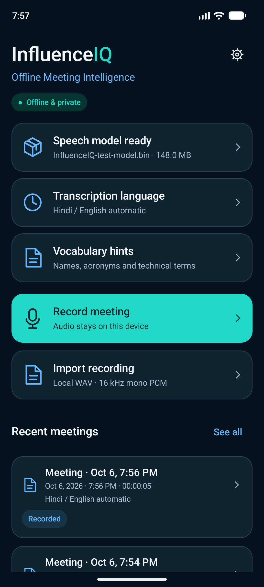
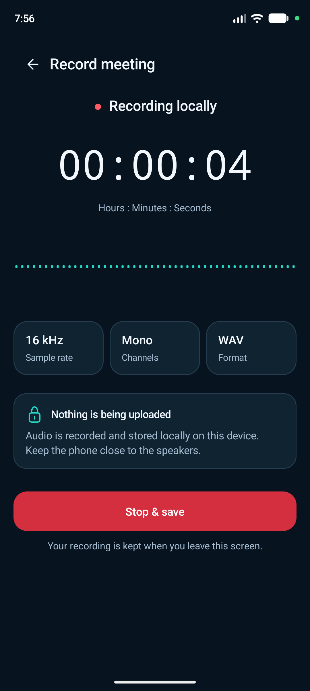
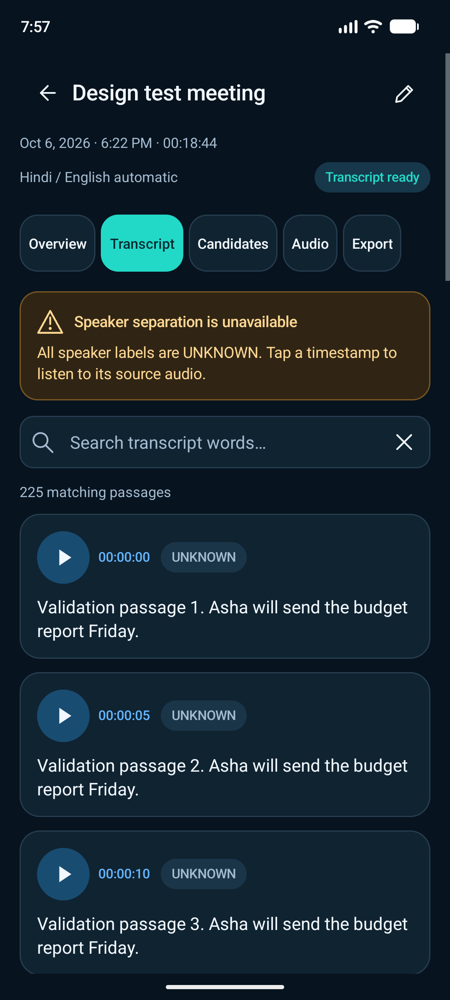
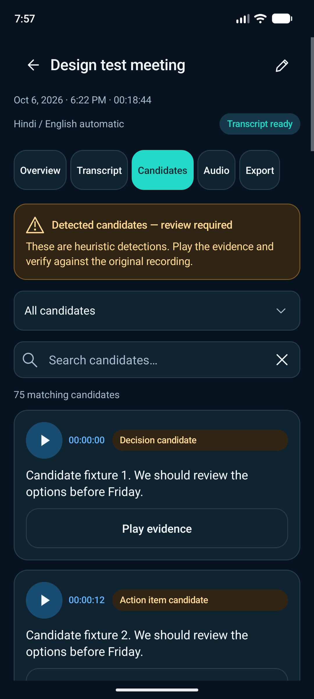
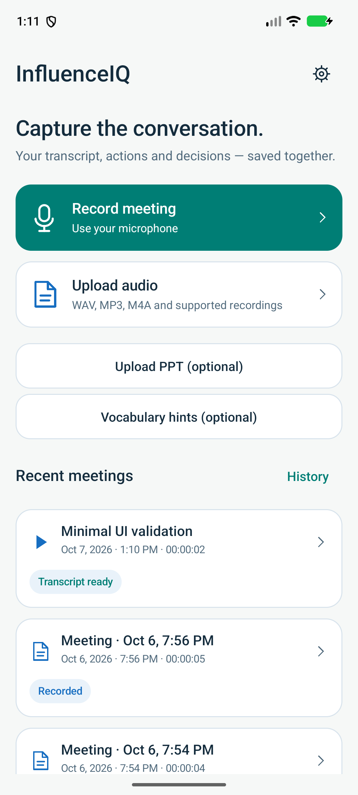
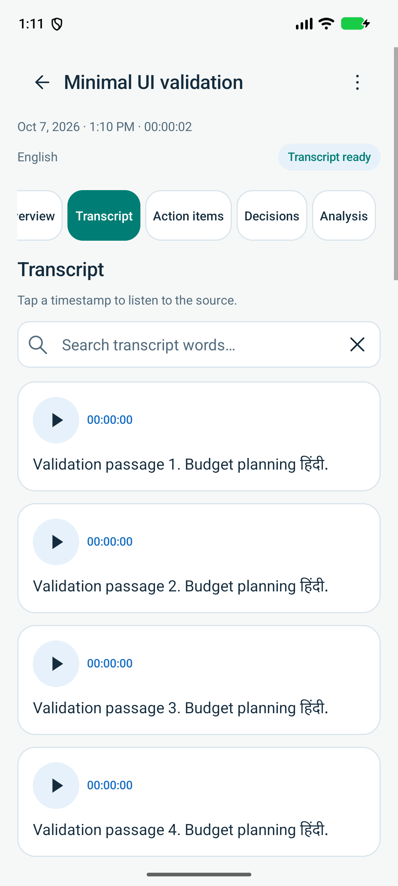
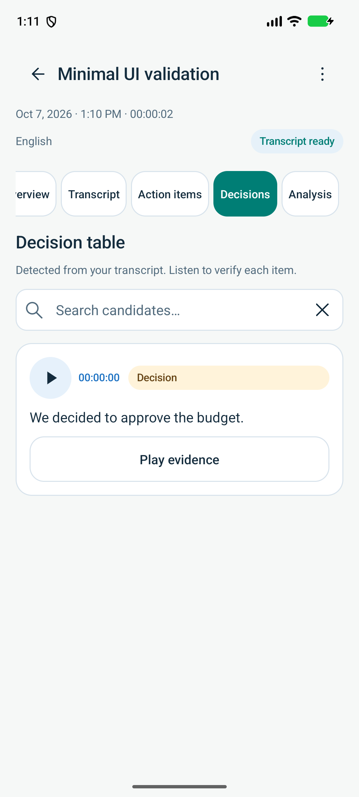
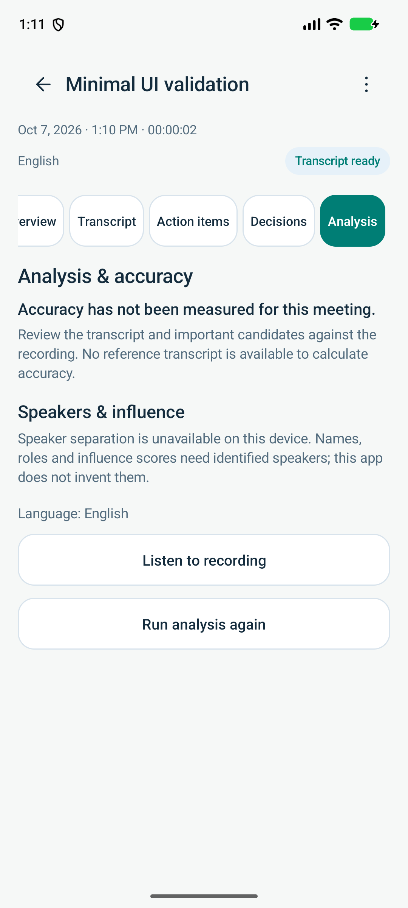

# InfluenceIQ Android design and validation

Historical October 6, 2026 design. The current simpler **0.5.0** screens and wider imports are described in [the October 7 update](../validation/17_MINIMAL_UI_IMPLEMENTATION_AND_VALIDATION.md).

Implemented October 6, 2026. APK: **0.4.0-prototype**, package `org.meetiq.offline`.

The Android app now has a coherent native interface based on the supplied navy/teal reference: Home, Recording, meeting review, analysis progress and Settings. The direct SDK/JDK/NDK build remains; no Gradle, AndroidX, Compose, downloaded fonts, remote assets or new dependencies were introduced.

## Screens

| Home | Recording |
| --- | --- |
|  |  |

| Transcript | Candidates |
| --- | --- |
|  |  |

These are actual emulator captures. The transcript/candidate screenshots use an explicitly generated validation report, not measured recognition output or preloaded app content. A clean installation starts with an empty meeting library. The flat recording waveform reflects quiet emulator input; it is not a decorative animation.

Additional captures: [Overview](../../android/design/screenshots/overview.png), [Audio](../../android/design/screenshots/audio.png), [Export](../../android/design/screenshots/export.png), [Settings](../../android/design/screenshots/settings.png), [analysis pause](../../android/design/screenshots/analysis-paused.png), [360dp with larger text](../../android/design/screenshots/transcript-360-large.png), [light theme](../../android/design/screenshots/transcript-light.png).

## UI and architecture

- **Home:** model readiness, language and hints, recording/import actions, recent meetings and a larger library. Empty states explain how to start.
- **Recording:** elapsed time from written PCM samples, microphone RMS history, audio format, local-storage message and Stop & save. Recording continues when navigating away. Saving opens the new meeting. Recording pause is not advertised.
- **Meeting Detail:** Overview, Transcript, Candidates, Audio and Export tabs. Search scans the entire saved report, highlights matches and renders 20 items per page. Candidates can be filtered by type. Timestamps and evidence controls seek the original WAV.
- **Analysis:** actual completed/total seconds, completed-chunk percentage, remaining chunks and a pause control. Pause finishes the current native chunk before saving. Partial reports can be reviewed and resumed.
- **Audio:** asynchronous local playback, pause, stop, elapsed/duration and seeking. Playback is released when the activity leaves the foreground.
- **Export:** Markdown with the full transcript/candidates, unchanged JSON and original WAV, using a user-selected Android document destination.
- **Settings:** validated local model import/replacement, model filename/size, auto/en/hi defaults, vocabulary hints, privacy and current capability limits.

Native widgets use system fonts, rounded cards and local vector drawing. Themes follow Android light/dark settings. Icon controls are 48dp; primary buttons are at least 52dp. System/keyboard insets are handled, text can wrap, and the tab strip scrolls at larger font sizes. Selected meeting, tab, query, filter, page and pending transfer revision are saved through activity recreation. Returning after a background save opens the saved meeting instead of leaving a stale recording screen. Important errors appear visibly with a dismiss action. Conflicting actions are disabled during recording, analysis or file transfers.

| Changed file | Responsibility |
| --- | --- |
| `app/src/main/java/org/meetiq/offline/MainActivity.java` | Native screen navigation, state restoration and action wiring |
| `Ui.java` | Shared widgets, colors, vector icons and real-input waveform |
| `MeetingRepository.java` | Existing-folder summaries, one parsed-report cache, metadata-preserving rename and full Markdown export |
| `AudioPlaybackController.java` | Local MediaPlayer lifecycle, timestamp seeking and play/pause/stop |
| `LocalTransfers.java` | One background worker for document-picker imports/exports, with application context |
| `MeetingProgress.java` | Immutable structured service progress and PCM amplitude calculation |
| `MeetingService.java` | Progress snapshots, real microphone levels and a notification that opens the app |
| `app/src/main/res/` | Launcher vector and native light/dark/splash themes |
| `app/src/main/AndroidManifest.xml` | InfluenceIQ label/theme/icon and version; existing package and permissions retained |
| `build.sh` | Compile and link local Android resources in the existing direct build |
| `test.sh`, `test/MeetingProgressTest.java` | Existing WAV/rule checks plus PCM/progress checks |
| `../scripts/check_android_design.py` | Emulator-only, read-only screen smoke check and screenshot capture |
| `README.md`, `../PROJECT_STATUS.md`, this file | Current implementation and validation record |

The activity updates lightweight progress while visible. Full reports are read on selection, file changes and chunk completion, rather than repeatedly parsed on an idle timer. Disk reads and transfers run off the UI thread. Service progress remains in memory while the service runs; durable recovery uses the existing reports/checkpoints and a manual resume action.

## Data and offline compatibility

Existing timestamp-named meeting folders remain readable. There is no migration that deletes or rewrites user recordings. Renaming merges the title into existing metadata, retaining other keys. `audio.wav`, `report.json`, `checkpoint.json`, report fields and the `v3:<model hash>:<audio hash>:<language>:<hints>` checkpoint identity remain compatible. Whisper/JNI and the shared bilingual event rules remain in place.

The APK has **no INTERNET permission**, endpoint, account or telemetry dependency. Backup remains disabled. Models are imported before offline transcription; exports require an explicit destination. Settings and local recordings do not require a cloud server.

## Verification performed

Environment: existing Pixel_6 emulator, x86_64, API 37, 16 KB system pages. Installation used `adb install -r`; app data was retained. Generated validation folders were clearly labelled. No SDK/package/model installation was performed.

| Check | Result |
| --- | --- |
| `bash android/test.sh` | Passed WAV parsing/recovery/sample preservation, PCM amplitude/progress and exported English/Hindi/Hinglish rules |
| `bash android/build.sh` | Passed resource linking, Java/DEX, ARM64 and x86_64 native build and debug APK signing |
| APK verification | Signature, 16 KB zip alignment, both ABIs and absence of INTERNET permission passed |
| Model import | Imported the local multilingual base GGML model through Android's picker; invalid GGML replacement rejected and existing model hash retained |
| WAV import | Imported a real 20-second PCM recording through the picker and opened its meeting |
| Native inference | English mode with `Asha` vocabulary hints produced a completed report with 9 timestamped UNKNOWN passages; checkpoint recorded `en:Asha` |
| Pause/restart/resume | A 160-second validation WAV contained real speech followed by digital silence. Pause saved the first 120-second chunk and 12 passages. After package/process restart, resume completed chunk two with the same identity and unchanged saved passages |
| Partial review | Paused overview and its 12-passage transcript opened successfully |
| Language wiring | Hindi and automatic modes reached report/checkpoint identity on a 2-second digital-silence recording, including vocabulary hints |
| Background navigation | Emulator microphone capture continued after Home; return after stopping/saving opened the saved meeting |
| Microphone capture | Foreground service recorded a valid 24-second 16 kHz mono PCM16 WAV; Stop & save opened the newly created meeting |
| Search and pagination | Generated 225-passage report: final-passage search, match count/highlight, page 2 of 12, theme recreation and search retention passed |
| Candidate review | Generated 75-candidate report: type filter returned the expected 25 decisions |
| Playback | Timestamp at five seconds sought local audio; play/pause, seek and stop/reset passed |
| Rename | Title changed while an existing unrelated metadata key was retained |
| Exports | Android destination picker saved all 225 Markdown passages; exported JSON and WAV hashes matched the original files |
| Layout/recreation | 360dp/432dp with 1.3× text and system dark/light themes checked; meeting/tab/search survived density and theme changes |
| Final screen smoke check | Home, Settings and all five detail tabs captured on the final installed APK |

Local build/test logs are under `../logs/android_design_*`; they are ignored build artifacts. The screenshots above are included for review.

Repeat the basic checks using the installed tools:

```bash
bash android/test.sh
bash android/build.sh
adb -s emulator-5554 install -r android/build/meet-iq-debug.apk
# Open Home first. The optional title refers to an existing emulator meeting.
python3 scripts/check_android_design.py --serial emulator-5554 \
  --meeting-title 'Design test meeting' --output outputs/android-design
```

The screen script does not create/delete meetings, export files, change device settings or install dependencies. Functional imports/recording/exports are deliberate state-changing tests through the real UI. Android's hierarchy dumper requires idle controls; live recording/playback captures were taken directly, with playback paused before inspecting hierarchy assertions.

## Remaining product validation

No physical phone was connected. ARM64 runtime, long capture, noisy/overlapping speakers, Hindi/Hinglish transcription accuracy, battery/thermal behavior, background/process interruption, storage exhaustion, transfer interruption and TalkBack still require physical-device validation. The language fixture checks wiring, not recognition accuracy. There is no measured accuracy improvement claim from this UI redesign.

Speaker separation is still unavailable and labels remain UNKNOWN. Events are review-required candidates. Slide alignment, richer semantic summaries and the laptop's graph/influence features are not implemented in the Android prototype. The APK uses debug signing; release signing and release-device qualification remain necessary before distribution as a production app.


## October 7 minimal interface captures

These 0.5.0 emulator screenshots show the current neutral/teal Home and separate review sections. Meeting content belongs to the labelled generated validation fixture and is not measured recognition output.

| Home | Transcript |
| --- | --- |
|  |  |

| Decisions | Analysis |
| --- | --- |
|  |  |

The complete current implementation/checks are in [chapter 17](../validation/17_MINIMAL_UI_IMPLEMENTATION_AND_VALIDATION.md). The earlier screenshots and checks above describe version 0.4.0.
