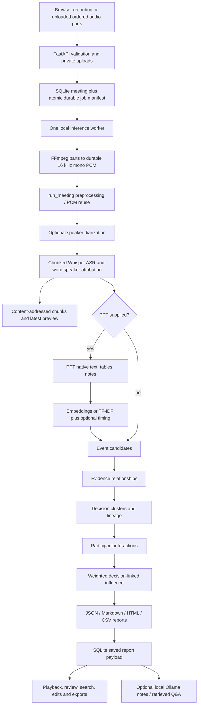
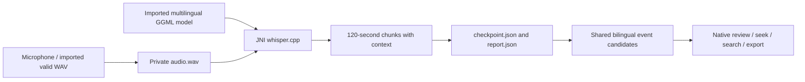

# Architecture and complete pipeline

Layout update, 8 October 2026: use the [master documentation](../README.md) and [structure/performance update](../validation/22_STRUCTURE_PERFORMANCE_AND_GAPS.md). Historical comparisons and measurements below describe their stated audit date. The older working tree is now archived; current paths and runtime are described in the update.

[Handbook index](../handbook/README.md)

## Laptop flow

The main entry point is [`run_meeting()`](../../src/pipeline/orchestrator.py), called by `api.run_pipeline_background()` and `scripts/process_meeting.py`. This replaces an empty older orchestrator; old stage modules are reused.

## Stages, inputs, and outputs

| Stage | Actual operation | Main artifact |
| --- | --- | --- |
| API ingestion | Validates file types/audio, stores up to 32 ordered parts, writes queue manifest | `.runtime/uploads/<id>/`, `.runtime/jobs/<id>.json`, SQLite row |
| Decode | Streams each part through FFmpeg to one PCM16 WAV; checks content cache | `data/custom_test/<id>.wav`, `<id>.decode.json` |
| Preprocessing | Validates/reuses normalized PCM, otherwise atomically converts | Input reused or `data/processed/audio/<id>_processed.wav` |
| Diarization | pyannote or optional ONNX; exception policy governed by auto/required/off | `<id>_diarization.json` or `<id>_unknown_diarization.json` |
| Transcription | Bounded audio chunks, faster-whisper VAD, words attributed to diarized intervals | `<id>_transcript.json`, `.txt`, ASR chunk directory, preview |
| Optional slides | PPTX extraction and chosen content matching plus timing | slides JSON, optional embeddings NPY, alignment/multimodal JSON |
| Events/evidence | Highest matching event type and temporal/type/slide relationships | events/evidence JSON |
| Decisions | Anchor-window reconstruction and lineage | decisions and decision graph JSON |
| Interactions | Evidence/lineage/reactive-event passes | interactions and participant graph JSON |
| Influence | Normalized feature-weight score; excludes UNKNOWN | influence and speaking/event baseline JSON |
| Report | Assembles artifacts and processing diagnostics | `outputs/reports/<id>_report.*` and CSV files |
| API completion | Stores final JSON string in SQLite | `Meeting.report_data`, completed status |
| Optional notes | Separate requested operation using local Ollama | SQLite `local_notes`, `.runtime/notes/<id>/` checkpoints |

`run_meeting()` records named progress stages, but it does not independently call standalone `run_vad()`. Its ASR call enables faster-whisper's VAD. The older staged `scripts/run_pipeline.py --audio ...` still performs preprocessing → standalone VAD → diarization → ASR. This distinction matters for methods descriptions and VAD timing.

## Complete runner versus stage runner

`scripts/process_meeting.py` is the recommended single-meeting end-to-end CLI. `scripts/run_pipeline.py` remains useful for separate experiments: audio, PPT, transcript/slides alignment, events, decisions, interactions, or influence depending on flags. Its audio mode does not automatically produce the whole research report.

`scripts/generate_report.py` consumes existing stage outputs and does not run ML. `scripts/run_evaluation.py` evaluates existing artifacts and likewise does not rerun inference; it has documented scientific wiring problems in [11](../research/11_EVALUATION_BASELINES_AND_ABLATIONS.md).

## Persistence and recovery

The application uses a single `ThreadPoolExecutor(max_workers=1)` shared by meeting inference, notes, and model-backed Q&A. An OS file lock prevents two API workers using the same runtime. It is a local, serialized CPU workflow.

SQLite stores account/meeting ownership, titles, statuses, and report JSON. Private atomic job manifests store source paths, options, stage/error/progress, and note state. Startup requeues interrupted `queued`/`processing` meetings with available manifests. A conditional failed-to-queued status update prevents duplicate retry submissions.

ASR and diarization can reuse validated content caches. Resume-state files describe progress; they are not a universal cache for every downstream algorithm. Events, decisions, interactions, and reports are recomputed on a new full run. Most inherited stage JSON writers are ordinary writes; do not claim every artifact is transactional.

API title/speaker alias edits and optional notes update the SQLite report payload. They do not automatically rewrite all disk report exports. For the current user-visible report, use the authenticated API export route. For scientific analysis, specify whether a file is a raw pipeline artifact or an edited application export.

## Android flow

Android is not a client calling the laptop API. It runs without an account/server and has no INTERNET permission. It implements transcription and rule candidates; it does not run the laptop multimodal/influence pipeline.
