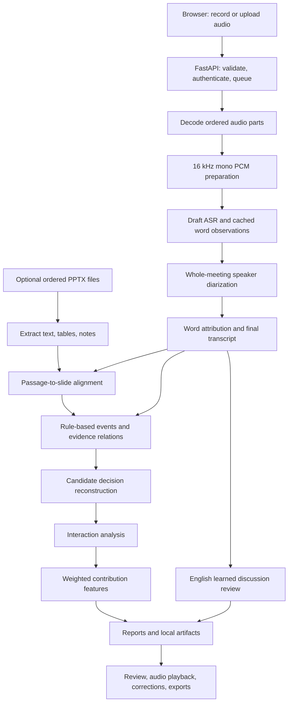

# InfluenceIQ / Meet IQ: complete project study guide

For an imminent presentation, use the [one-page rehearsal card](../../presentation/PRESENTATION_ONE_PAGE_20261025.pdf) and [14-minute script with 80 viva answers](../../presentation/PRESENTATION_CRASH_PACK_20261025.pdf) first. This chapter-by-chapter guide is the deeper reference.

Prepared 25 October 2026 from the current workspace's code, configuration, presentation, and saved experimental records. This is an explanation, not a new benchmark or a change to application behavior. Some existing documentation describes older implementations; the distinctions below follow current source where inspected.

Update: subsequent website corrections on 25 October changed keyword-event confidence, upload recovery, progress/reconnection, vocabulary filtering, and speaker display numbering. Historical evaluation tables below retain their original pipeline versions; they were not rerun or replaced by those corrections.

## 1. What the project is

**InfluenceIQ is a local meeting-review system that turns a recording into a speaker-attributed transcript and source-linked suggestions about discussions, actions, decisions, and participant contributions.** Optional presentations add document context. People review the suggestions against the recording.

Meet IQ is the application name in parts of the code and interface. InfluenceIQ is the project/research identity. The current paper title is **InfluenceIQ: A Multimodal Framework for Assessing Participant Contributions to Meeting Decisions**.

A useful opening explanation:

> A recording preserves a meeting, but reviewing it still takes time. Our system helps a reviewer find what was said, who said it, and which passages may relate to actions and decisions. It keeps timestamps and source references so those suggestions can be checked. We also study whether automatically extracted contribution features help rank participants against an outcome-alignment reference.

There are three connected parts to understand:

| Part | Main question | Output |
| --- | --- | --- |
| Meeting application | How can someone review a recording locally? | Transcript, speaker clusters, candidate events/decisions, reports, editable follow-ups |
| Learned discussion detector | Which English passages belong to decision-related discussion? | Passages suggested for review |
| Influence research | How do participant features compare with an outcome-alignment proxy? | Experimental participant rankings and diagnostics |

Their accuracy figures answer different questions. Do not combine them.

## 2. The problem, objectives, and contribution

Long recordings make it difficult to locate a decision, check its context, or identify the contribution behind it. Speaking longest does not necessarily mean contributing most to an outcome. A fluent-looking generated summary would also need verification.

The implemented objectives are local processing after provisioning; speaker/time/source traceability; optional audio-to-slide links; structured review candidates; editable names, roles, and follow-ups; durable history and exports; and separately scoped component evaluation.

The contribution is the concrete integration and inspectable representation, together with an exploratory comparison and diagnosis of contribution features. Whisper, speaker clustering, TF-IDF, random forests, and Ridge regression are established methods. The project does not introduce those algorithms. A research novelty claim requires comparison with relevant prior systems, beyond showing that the application runs.

The application is extractive and structured. It preserves source text and computes candidates. There is no deployed generative meeting chatbot or LLM-generated notes workflow.

## 3. The architecture you should draw



This shows dependencies. It does not claim parallel execution. Slides are optional; without them, transcript passages go directly to event extraction. The learned discussion branch is separate from final-decision reconstruction and influence scoring.

The main coordinator is [`src/pipeline/orchestrator.py`](../../src/pipeline/orchestrator.py), function `run_meeting()`. The API and complete-pipeline CLI share it.

## 4. One meeting from upload to saved report

1. The user signs into the local web application and records or selects audio. Optional inputs include PPTX files, language, vocabulary hints, and a known speaker count.
2. `POST /api/analyze` validates files/options, saves uploads, creates a meeting ID and SQLite row, and persists job state.
3. The API returns HTTP 202 and the meeting ID. This means accepted/queued, not completed.
4. A single background worker runs the analysis. A second meeting waits.
5. FFmpeg decodes ordered audio parts into one retained WAV. These are chronological parts of one meeting, not simultaneous microphones fused together.
6. Audio is prepared as 16 kHz mono PCM16. Compatible normalized input can be reused.
7. Draft transcription runs before global speaker clustering so text can appear earlier. Initial attribution uses an existing speaker artifact when available, or UNKNOWN.
8. Diarization estimates who spoke when across the recording.
9. ASR attribution runs against the resulting speaker intervals. Separately cached word observations allow speaker reassignment without repeating unchanged recognition work.
10. Optional presentation extraction and alignment attach slide candidates to passages.
11. Event extraction and evidence linking build structured candidate observations.
12. The decision stage runs learned discussion review separately and reconstructs decision candidates from events/evidence.
13. Interactions and participant contribution scores are computed.
14. The report is assembled and exported. The API stores the completed application report in SQLite; stage files remain on disk.
15. The browser polls for status/results. The user listens, reviews speaker names and candidates, and saves permitted edits.

The two calls to `run_asr()` do not imply every recording is fully transcribed twice: word recognition and speaker attribution have separate cache identities.

## 5. Audio fundamentals and preprocessing

**Sampling rate** means samples per second. At 16 kHz, the waveform contains 16,000 samples each second. **Mono** means one channel. **PCM16** stores each sample in two bytes.

Uncompressed audio storage is approximately:

```text
16,000 samples/s × 2 bytes/sample × 1 channel = 32,000 bytes/s
One hour ≈ 115.2 MB, excluding the small WAV header
```

Standardizing the waveform gives the recognizers and speaker models compatible input. This conversion does not recover lost information or automatically improve a noisy recording.

FFmpeg handles common decodable formats. The API accepts a defined list of extensions, checks that audio can actually be decoded, rejects empty uploads, and applies an aggregate upload limit. The code default is 1 GiB, configurable through `MAI_MAX_UPLOAD_BYTES`.

The API accepts 1–32 ordered audio parts and at most 32 ordered PPTX files. These are implementation limits, not quality guarantees.

`src/audio/parts.py` handles ordered decoding. `src/audio/preprocess.py` probes and normalizes audio, writes a partial output, and replaces the final file after success. It does not perform automatic denoising, source separation, or clipping repair.

**VAD**, voice activity detection, identifies likely speech. The complete orchestrator uses faster-whisper's `vad_filter=True`. A standalone Silero VAD module also exists for the separate stage runner; do not describe it as a mandatory separately executed stage of every web job.

## 6. Speech recognition: what was said

**ASR** means automatic speech recognition. The laptop implementation uses pretrained Whisper through **faster-whisper**. The saved configuration selects:

| Setting | Current YAML default | Purpose |
| --- | --- | --- |
| Model | `small` | Laptop size/quality tradeoff |
| Device | CPU | Works without a functioning CUDA installation |
| Compute type | `int8` | Quantized inference |
| CPU threads | 4 | Configured compute budget |
| Beam size | 5 | Search across decoding candidates |
| Central chunk | 120 seconds | Checkpointable long-recording processing |
| Language | Automatic, restricted to `en`/`hi` | English/Hindi operating scope |

Per-meeting options or environment overrides can change these settings. The YAML default is not proof of the configuration used for every saved report.

Whisper is a pretrained encoder-decoder Transformer. The project uses its learned recognition capability; it does not train Whisper from scratch. faster-whisper is the inference implementation, not a separate linguistic model invented by the team.

Each central chunk receives up to two seconds of preceding/following context. A recognized word is retained only when its midpoint belongs to the central interval. This provides boundary context while avoiding intentionally emitting the same boundary word from both chunks.

Decoding uses word timestamps, transcription rather than translation, and `condition_on_previous_text=False`. Vocabulary is passed as a recognition hint; it is not a guarantee that a name will be transcribed correctly.

English/Hindi automatic selection and bilingual downstream rules do not establish robust Hinglish recognition. One selected chunk language does not amount to a specially trained code-switching model.

## 7. Diarization: who spoke when

**Speaker diarization** groups speech into anonymous speakers over time. **Speaker identification** determines a real identity. These are different tasks.

The configured laptop backend is `sherpa-onnx`, with local segmentation and speaker-embedding ONNX files. The adapter supplies these to an offline diarization engine that clusters speech across the meeting. The segmentation configuration uses a pyannote-style model; this is distinct from selecting the alternative Python `pyannote` backend.

The conceptual steps are speech segmentation, speaker-vector extraction, and clustering similar vectors. Clusters become IDs such as `SPEAKER_00`. User-entered names or source-based self-introduction suggestions provide labels to review; the system does not automatically know verified identities.

The configured clustering threshold is 0.9. An exact known speaker count can constrain clustering. It can reduce splitting/merging errors, but it cannot make the acoustic assignments correct by itself.

The upstream engine clusters the whole recording. Independent chunk clustering would reset identities unless an additional cross-chunk identity mechanism were implemented. This implementation reads a full waveform for speaker analysis; ASR chunking does not mean the entire pipeline has bounded memory.

Modes:

| Mode | Behavior |
| --- | --- |
| `auto` | Try diarization; continue with UNKNOWN and a warning if unavailable |
| `required` | Fail the job if diarization fails |
| `off` | Transcribe without identifying speakers |

When valid speaker separation is unavailable, participant influence is marked unavailable. UNKNOWN is not scored as a real person.

## 8. How words receive speaker labels

For a word interval `[a,b]` and speaker interval `[c,d]`:

```text
overlap = max(0, min(b,d) − max(a,c))
coverage = overlap / word duration
```

The implementation unions overlapping intervals belonging to the same speaker before totaling coverage. This prevents repeated same-speaker intervals from double counting. It chooses the speaker with greatest coverage when that coverage reaches the configured minimum, 0.3. Insufficient coverage, an exact top tie, or a configured insufficient margin returns UNKNOWN.

Illustration: a word lasts one second. Speaker A covers 0.7 seconds and B covers 0.2 seconds. A wins. If both cover 0.5 seconds, the system abstains. This is an interval illustration, not a measured recognition example.

Words with compatible speaker labels are grouped into passages. A label edit changes the display identity. Repairing a wrong acoustic cluster requires rerunning diarization/attribution and reviewing the resulting groups.

## 9. Presentations and the meaning of multimodal

The application accepts optional `.pptx` presentations. `python-pptx` extracts native text, tables, and notes; supporting modules preserve useful presentation metadata. Optional local OCR can extract image text on the laptop when provisioned and enabled. The current YAML disables OCR by default.

The implemented fusion is **audio-derived transcript text plus extracted document text, optionally with supplied slide timing**. There is no jointly trained acoustic-image fusion network, general chart-understanding model, or facial/body-language analysis.

A presentation's page order does not say when it appeared during the recording. Missing slide timing stays unavailable; it is not invented.

Two matching methods exist:

| Method | How it represents text | Practical limit |
| --- | --- | --- |
| Sentence embeddings | Pretrained `all-MiniLM-L6-v2` vectors | Similar meaning does not prove factual support; cross-language quality is unvalidated here |
| TF-IDF | Weighted word overlap | Misses many paraphrases and different-language equivalents |

The Python default is embeddings. Android uses a native lexical TF-IDF path. Their behavior is not identical.

## 10. Slide alignment formula

Semantic similarity uses cosine similarity between a passage vector and slide vector:

```text
cosine(u,v) = (u · v) / (||u|| × ||v||)
```

With supplied timing:

```text
temporal score = passage/slide overlap duration / passage duration
combined = (wt × temporal + ws × semantic) / (wt + ws)
```

Current defaults: `wt=0.5`, `ws=0.5`, top three candidates, minimum combined score 0.3. Without timing, default nonzero semantic weight gives semantic-only scoring.

Example: temporal 0.8 and semantic 0.6 give combined 0.7. Without timing, semantic 0.6 gives 0.6. If the best score is below threshold, the selected slide is `NO_CONFIDENT_SLIDE`.

The output retains candidate IDs and scores. A similarity score is not a calibrated probability. A matched slide is a candidate contextual source, not proof that it supports the claim. The narrow quantity-mismatch checks in the report also require review and do not provide general factual verification.

## 11. Event extraction: what kind of utterance is this?

The default event extractor is a rule-based NLP component, `KeywordEventExtractor`, with eleven configured categories:

| Category | Illustrative meaning |
| --- | --- |
| Proposal | Suggesting an alternative |
| Question | Asking for information |
| Objection | Raising a reason against an alternative |
| Evidence | Offering supporting information |
| Correction | Correcting earlier information |
| Clarification | Explaining or resolving ambiguity |
| Agreement | Expressing assent |
| Disagreement | Expressing a contrary position |
| Revision | Modifying an earlier alternative |
| Decision | Explicit commitment/choice language |
| Action item | A future-work commitment |

These descriptions are conceptual; actual output depends on configured patterns and blockers.

The Python extractor normalizes text, applies English/Hindi/Hinglish pattern banks, suppresses blocked interpretations, chooses the highest-scoring type, and emits it only above threshold. It can emit no event. It does not label every passage or assign multiple event types per passage by default.

The score is:

```text
English selection score = min(1, 3 × English hits / patterns for this type)
Bilingual score = min(0.8, 0.6 × bilingual hits)
Type selection score = max(English selection score, bilingual score)
Winning type confidence = max(type selection score, min(1, 0.3 × English hits))
Emission threshold = 0.3
```

These are heuristic values, not semantic correctness probabilities. The 25 October correction prevents a single English cue being suppressed solely because its category has many alternative patterns: an eleven-pattern proposal bank previously gave one hit only 0.2727, below the default 0.3 threshold. Role selection still uses the original density comparison. Unusual phrasing, implicit decisions, pronouns, topic changes, sarcasm, and multiple roles in one passage remain difficult.

Each event preserves event ID, source passage ID, speaker, exact text, start/end times, optional slide, and heuristic score. Android reuses phrase banks but can emit multiple surviving types; shared vocabulary does not mean identical predictions.

## 12. Evidence links, decisions, and interactions

An **event** is one observation. An **evidence relation** connects observations. A **decision cluster** groups a discussion around a candidate anchor. An **interaction** relates speakers through those inferred links.

Evidence linking uses event types and proximity, normally a 60-second window. Examples include agreement supporting a prior proposal, an objection contradicting it, and a revision modifying it. A matched slide can become a `supports` source by heuristic convention. These links are inspectable hypotheses rather than verified factual support.

Decision reconstruction normally uses a 120-second window around anchors. Explicit decision events are anchors; agreement can anchor a candidate when a recent preceding proposal qualifies. Nearby anchors are deduplicated. With no qualifying anchor and the default non-strict mode, proposals can form unresolved candidates. Current strict `require_final_decision=True` suppresses that fallback; older documentation records a bug that has since been corrected.

Events already assigned to an earlier cluster are not reused in a later one. The representation preserves a representative proposal, secondary proposals/discussion, revisions, agreements, source IDs, participant roles, and lineage edges.

| Status | System rule |
| --- | --- |
| `confirmed` | Contains an explicit decision-type event |
| `probable` | Agreement exists without an explicit final decision |
| `conflicting` | Multiple proposals plus objection and no agreement |
| `unresolved` | Other candidate cases |

These are rule labels, not human-adjudicated outcomes. The web UI calls a confirmed result a decision candidate.

Interaction analysis combines evidence relations, decision-lineage edges, and reactive events linked to nearby preceding events. Graph edges represent inferred conversational relationships; no graph neural network or PageRank influence algorithm is deployed.

## 13. Worked meeting example

Consider this **invented explanation**, not saved model output:

| Time | Speaker | Utterance | Intended role |
| --- | --- | --- | --- |
| 00:10 | A | We should launch on Friday. | Proposal |
| 00:20 | B | Testing needs another two days. | Objection/evidence |
| 00:30 | C | The test report shows three unresolved failures. | Evidence |
| 00:40 | A | Then let us move the launch to Monday. | Revision |
| 00:50 | B | Agreed, Monday. | Agreement |
| 01:00 | C | We have decided to launch on Monday. | Decision |
| 01:10 | B | I will send the updated plan. | Action item |

The intended review story is proposal → constraint/evidence → revision → agreement/final decision → follow-up. The application may miss or misclassify any of these phrases. In particular, one passage can express more than one role while Python chooses only one.

This example explains why influence should consider more than speaking time: B's constraint and C's evidence may matter. It also explains why proximity is insufficient: C announcing Monday does not prove C caused the change, and B speaking near a revision does not prove that the objection caused it.

Traceability lets the reviewer listen and make that judgment.

## 14. Current participant contribution formula

The default application computes seven transparent features with prototype weights:

| Feature | Current raw rule, abbreviated | Weight |
| --- | --- | ---: |
| Proposal | +1 for each observed proposal in a decision cluster | 0.15 |
| Evidence | +1 for decision-linked evidence; +0.5 if slide-grounded | 0.20 |
| Objection | +0.5 for decision-linked objection/disagreement; +1 if a later revision exists in its cluster | 0.15 |
| Revision | +1 for a revision in a confirmed/probable cluster | 0.20 |
| Decision | +1 per participant event in confirmed clusters; +0.5 in probable clusters | 0.15 |
| Interaction | +1 per outgoing decision-linked interaction | 0.05 |
| Slide grounding | +1 per decision-linked event with a slide association | 0.10 |

For each feature, divide by the maximum across participants in that meeting. If every value is zero, leave that feature at zero. Then calculate the weighted sum:

```text
z(p,k) = x(p,k) / max_q x(q,k), if the maximum is positive; otherwise 0
S(p) = Σ_k w(k) × z(p,k)
```

Example: raw proposal counts are A=2, B=1, C=0. Normalized proposal values are 1, 0.5, 0. Proposal contributions to the final score are 0.15, 0.075, 0. Other categories are computed independently and added.

Scores are relative within a meeting. They are not probabilities, percentages of caused outcomes, or fair cross-meeting measures of personal ability. Prototype weights are not independently validated. Category overlap can credit one event through several signals.

Current code retains known transcript speakers even when no event features are extracted, assigning zero features. A zero can represent failed extraction. UNKNOWN is excluded. Tied scores receive shared ranks.

Older records describe a bonus for the first proposal in a confirmed cluster. Current code removed that unsupported adoption bonus and preserves credit for secondary proposals. Do not explain the old rule as current behavior.

The separate decision-level display allocation uses event share and normalized features; it is not a decomposition proving each participant's causal share. Full-transcript speaking statistics are calculated separately as participation baselines.

## 15. The learned English discussion detector

This stage answers **“Does this passage belong to decision-related discussion?”** It does not answer **“Was a final decision made?”** or **“Whose proposal was adopted?”** Its output does not feed the default influence score.

Research training uses AMI human transcript dialogue acts. A dialogue act is a short manually delimited utterance unit. An act is positive when at least half of its lexical word identifiers lie inside a manually annotated decision-discussion span. Outside-span acts are treated as negative under an annotation-completeness assumption.

Features combine:

1. Current-act word TF-IDF, including word unigrams/bigrams.
2. Current-act character TF-IDF, using within-word character 3–5 grams.
3. Word TF-IDF of up to forty neighboring acts before and after, within the same meeting.

TF-IDF gives larger weight to informative terms and reduces the dominance of common terms. Word features capture terms/phrases. Character patterns capture useful subword forms. Context helps distinguish an isolated “yes” from agreement in a relevant discussion. Vocabulary and IDF are fitted on training text, then applied unchanged to later partitions.

Four classifier families were compared under matched local/context feature conditions: logistic regression, Complement Naive Bayes, calibrated linear SVM, and random forest. Logistic regression learns a weighted linear boundary. Naive Bayes uses class-conditional feature statistics. A linear SVM learns a separating margin. A random forest averages decision trees that can capture feature interactions.

The installed model combines logistic regression and random forest:

```text
raw score = 0.25 × logistic score + 0.75 × forest score
final score = moving mean over up to ±5 neighboring acts/passages
flag if final score ≥ 0.3577398635496262
```

The context radius is 40; smoothing radius is 5. Both are counts of input units, not seconds. Because future passages are used, this is an offline detector. Batch processing preserves meeting boundaries and source IDs.

The trained bundle is `models/discussion/model.joblib`; its manifest records weights, smoothing, threshold, and provenance. The application applies it to ASR passages, whose text and boundaries differ from reference dialogue acts. Its historical oracle-input F1 therefore does not measure recording-level application performance. Non-English/mixed-language input receives an explicit unsupported status for this learned branch, while other bilingual rule stages can still run.

## 16. Training, development, evaluation, and leakage

**Training** fits parameters. **Development** selects settings such as regularization, mixture, smoothing, and threshold. **Evaluation** measures the fixed choice on held-out groups. If evaluation results guide later choices, those groups become historical evidence rather than a fresh final test.

AMI discussion split:

| Partition | Meetings | Dialogue acts |
| --- | ---: | ---: |
| Training | 29 | 20,339 |
| Development | 6 | 3,739 |
| Historical evaluation | 12 | 11,136 |

Related meetings from the same project series stay together. Otherwise, repeated speakers, vocabulary, and topics could leak across partitions. The twelve historical meetings contain only three independent project series, and their results have been examined in successive research rounds. Thousands of acts do not create thousands of independent meetings.

Pretrained ASR/speaker/embedding models are used for inference. Small supervised discussion classifiers are trained. Research rankers and optional contextual models also have training workflows. Therefore, “the whole project is training-free” is incorrect, and “we trained Whisper” is also incorrect.

## 17. How to explain the discussion results

Installed forest/logistic detector, on 11,136 reference acts:

| Metric | Result | Plain meaning |
| --- | ---: | --- |
| Precision | 39.94% | About 40 of 100 flagged acts match reference positives |
| Recall | 81.18% | Finds about 81 of 100 reference-positive acts |
| F1 | 53.54% | Harmonic balance of precision and recall |
| Accuracy | 68.62% | Correct positive/negative predictions among all acts |
| Balanced accuracy | 73.10% | Mean of sensitivity and specificity |
| Average precision | 53.40% | Quality of positive retrieval across score thresholds |
| ROC AUC | 80.03% | Threshold-independent score-ordering discrimination |

Confusion counts: TP=2,014; FP=3,028; FN=467; TN=5,627.

```text
Precision = TP / (TP + FP)
Recall = TP / (TP + FN)
F1 = 2 × Precision × Recall / (Precision + Recall)
Accuracy = (TP + TN) / total
```

An always-negative system has 77.72% accuracy because most acts are negative, yet it finds zero discussion and has zero positive F1. This is why plain accuracy is misleading on this imbalanced task.

The matched context random forest alone scored 52.08% F1; the installed blend scores 53.54%, a gain of **1.46 percentage points**. That observed difference is exploratory; limited groups and an uncertainty interval crossing zero do not establish reliable superiority. Other models can rank differently on average precision.

Safe wording: “The installed English discussion detector achieved 53.54% historical F1 on human transcripts and dialogue-act boundaries. End-to-end performance on our ASR passages remains unmeasured.”

Source: [`QUALITY_IMPROVEMENTS.md`](../../professor_guidelines/QUALITY_IMPROVEMENTS.md) and [`CLASSIFIER_COMPARISON.md`](../../professor_guidelines/CLASSIFIER_COMPARISON.md).

## 18. Participant-ranking research: original and latest protocols

The GAP release used here contains **28 meetings, 84 participants, and 8,009 reference utterances**. People rank survival items individually and then as a group. **Absolute Individual Influence (AII)** measures distance between an individual's initial ranking and the final group ranking; lower is greater outcome alignment.

Someone can start close to the eventual group ranking without persuading anyone. AII is therefore an outcome-alignment proxy, not direct evidence of caused decisions. Reference transcripts/speakers bypass the audio pipeline, and this study has no slide input.

**Original historical pilot:** 16 training meetings, six development, six historical evaluation. The development-selected structural Extra Trees model scored 61.11% pairwise accuracy on the six evaluation meetings; word count scored 63.89%. The selected model did not beat that simple baseline. The nonprimary combined Extra Trees candidate's 66.67% could not legitimately replace the primary after seeing evaluation scores.

**Latest controlled exploratory study:** participation-only, contribution-only, and combined features use the same Ridge family and tuning budget over all 28 previously examined meetings.

Participation has six variables: speech duration, word count, utterance count, mean words per utterance, early words, and late words. Contribution has the seven normalized categories. Combined has thirteen features.

Ridge fits a linear model with an L2 penalty. It was chosen here as a common estimator to isolate feature families rather than change both model and representation at once.

Seven outer folds hold out four complete meetings each. Three inner folds select alpha from 0.1, 1, 10, and 100. Scaling is fitted only inside fitting partitions. Each participant receives one outer prediction.

| Latest matched method | Meeting-average pairwise accuracy |
| --- | ---: |
| Combined Ridge | 68.93% |
| Speaking-duration baseline | 67.86% |
| Word-count baseline | 66.55% |
| Participation-only Ridge | 61.79% |
| Fixed contribution score | 55.77% |
| Contribution-only Ridge | 53.39% |
| Constant ties | 50.00% |

Pairwise accuracy compares participants within a meeting: correct order gets 1, predicted tie 0.5, reversal 0; reference ties are excluded. Meeting scores are then averaged equally. These results use 87 comparable pairs across 28 meetings. Exact top-set accuracy is stricter: the complete predicted winner set must equal the reference winner set; combined Ridge reaches 14/28, or 50%.

Combined minus participation-only is +7.14 points, with a descriptive paired interval of −1.79 to +17.86 points. Combined minus word count is +2.38 points, interval −5.36 to +10.71. Both include zero. Prior corpus exposure also prevents a fresh-test interpretation. Nested fitting does not erase previous researcher access.

These are saved research results, not an installed replacement for the application's default weighted score. Do not directly compare 68.93% across 28 meetings with 61.11% across the earlier six as if only the model changed.

Authority: [`manuscript.md`](../paper_20261024/manuscript.md) and its [`analysis/results.json`](../paper_20261024/analysis/results.json).

## 19. The most revealing limitation: feature coverage

The latest GAP diagnostic found:

| Category | Participants with nonzero features, out of 84 |
| --- | ---: |
| Proposal | 0 |
| Evidence | 0 |
| Objection | 2 |
| Revision | 0 |
| Decision | 14 |
| Interaction | 4 |
| Slide grounding | 0 |

Seventy participants and 22 meetings had no contribution features in that historical evaluated snapshot. Missing slides explain the slide category, but do not explain all other inactive categories. That snapshot's proposal extractor emitted none of the 537 reference-tagged proposal utterances in the corpus-wide role diagnostic. These counts predate the 25 October keyword-confidence correction; no new GAP benchmark is implied.

One source-checked proposal scored 0.2727, below the 0.3 threshold. Another proposal was selected as a question. These illustrate a threshold/role-selection problem. Raising model complexity or changing score weights cannot recover information absent from extracted features.

This is a valuable research finding: a score can have a clear formula and source pointers while still resting on incomplete observations. Interpretability of arithmetic is not validity of the underlying construct. A zero vector does not establish that a participant contributed nothing.

Optional research paths include contextual discussion/role models, topic grouping, outcome-pair labeling, and XGBoost ranking. Their existence does not mean they are installed or empirically better. The AI outcome-link pilot used assistant labels; agreement with those labels is not independent human validation.

## 20. Audio metrics and recorded findings

**WER**, word error rate:

```text
WER = (substitutions + deletions + insertions) / reference words
```

Lower is better. Insertions mean WER can exceed 100%, so `100 − WER` is not a general-purpose accuracy measure. **CER** performs a similar comparison over characters.

**DER**, diarization error rate, combines missed speech, false-alarm speech, and speaker-confusion time relative to reference speaker time under the declared scoring protocol. Collar/overlap/reference coverage affect comparability. It evaluates who spoke when, not transcript wording.

Saved small-versus-Turbo WER pilots:

| Cohort | Small | Large-v3-turbo |
| --- | ---: | ---: |
| English development, 2 clips | 29.98% | 28.15% |
| English historical, 2 clips | 61.61% | 63.91% |
| Hindi, 8 samples | 50.96% | 28.85% |
| Hinglish, 8 samples | 66.13% | 57.26% |

Turbo improves those Hindi/Hinglish pilot WER values, but worsens the historical English value. Small remains the shared default; Turbo is optional. Bigger is not universally better on every cohort or metric.

An earlier two-excerpt speaker calibration pilot reduced DER from 64.08% to 40.91%. This is a small custom pilot with reference limitations, not a full-corpus benchmark or a measured rate for all user recordings.

Software tests, discussion F1, participant pairwise accuracy, WER, DER, and slide-match quality have different denominators. Never average them into “overall project accuracy.”

## 21. Web frontend, API, and persistence

The frontend uses React/Vite. `frontend/src/App.jsx` manages authentication, uploads, recording, meeting selection, polling, result tabs, edits, and exports. Browser recording uses MediaRecorder; IndexedDB stores chunks for interrupted-recording recovery. `ProcessingPanel.jsx` displays stage progress, and `TaskReview.jsx` handles reviewed follow-ups.

The completed web meeting has Overview, Transcript, Participants, Action items, Decisions, Influence, Events, and Presentation tabs. Playback timestamps connect review to the recording.

Bounded microphone previews are a separate path: `POST /api/recording/preview` accepts 1–30 seconds of normalized PCM WAV and returns draft UNKNOWN-speaker text. It rejects work when the analysis worker is busy. Those previews do not provide final global speaker identities or a completed decision graph.

FastAPI exposes the backend. Its `ThreadPoolExecutor(max_workers=1)` serializes expensive jobs. A runtime file lock prevents another backend from sharing that worker runtime. Persistent queued/processing jobs with saved state are resubmitted on startup.

Important endpoint groups:

| Endpoint | Purpose |
| --- | --- |
| `/api/auth/register`, `/login`, `/me` under `/api/auth` | Local account registration/login/identity |
| `POST /api/analyze` | Validate and queue a meeting |
| `GET /api/meetings`, `GET /api/meetings/{id}` | Owned history, report, status |
| `POST /api/meetings/{id}/retry` | Restart analysis using retained state |
| `POST /api/meetings/{id}/analyze-speakers` | Rerun speaker analysis from retained audio |
| `POST /api/meetings/{id}/edit` | Supported report metadata/speaker edits |
| `POST /api/meetings/{id}/actions/{event_id}` | Reviewed follow-up state |
| `GET /api/meetings/{id}/export` | Download a permitted format |
| `/api/sync/meetings` | Explicit cross-device publication |

Passwords are hashed with bcrypt; access uses expiring JWTs; meeting access checks account ownership. These are application controls, not a claim of encrypted audio storage or a hardened public deployment.

SQLite, through SQLAlchemy, holds users, meetings, and synchronization links. Meeting records contain account ownership, title, status, serialized report data, and creation time. Disk files hold recordings and pipeline artifacts. SQLite is used alongside files rather than storing every waveform in a database.

Useful locations:

| Location | Content |
| --- | --- |
| `data/state/nexus_v2.db` | Account/history database |
| `.runtime/uploads/` | Retained upload inputs |
| `.runtime/jobs/` | Persistent job state |
| `data/custom_test/` | Default decoded API recordings |
| `data/processed/` | Transcript, speaker, slide, event, graph, score, and checkpoint artifacts |
| `outputs/reports/` | Generated report files |
| `models/` | Provisioned model assets |

Do not delete these directories to make a demo look clean; they can contain accounts and irreplaceable meeting data.

## 22. Recovery, caching, edits, and exports

Content/settings fingerprints identify reusable processing results. Atomic JSON writes reduce partial-state corruption. Completed ASR chunks can be reused after interruption; a changed speaker artifact can invalidate attribution while unchanged word observations remain reusable. One configured recognition model is kept warm in the worker.

These mechanisms reduce repeated work. They do not promise recovery inside every native inference call. Cold model loading, warm inference, and fully cached report regeneration are different timing conditions. Do not demonstrate a cached rerun and describe it as fresh recognition speed.

Human edits are separate from original evidence. A speaker-name edit does not change acoustic boundaries. Follow-up review can set owner, exact date, and open/done/dismissed state without retranscribing. The speaking participant is not automatically the task owner. Relative dates such as “tomorrow” or “kal” are not silently turned into absolute dates.

Reviews bind to source identity/text/time. Revision checks reject stale web saves. If analysis changes the task evidence, its old review is not silently applied as the review of the new task.

The pipeline writes JSON, Markdown, HTML, and CSV reports. Web exports additionally include plain text, SRT/VTT subtitles, transcript CSV, and reviewed-task ICS. Browser printing provides a PDF route. An ICS file includes explicitly reviewed open tasks with valid dates; it is a file export, not live calendar synchronization or an automatic invitation.

## 23. Android is an independent implementation

The Android application is native Java with C++/JNI bindings. It can record and analyze locally without a laptop/backend after model provisioning. It is not simply a WebView around the website.

| Component | Laptop/web path | Android path |
| --- | --- | --- |
| Speech inference | faster-whisper, small by default | whisper.cpp, imported multilingual GGML model; base provisioned |
| Speaker inference | Sherpa-ONNX through Python | Native Sherpa-ONNX integration |
| Slide matching | Embeddings or TF-IDF | Native-text TF-IDF |
| Event/decision analysis | Python evidence and decision structures | Shared phrase banks and simpler native candidate lineage |
| Learned discussion model | Installed English sklearn bundle | Do not assume Python-model parity |
| Account requirement | Web login | Local analysis needs no account; sync optional |

Key classes: `MainActivity` provides screens; `MeetingService` coordinates recording/analysis; `MeetingRepository` handles meeting storage; `NativeWhisper` and `NativeSpeakers` bridge inference; `SpeakerAttribution` assigns words; `PresentationText`/`SlideIndex` process decks; `MeetingAnalysis`/`SpeakerReports` build candidate analysis; `AccountSync` handles explicit transfers.

Android uses a foreground recording service, notification, recoverable WAV handling, chunk checkpoints, and source exports. Account sign-in does not automatically upload recordings; publication/download is explicit. The newer app has INTERNET permission for optional account operations, so older “no Internet permission” statements no longer describe the current APK.

The documented current build is 0.7.1-prototype. It is a development/debug APK. Emulator/build tests do not establish physical-phone battery, thermal, memory, or long-background-run performance. Speaker processing uses a global buffer with a memory budget; longer recording support does not imply unrestricted speaker analysis.

## 24. Folder and source-reading map

| Folder/file | Learn from it |
| --- | --- |
| `backend/api.py` | Authentication, upload validation, queue, status, history, edits, sync |
| `src/pipeline/orchestrator.py` | Complete shared application flow |
| `src/audio/asr.py` | Recognition, chunking, word cache, attribution |
| `src/audio/diarization.py`, `onnx_diarization.py` | Speaker backend and clustering adapter |
| `src/ppt/` | Presentation extraction, features, optional OCR |
| `src/fusion/` | Semantic/lexical/temporal passage alignment |
| `src/meeting/events.py`, `language_rules.py` | Default event roles and language patterns |
| `src/meeting/evidence.py`, `decisions.py`, `interaction.py` | Relationships, clusters, lineage, interactions |
| `src/meeting/influence.py` | Transparent scoring and speaking baselines |
| `src/meeting/discussions.py` | Installed learned English discussion review |
| `src/meeting/followups.py` | Human task review and calendar export |
| `src/meeting/contextual.py`, `ranking.py`, `outcomes.py` | Optional research extensions |
| `src/report/` | Report assembly, structured exports, portable/transcript formats |
| `src/evaluation/` | Metrics, baselines, diagnostics, ablations |
| `src/utils/` | Config, paths, cache, atomic writes, checkpoints |
| `frontend/src/` | Browser capture and review interface |
| `android/` | Native Android app/build/testing |
| `scripts/` | Startup, provisioning, processing, experiments, reporting |
| `tests/` | Python regression coverage |
| `professor_guidelines/` | Course requirements and component research records |
| `docs/paper_20261024/` | Latest paper, controlled-study results, source/version evidence |
| `presentation/` | Existing 18-slide deck, architecture diagrams, presenter script |
| `archive/`, `waste/` | Historical material, not the active entry point |

Suggested first code reads: orchestrator → ASR → events → decisions → influence → discussions → API → frontend. Then read the evaluation records beside the features they evaluate.

## 25. Presentation plan and demo

The existing deck is [`InfluenceIQ_ESE_Final.pptx`](../../presentation/InfluenceIQ_ESE_Final.pptx). Its [`presenter guide`](../../presentation/PRESENTER_GUIDE.md) has a fourteen-minute spoken plan plus one minute for transitions, across eighteen slides. The photograph slide is a post-event placeholder.

| Slides | What to understand |
| --- | --- |
| 1–4 | Project identity, review problem, discussion versus decision, objectives |
| 5–8 | Development phases, related work, bounded gap, complete architecture |
| 9–10 | Requirements and each technology's job |
| 11–12 | Discussion features, model combination, project-separated data |
| 13 | Software checks versus model accuracy |
| 14 | 53.54% discussion F1, low precision, historical scope |
| 15 | WER/DER pilot results and limits |
| 16–18 | Conclusion, references, photograph placeholder |

The existing deck's emphasis is discussion detection. The newer paper emphasizes participant-contribution diagnostics and includes the 68.93% ranking study. They are different dated artifacts. Do not describe the new result as already present in the older slides. If asked about current research, state its task and protocol explicitly.

If you are presenting slides 5–8 under the suggested handoff, concentrate on scope, related work, the bounded contribution, and the three architecture sweeps: input/preparation; speech/slides; analysis/review. The handoff is a rehearsal assignment, not proof of individual implementation ownership.

On the prepared machine, the documented web startup is:

```bash
cd '/home/amitkumar/Music/MAI Project'
export MAI_HOST=127.0.0.1
export MAI_PORT=8001
.venv/bin/python -m backend.api
```

Open `http://127.0.0.1:8001` when that server is running. This guide did not start or check a server. If one already uses the runtime, use it rather than start a second backend. Fresh setup/provisioning is described in [`QUICK_START.md`](QUICK_START.md); do not make model downloads part of a timed presentation.

A practical demo order:

1. Open a prepared completed meeting and explain its input/configuration.
2. Show a transcript passage and play its timestamp.
3. Show anonymous clusters and explain naming versus reattribution.
4. Open a decision candidate and inspect its source events.
5. Show one action, review its owner/date/state, and explain what is human-entered.
6. Show a slide association when a deck exists and explain similarity/abstention.
7. Show influence features and clearly label them estimates.
8. Export a report; distinguish saved review behavior from accuracy validation.

Use a short new recording only if time and hardware permit; retain the prepared result as the main walkthrough. Be clear whenever a result is cached or precomputed.

## 26. Viva answers to practice

**What did your team build?** A local recording-to-review workflow, source-linked structured analysis, native/mobile integration, and scoped experiments. The speech and embedding foundation models are pretrained.

**Why is this an AI project if parts use rules?** It combines learned speech recognition, speaker embeddings/clustering, sentence embeddings, and trained discussion classifiers with deterministic rules for transparent downstream structures. Different stages use different methods.

**What exactly is multimodal?** Audio-derived text is linked to optional presentation document text and supplied timing. We do not claim a trained acoustic-image network or demonstrated multimodal ranking improvement.

**Do you use an LLM?** The deployed review workflow does not use a generative notes/chat LLM. Whisper is a speech Transformer; MiniLM supplies sentence vectors. Experimental contextual text models and an AI-labeled pilot are separate research paths.

**What is the difference between transcription and diarization?** Transcription estimates words; diarization estimates anonymous speaker intervals. Attribution combines them.

**Why can the transcript be right but influence be wrong?** Speaker assignment can be wrong, events can be missed, relations can be incorrect, or the contribution proxy itself can be invalid. Errors propagate across stages.

**What happens when speakers cannot be separated?** Text can remain available with UNKNOWN labels; participant influence is unavailable.

**Why not just rank speaking time?** It measures participation, not verified decision contribution. We retain it as a necessary baseline, and it is competitive in the current ranking study.

**Are names discovered from voices?** No verified voice identity is inferred. Clusters are anonymous; users review labels and any source-based introduction suggestions.

**What does the discussion classifier learn?** Membership in manually annotated decision-related discussion, not final decisions, adoption, or personal influence.

**Why include future context?** The task is offline meeting review. Later dialogue helps interpret earlier acts. A strict real-time detector would need different features and evaluation.

**Why use TF-IDF rather than only a large neural model?** It is a compact, trainable, reproducible baseline that performed competitively on the measured task. Tested contextual/semantic extensions did not establish a suitable replacement.

**Why 75% forest and 25% logistic?** That particular combination was selected through development experiments. It is not a universal optimal rule.

**Is 0.36 a 36% chance of being correct?** No. The model scores and fixed threshold are uncalibrated operating values.

**Why report F1 instead of just accuracy?** The task is imbalanced. An always-negative model gets high accuracy while finding no positive discussion.

**Is your accuracy 53.54% or 68.93%?** Neither is a whole-application accuracy. The first is discussion F1 on AMI reference acts; the second is meeting-average pairwise ranking accuracy against GAP's outcome-alignment proxy under the latest exploratory protocol.

**Does the best ranking prove contribution features help?** The observed combined Ridge mean is higher, but paired intervals include zero, corpus exposure limits inference, and many features are inactive. It is an exploratory result.

**What is the strongest failure finding?** Seventy of 84 GAP participants have zero contribution features; the unchanged rule diagnostic emits no proposals among 537 reference-positive proposal utterances. Feature extraction coverage must improve before score interpretation is trusted.

**Do slides prove a speaker's claim?** No. Similarity gives contextual candidate links; support and truth require review.

**How are task owners and deadlines determined?** Candidates come from source events; the reviewer confirms owner/date/status. The speaker is not silently made owner, and relative dates are not silently resolved.

**What is your ablation?** A controlled removal of inputs. The latest Ridge study refits after removing participation or contribution features under the same protocol. Fixed-score weight deletions are a different diagnostic and use a different reference score.

**What prevents data leakage?** Complete groups stay together; preprocessing is fitted within fitting partitions; settings use development data. Prior repeated corpus inspection is still disclosed, so current evidence remains exploratory.

**Does offline mean encrypted or completely secure?** No. Inference is local after provisioning. Authentication and ownership checks exist, but local files are not an encrypted vault and the service has not been established as a hardened public deployment.

**Can Android work without the laptop?** Yes, for local processing after model setup. Account synchronization is optional; algorithm parity with Python is not claimed.

**What did software testing establish?** Functional behavior such as preserved source IDs, batching boundaries, exports, recovery, validation, and optional-stage handling. The saved presentation cites a historical 597-test run; it does not mean 597 correctly interpreted meetings or a current rerun.

**What remains for a stronger research claim?** Independently annotated contribution/outcome links and rankings on fresh representative meetings; verified speakers; end-to-end recording evaluation; matched with/without-slide study; annotation agreement; and physical-device validation.

## 27. How to study this efficiently

First, explain the one-sentence project definition and trace one recording through the architecture without naming files. Next, use the invented launch example to distinguish events, relationships, decisions, and contribution estimates. Then learn the three formulas: speaker overlap, slide combination, and weighted normalized contribution.

After that, learn the discussion detector's task, features, mixture, smoothing, and split. Finally, practice separating discussion F1, audio error rates, participant-ranking accuracy, and software checks. You should be able to attach an input condition, reference, metric, and limitation to every number you quote.

Rehearse these five sentences without notes:

1. “The application helps a human review a meeting through source-linked candidates.”
2. “ASR supplies words, diarization supplies speaker intervals, and attribution combines them.”
3. “The learned English model detects discussion membership; the decision/influence branch is separate.”
4. “The ranking research measures outcome alignment, and its current evidence is exploratory.”
5. “A source pointer makes an estimate inspectable; it does not prove the inference is correct.”

Existing source changes were preserved. No application, model, report, database, or presentation was modified to prepare this guide. No training, benchmark, regression suite, live demo, or physical-device test was run for this explanation; numerical results above are attributed to saved records.
