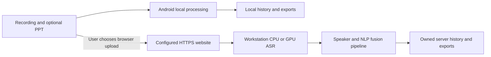

# Offline operation and optional workstation/cloud deployment

Status: 7 October 2026. Deployment artifacts are prepared; no external server, domain or hosted service has been deployed in this task.

## What currently runs where

| Mode | Connectivity | Processing / storage | Delivery status |
| --- | --- | --- | --- |
| Android local | None after speech-model setup | Native ASR, ONNX speakers, text fusion and extractive influence on the phone; local history | Implemented in 0.6; no INTERNET permission |
| Laptop local website | Browser and API on the same machine | Existing Python pipeline; owned SQLite history and private files | Implemented; local CPU model environment provisioned |
| Remote workstation website | Client must reach the workstation, over LAN/VPN or HTTPS | Same Python pipeline on the server; server-owned account history | Launch script/config prepared; hosting not performed |
| Android access to cloud website | Browser needs connectivity | Explicit browser upload to your configured website | Settings includes an HTTPS browser link; no automatic app upload or history synchronization |
| Integrated Android cloud worker | Would require an authenticated upload/download client | Could import server results into local history | Not implemented; current cloud access uses the browser |

Offline-first does not mean cloud computation works without a connection. The phone can process locally without internet. Optional remote processing requires connectivity and may speed ASR, depending on hardware, upload time and queue load. Remote inference can itself stay offline on the server after model provisioning.



The Android app remains offline by default. It does not select cloud processing automatically when connectivity appears, and its browser shortcut does not send recordings, account tokens or saved reports. Local and server histories are separate.

## Prepared files

- [`deployment/run_workstation.sh`](../../deployment/run_workstation.sh): serves the built frontend and API using the existing venv; defaults to loopback, one ML worker and closed registration.
- [`deployment/workstation.env.example`](../../deployment/workstation.env.example): CPU/GPU/model/origin settings, with no secrets.
- [`deployment/Caddyfile.example`](../../deployment/Caddyfile.example): hostname/TLS reverse proxy with a request-body limit; a template requiring a real server/domain.
- [`src/utils/config.py`](../../src/utils/config.py): new `MAI_ASR_DEVICE` and `MAI_ASR_COMPUTE_TYPE` overrides. ASR cache settings include these overrides, avoiding reuse of a CPU cache as a fresh GPU benchmark.
- [`backend/api.py`](../../backend/api.py): `MAI_ALLOW_REGISTRATION=0` closes new account registration while existing accounts can still log in. Local development defaults retain registration.

## Workstation setup

Use the existing [environment/setup instructions](../development/03_ENVIRONMENT_AND_SETUP.md) and [`RUN_MANUALLY.md`](../guides/RUN_MANUALLY.md). Provision models once with the explicit download scripts. Start with CPU mode to verify the account, upload, history, speaker and PPT flow before changing hardware execution.

```bash
npm --prefix frontend run build
.venv/bin/python scripts/validate_setup.py
# Create intended accounts locally before closing registration.
# Stop the local API before starting a server against the same state directory.
MAI_ASR_DEVICE=cpu MAI_ASR_COMPUTE_TYPE=int8 bash deployment/run_workstation.sh
```

The launcher defaults to `127.0.0.1:8000`. It does not create a second database or publish the workstation. An SSH tunnel/VPN can provide private access. For an HTTPS website, set a real hostname in a copy of `Caddyfile.example`, point DNS to the server, and configure reachable ports. Caddy supports automatic certificate provisioning/renewal for qualifying hostnames; see its [official HTTPS requirements](https://caddyserver.com/docs/automatic-https) and [request-body directive](https://caddyserver.com/docs/caddyfile/directives/request_body).

Keep one application process: SQLite, local job recovery and the serialized ML executor are intended for this deployment size. Multiple independently writable API replicas or a high-volume public service need shared job/storage design. Back up the database, private JWT secret, uploads, reports and model/config versions together. `MAI_RUNTIME_DIR`, `MAI_DATA_DIR`, and `MAI_DB_PATH` are existing API overrides; report and pipeline output directories still derive from the project root.

The template does not include a new provider account, storage service, email integration, domain purchase, public account provisioning or uptime monitor. None has been configured here. Keep the initial remote use to the intended team while testing the deployment.

## GPU ASR

The current laptop venv uses CPU PyTorch wheels. Changing an environment variable is not a CUDA installation. The ASR engine is CTranslate2/faster-whisper; consult its [official GPU runtime requirements](https://github.com/SYSTRAN/faster-whisper#gpu) for a compatible CUDA/cuDNN installation. Do not replace the working CPU environment blindly; prepare and verify the GPU workstation separately.

On a compatible provisioned host:

```bash
MAI_ASR_DEVICE=cuda MAI_ASR_COMPUTE_TYPE=float16 bash deployment/run_workstation.sh
```

The launcher checks CUDA device availability and the requested CTranslate2 compute type before starting. Check the model-loading logs on the first real job: the existing ASR loader can fall back to CPU after a GPU loading error. This option accelerates ASR when GPU loading succeeds; the selected Sherpa speaker stage remains CPU-based. GPU inference and fine-tuning are separate workloads.

No GPU job was run in this update. Measure full upload + queue + processing + download latency with fresh caches on the chosen server. A faster GPU stage does not automatically guarantee faster end-to-end processing for short recordings or slow networks.

## Phone use

Install the latest debug APK, import a multilingual GGML speech model once and use local analysis. Speaker weights are packaged in the APK. Settings includes an optional **Cloud website address**; enter your configured HTTPS URL and choose **Open cloud website** to use the browser. Uploading in that browser is explicit. To reuse an app recording remotely, export its WAV/PPT and select those files in the website.

Native cloud uploads, offline cloud-job queuing and automatic cloud-report import are possible later extensions, but are not part of the current delivery. Server/provider choice and credentials are still needed before actual hosting.

## Verification limits

Shell syntax and launcher help are checked locally; config/registration behavior has Python tests. The cloud shortcut is a browser intent, not a remote processing integration test. The Caddy configuration is a documented template and was not started against a real domain. Native inference was checked on the x86_64 emulator; ARM64 is compiled but physical-phone speed, battery and thermals are unmeasured.
