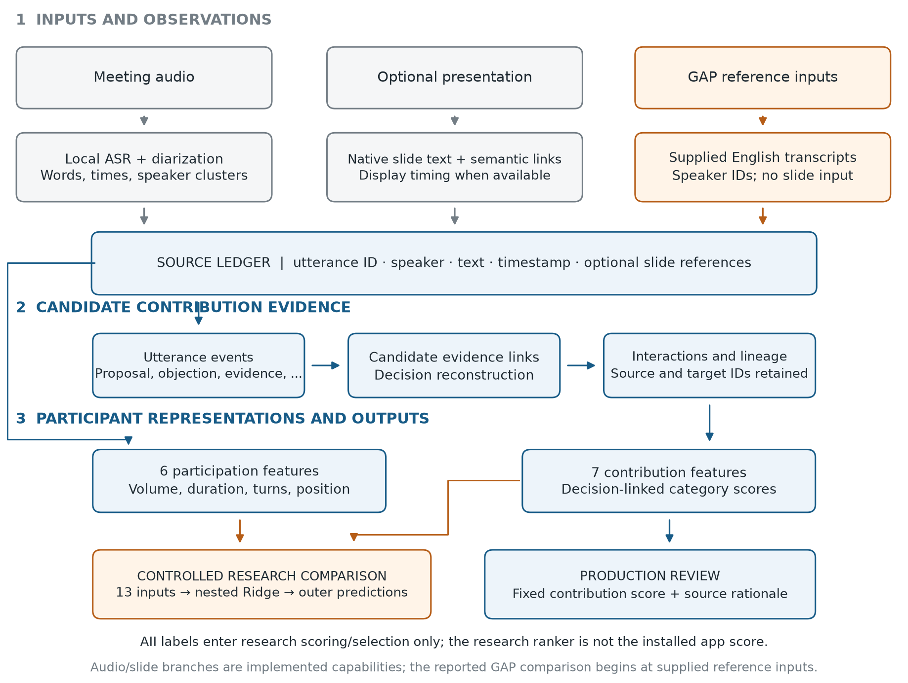
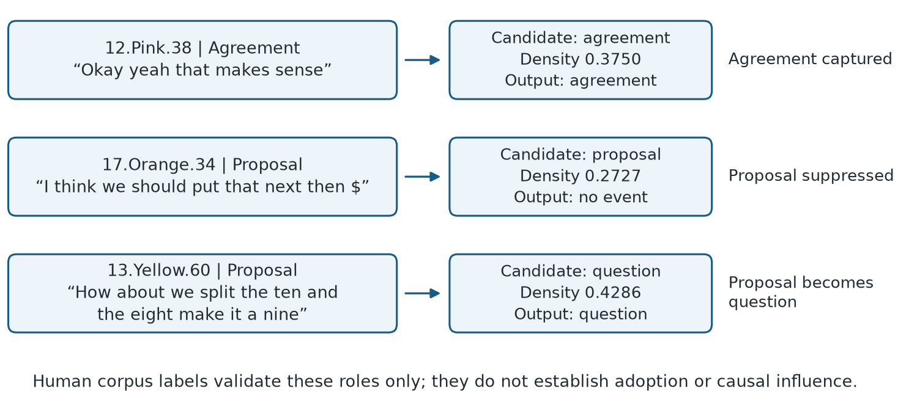
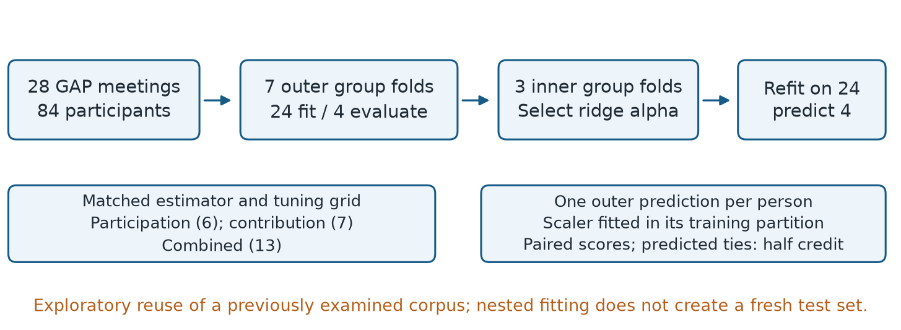
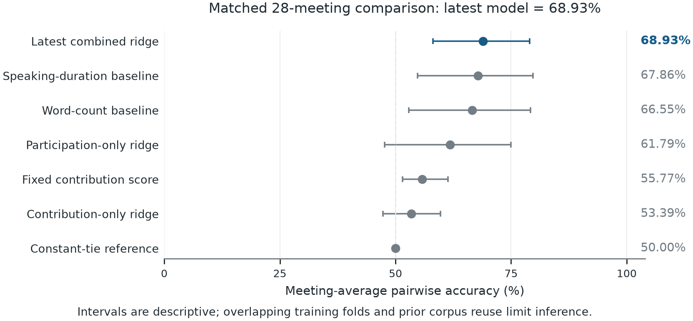
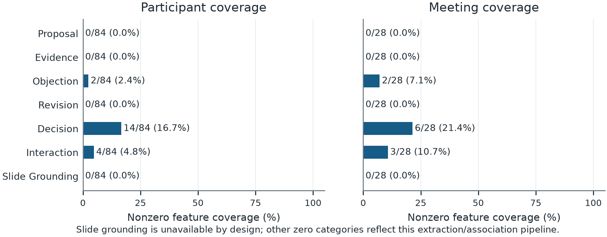
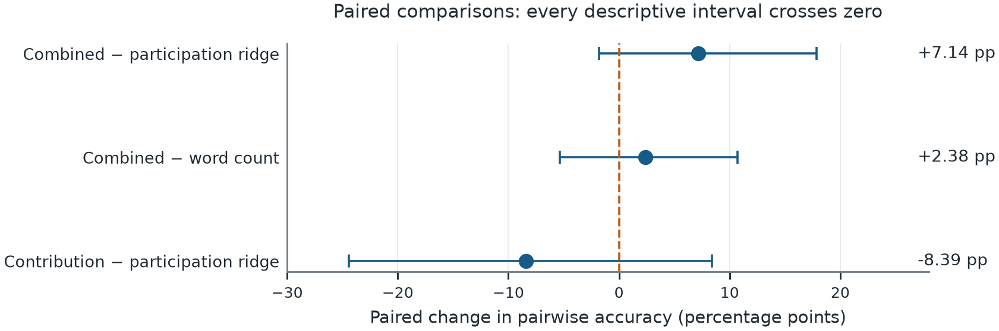
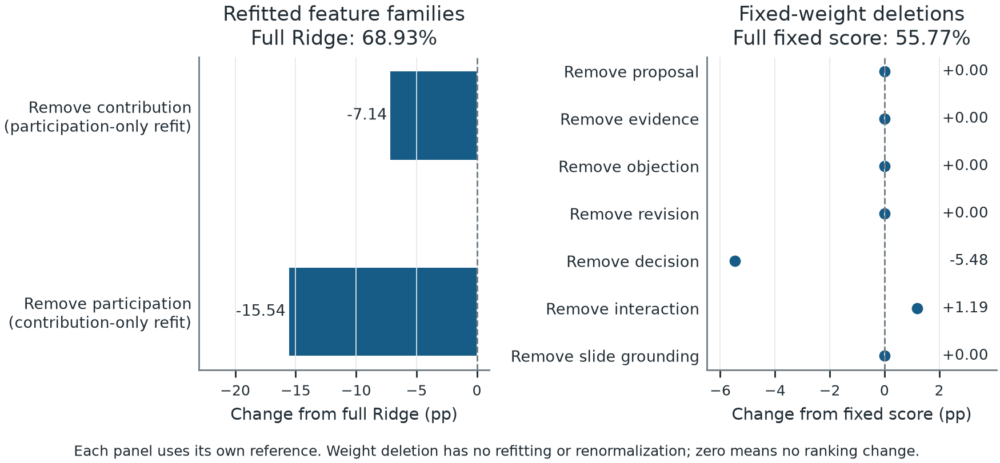

# InfluenceIQ: A Multimodal Framework for Assessing Participant Contributions to Meeting Decisions

Anushka Chatterjee, Amitkumar Racha, Sahil Awatramani, Shriyans Sahoo

Department of Artificial Intelligence & Machine Learning

Symbiosis Institute of Technology, Pune

Symbiosis International (Deemed University)

Pune 412115, Maharashtra, India

Anushka Chatterjee (e-mail: anushkac2311@gmail.com)

Amitkumar Racha (e-mail: rachaamitkumar@gmail.com)

Sahil Awatramani (e-mail: sahilawatramani@gmail.com)

Shriyans Sahoo (e-mail: shriyanssahoo2005@gmail.com)

## Abstract

Assessing individual contributions to meeting decisions requires distinguishing participation, observable conversational roles, and relationships to final outcomes. This paper presents InfluenceIQ, an offline framework that retains source references across speaker-attributed utterances, optional presentation links, candidate decisions, and transparent participant scores. Its empirical contribution is a controlled diagnostic study of the contribution representation, rather than a claim of causal attribution. The study uses 28 public group-decision meetings containing 84 participants and 8,009 reference utterances. Four of seven implemented contribution categories are inactive in this setting, including the unavailable slide category; 70 participants have no extracted contribution features. A fixed-rule diagnostic recovers none of 537 manually tagged proposal utterances. A protocol-frozen exploratory nested group comparison evaluates participation-only, contribution-only, and combined representations using the same ridge-regression family and tuning budget. Combined features obtain 68.93% meeting-average pairwise accuracy, versus 61.79% for participation features and 66.55% for word count. The combined-minus-participation difference is 7.14 percentage points, with a descriptive paired interval of −1.79 to 17.86 points. The interval includes zero, and prior examination of the corpus prevents a fresh-test interpretation. Source-linked cases expose threshold and role-selection failures. The results identify a concrete extraction-coverage limitation while leaving independent contribution validity and end-to-end multimodal benefit unestablished.

Index Terms—participant influence; meeting analysis; decision attribution; multimodal systems; interpretable scoring.

## I. Introduction

Meeting decisions emerge from distributed contributions. One participant introduces an alternative, another supplies evidence, and a third identifies a constraint that changes the choice. The person who speaks longest or announces the conclusion need not have contributed most to its formation. Assessing such contributions requires evidence about what was proposed, how it was received, and how it relates to the outcome.

Meeting behavior and influence have established research precedents. Rienks, Nijholt, and Heylen related argumentation and dialogue behavior to perceived influence [@rienks2007]. Mayfield and Black separated stance classification, outcome prediction, and individual impact assessment [@mayfield2019]. These studies motivate a distinction between observable participation and contribution to a decision. Influence analysis itself is not a new task introduced here.

InfluenceIQ is an offline framework for inspecting speaker-attributed contribution candidates and their sources. Audio-derived passages can be associated with presentation text, while candidate events, evidence relations, decision clusters, and interactions provide seven transparent score features. This design creates an inspectable record, but does not establish that a proposal was adopted merely because it occurred near a decision. This paper therefore treats the score as a hypothesis to diagnose rather than a validated measure of personal influence.

The Group Affect and Performance (GAP) corpus supplies initial preferences and final group choices for a survival-planning task [@gap2018]. Its evaluated release contains 28 meetings and 84 participants [@gaprelease]. Absolute Individual Influence (AII), an initial-to-final preference distance, is a bounded outcome-alignment proxy rather than a direct contribution annotation. The AMI corpus supports separate historical component and outcome-link pilots [@ami2006]; those do not substitute for participant-contribution references.

We ask: RQ1, what source-linked representation does the framework retain, and what can be checked from it? RQ2, do extracted contribution features add predictive information beyond participation under a matched group-separated comparison? RQ3, what extraction and coverage failures constrain score interpretation?

The contributions are an explicit separation of participation, utterance roles, candidate decision relations, and outcome-alignment targets in an implemented framework; a controlled exploratory feature comparison with identical estimator and tuning procedures; and a corpus-wide coverage audit connected to manually tagged roles and source-checked cases. The study's empirical value is a reproducible diagnosis of a representation whose apparent interpretability otherwise risks concealing missing evidence. A new speech model or algorithmic superiority is not claimed.

## II. Related Work

### A. Influence and Decision Attribution

Perceived influence and contribution to an outcome require different references. Rienks et al. use participants' experienced influence, while Mayfield and Black study stance, consensus, and impact in online decisions. GAP supplies a third construct: distance between initial individual preferences and a final group ranking. A person who already agrees with the eventual choice can obtain favorable AII without changing anyone's view. These measures are not interchangeable labels.

The CALO Meeting Assistant integrated transcription and interpretation within a meeting-assistance architecture [@calo2010]. Fernández et al. investigated decision modeling in multiparty dialogue [@fernandez2008]. These precedents make two distinctions essential: an integrated application is not automatically a new attribution method, and membership in decision-related discussion is not proof of adoption. Table I compares relevant constructs and evidence units.

Table I. Reference constructs and relationship to participant assessment.

| Work | Reference construct | Attribution or evidence unit | Boundary relevant to this study |
| --- | --- | --- | --- |
| Rienks et al. | Perceived influence | Annotated behavior and argumentation | Perception differs from verified adoption |
| Mayfield and Black | Stance, consensus, individual impact | Online group-decision contributions | Different interaction setting and impact definition |
| GAP | Initial-to-final preference alignment | Individual and group item rankings | Alignment can exist without observed persuasion |
| Fernández et al. / CALO | Decisions and meeting interpretation | Dialogue segments and system analyses | Decision detection does not establish personal impact |
| Evidence-grounded summarization | Support for an answer or summary | Source-to-output passages | Supporting a statement differs from originating a decision |
| InfluenceIQ | Source-linked contribution proxies | Events, candidate relations, participant features | This study evaluates role coverage and outcome alignment |

### B. Grounding, Models, and Evaluation

ExplainMeetSum aligns summaries with evidence [@explainmeetsum2023]. QMSum studies query-focused meeting summarization [@qmsum2021], and MeetingBank provides a related benchmark [@meetingbank2023]. Dialogue-factuality analysis [@she2024], meeting-summary error refinement [@kirstein2025], and long-context evidence attribution [@wright2025] further motivate checking source support. Their generation and attribution scores are not participant-ranking baselines. Source references likewise permit inspection without validating an inferred decision relationship.

The framework uses pretrained Whisper recognition [@whisper2023] and optional sentence representations motivated by Sentence-BERT [@sbert2019] and MiniLM [@minilm2020], specifically all-MiniLM-L6-v2 [@minilmcheckpoint]. Historical comparisons include random forests [@rf2001], Extra Trees [@extratrees2006], and XGBoost [@xgboost2016]; complete results remain in the supplement. These established model families are not presented as novel architectures.

The controlled revision uses scikit-learn ridge regression [@sklearn2011] to isolate features under a common fitting procedure. Nested selection separates parameter choice from outer prediction, addressing one source of selection bias [@cawley2010]. It does not remove prior researcher exposure to the corpus. Uncertainty must also respect the group structure of the observations [@dror2018].

## III. Framework and Operational Definitions

### A. Inputs, Outputs, and Evidence Levels

Fig. 1 depicts the architecture. Audio is standardized to 16 kHz mono and processed locally by faster-whisper recognition and Sherpa-ONNX diarization. Anonymous clusters remain distinct from verified identities; a display-name edit does not repair an acoustic assignment. Recognition and attribution are cached separately. Local inference is available after provisioning, without a formal privacy guarantee.

Fig. 1. Implemented pipeline and reference-input evaluation boundary.

Optional PPTX processing extracts native text, tables, and notes. Semantic similarity and supplied display times support passage-to-slide links; missing times remain unavailable. This is audio-derived text to document-text alignment, not a jointly trained acoustic-image network. GAP supplies transcripts and speaker identities without slides, bypassing these branches. The title describes framework capabilities; a multimodal contribution-assessment benefit is not established.

We distinguish four evidence levels: participation statistics; utterance roles such as proposal or agreement; candidate relations between acts and decisions; and participant contribution judgments. Correctness at one level does not validate the next. Agreement may acknowledge understanding, and a correctly identified proposal may be rejected. The framework retains speaker, time, verbatim text, event identifiers, relation endpoints, and available slide identifiers. Its score is meeting-relative, not a correctness probability or a cross-meeting measure of ability. The learned discussion detector is a parallel review aid rather than an adoption-label source.

### B. Events, Associations, and Canonical Version

Phrase rules select one candidate role per passage from the enabled taxonomy, subject to a match-density threshold. Evidence and interaction rules apply type and temporal constraints; anchor-based reconstruction forms candidate decision clusters. These mechanisms do not independently resolve coreference or determine adoption. The canonical version analyzed here is the corrected keyword pipeline preserved with the v2 ranking experiment, identified by hashes in the supplement.

That version retains secondary proposals, credits each observed proposer, preserves evidence-edge direction, and removes an unsupported bonus for the first proposal in a confirmed cluster. The new comparison uses its stored features. Earlier experiments retain a pre-correction snapshot and are explicitly separated from this method. Cluster membership remains an inferred association, not verified uptake.

### C. Transparent Score

Let x(p,k) be participant p's nonnegative feature in category k. Maximum normalization within a meeting leaves an inactive category at zero, and the participant score is a weighted sum.

Equation (1). z(p,k) = x(p,k) / max_q x(q,k) when max_q x(q,k) > 0; otherwise z(p,k) = 0.

Equation (2). S(p) = sum over k=1,...,7 of w(k) z(p,k), with w(k) >= 0 and sum over k of w(k) = 1.

Table II specifies the rules and configurable prototype weights. The weights are not independently validated contribution values. Scores are serialized to six decimals; categories can credit the same event, so the sum does not represent independent evidence. With transcript segments supplied, non-unknown transcript speakers are retained even when event extraction yields no features.

Table II. Canonical contribution features and prototype weights.

| Category | Extracted feature rule | Weight |
| --- | --- | --- |
| Proposal | One per observed proposal in a decision cluster | 0.15 |
| Evidence | One per linked evidence event, plus 0.5 if slide-grounded | 0.20 |
| Objection | 0.5 per linked objection/disagreement, plus one if a revision in its cluster starts later | 0.15 |
| Revision | One per revision in a confirmed or probable cluster | 0.20 |
| Decision | One per participant event in a confirmed cluster, or 0.5 in a probable cluster | 0.15 |
| Interaction | One per outgoing decision-linked interaction | 0.05 |
| Slide grounding | One per decision-linked event with a slide association | 0.10 |

The objection bonus represents temporal association rather than causation. A zero vector can mean failed extraction rather than negligible contribution. The coverage audit measures this possibility explicitly. The application's distinct decision-level display allocation is specified in the supplement and is not validated as an alternative impact measure.

### D. Source-Checked Role Cases

Fig. 2 contains three purposively selected GAP utterances with existing manual role tags. Utterance 12.Pink.38, “Okay yeah that makes sense,” is tagged Agreement and emits an agreement event. Utterance 17.Orange.34, “I think we should put that next then $,” is tagged Proposal, but its density of 0.2727 falls below the 0.3 emission threshold. Utterance 13.Yellow.60 proposes a compromise between rankings, yet the rule selector emits a question. The records retain original identifiers and times.

Fig. 2. A captured role and two source-checked proposal failures.

These cases demonstrate trace availability and mechanisms of role failure. They are not a random accuracy sample, contribution ratings, or proof of adoption. They show what an inspectable processing path can expose without turning a source pointer into a validated influence explanation.

## IV. Evaluation Protocol

### A. Data and Target

The evaluated GAP release contains 28 English meetings, 84 people, and 8,009 utterances. Groups of two to four rank survival items individually and then jointly. Release documentation is cited separately because its size differs from the original publication. Text, speaker identities, and timestamps are supplied reference inputs. AII, the initial-to-final ranking distance, is an alignment proxy, not an independent contribution judgment.

The regression target is the average-tie rank of negative AII within a meeting, minus one, divided by the participant count minus one. Higher targets denote greater alignment. AII, final rankings, questionnaires, demographics, and manual role tags do not enter automatic features. Role tags enter only the fixed-rule diagnostic. Independent contribution validation requires source-supported judgments separate from the system's scores.

### B. Controlled Representations and Nested Selection

The review-motivated protocol was recorded before fitting and reuses the corrected snapshot's meeting-normalized features. Participation has six variables: speaking duration, word count, utterance count, mean words per utterance, and early- and late-meeting word counts. Contribution has the seven categories in Table II. Combined concatenates the 13 variables without extra semantic or lexical event features. The same estimator, tuning grid, and group assignments apply to every family.

Fig. 3 shows the procedure. Seven outer group folds each hold out four meetings while retaining 24 for fitting. Three inner group folds select ridge regularization from 0.1, 1, 10, and 100 by pooled inner out-of-fold meeting-average pairwise accuracy; the first grid value wins ties. StandardScaler is fitted within each inner fit. The selected pipeline is refitted on the 24 outer fitting meetings and predicts the four outer meetings. Each participant receives exactly one outer prediction, with complete meetings separated in every fit/development/evaluation role.

Fig. 3. Matched comparison with nested complete-meeting separation.

The declared main contrast is combined minus participation. Word count, speaking duration, the fixed prototype score, and constant ties supply baselines. Constant ties receive half credit on every comparable pair. The analysis fits small ridge models, requires no new neural epochs, and installs no application model.

This procedure controls fitting and parameter selection within the analysis. All 28 meetings were previously available during development, and the comparison was designed after reviewing earlier results. It therefore remains exploratory rather than a fresh test. The original 16/6/6 split and pre-correction selection remain separately reported historical evidence.

### C. Metrics, Coverage, and Uncertainty

Let P be a meeting's unordered participant pairs with unequal reference AII a(p). Define delta(p,q) as predicted S(p) minus S(q), where larger predictions indicate greater alignment. Correct orderings receive one, exact predicted ties one-half, and reversals zero.

Equation (3). PA(m) = mean over pairs (p,q) with a(p) != a(q) of [1 if delta(p,q) * (a(q)-a(p)) > 0; 0.5 if delta(p,q) = 0; 0 otherwise].

Equation (4). MacroPA = mean over evaluable meetings m of PA(m).

The evaluable meeting set in (4) contains meetings with at least one comparable pair; all 28 qualify. Exact top-set accuracy requires equality of the complete predicted and reference winner sets. An all-tied prediction cannot win by including everyone. Constant-output meetings and comparable-pair counts accompany aggregates. Rank correlations are omitted where constant predictions make coverage misleading.

Feature coverage counts people and meetings with positive normalized contribution values; normalization preserves zero activity. Fixed-weight deletions set one weight to zero without renormalization or refitting. A separate corpus-wide diagnostic compares unchanged proposal and agreement rules with supplied Proposal and Agreement tags, including mixed-role labels. These references validate roles, not contribution/outcome relationships.

Ten thousand paired meeting bootstrap draws, seed 20261024, describe variation in the observed outer-prediction differences. Both methods use identical resampled meeting indices. These are conditional descriptive intervals: outer training sets overlap and the corpus has previously informed development. They do not guarantee generalization or correct for prior researcher exposure.

## V. Comparative Analysis and Ablation Study

### A. Contribution Coverage and Role Diagnostics

Table III counts the participants and meetings with any nonzero value in each contribution category. A category is active only when its normalized value is positive. Proposal, evidence, revision, and slide grounding are inactive for all participants. Slide inactivity is expected because GAP has no slide input. The other inactive categories expose extraction or association limitations. Seventy of 84 people and 22 of 28 meetings have no contribution features at all; zeros are not independent judgments that these people contributed nothing.

Table III. Feature availability on 28 GAP meetings and 84 participants. A feature is available when its normalized value is nonzero; counts and percentages use the column denominators.

| Contribution category | People with feature / 84 | Meetings with feature / 28 |
| --- | --- | --- |
| Proposal | 0/84 (0.0%) | 0/28 (0.0%) |
| Evidence | 0/84 (0.0%) | 0/28 (0.0%) |
| Objection | 2/84 (2.4%) | 2/28 (7.1%) |
| Revision | 0/84 (0.0%) | 0/28 (0.0%) |
| Decision | 14/84 (16.7%) | 6/28 (21.4%) |
| Interaction | 4/84 (4.8%) | 3/28 (10.7%) |
| Slide Grounding | 0/84 (0.0%) | 0/28 (0.0%) |

The fixed role diagnostic has 537 reference-positive Proposal utterances and no emitted proposals, yielding zero proposal precision, recall and F1 under the declared convention. Agreement has 684 reference positives, 80 emissions, 24 true positives, 56 false positives and 660 false negatives: precision 30.00%, recall 3.51%, and F1 6.28%. These are corpus-wide descriptive role checks, not participant influence accuracy. Fig. 2 supplies source examples, and Fig. 5 visualizes feature availability.

### B. Main Comparative Analysis: Latest Model and Matched Baselines

Table IV is the principal result table. Every row uses the same 28 GAP meetings, 84 participants and 87 reference-comparable within-meeting pairs. The three ridge models use identical nested group folds, estimator family and parameter-search budget. **The latest combined model obtains 68.93% meeting-average pairwise accuracy**, the highest observed mean among these seven matched methods. Its point advantage is 1.07 percentage points over speaking duration, 2.38 points over word count and 7.14 points over participation-only ridge. These are observed differences, not established superiority.

Table IV. Main matched comparison on 28 GAP meetings, 84 participants and 87 comparable pairs. Higher pairwise accuracy is better; intervals are descriptive. Exact top set is complete winner-set agreement. Nonconstant output counts meetings with distinct participant scores and measures coverage, not correctness.

| Model / baseline | Input features | Pairwise accuracy (%) | Descriptive 95% interval (%) | Exact top set /28 (%) | Nonconstant output /28 |
| --- | --- | --- | --- | --- | --- |
| **Latest combined ridge** | 6 activity + 7 contribution | **68.93** | 58.10 to 79.05 | 14/28 (50.00%) | 28/28 |
| Speaking-duration baseline | Union of speech intervals | 67.86 | 54.76 to 79.76 | 13/28 (46.43%) | 28/28 |
| Word-count baseline | Word volume | 66.55 | 52.86 to 79.17 | 14/28 (50.00%) | 28/28 |
| Participation-only ridge | 6 activity | 61.79 | 47.62 to 75.00 | 13/28 (46.43%) | 28/28 |
| Fixed contribution-score baseline | 7 weighted contribution | 55.77 | 51.49 to 61.31 | 4/28 (14.29%) | 6/28 |
| Contribution-only ridge | 7 contribution | 53.39 | 47.32 to 59.76 | 2/28 (7.14%) | 6/28 |
| Constant-tie reference | No distinguishing signal | 50.00 | 50.00 to 50.00 | 0/28 (0.00%) | 0/28 |

The interval column is a conditional meeting-bootstrap summary, not a guarantee of population performance. Exact top set means the complete predicted winner set equals the reference set. Nonconstant output means at least two participants receive different scores; it is coverage, not correctness. Each meeting is weighted equally, reference-tied pairs are excluded and predicted ties receive half credit. Neither pairwise accuracy nor exact top-set agreement is human-validated causal influence. Fig. 4 makes the 68.93% result visible alongside every matched baseline.

Fig. 4. All seven matched methods on 28 GAP meetings. Points show meeting-average pairwise accuracy and bars show descriptive 95% meeting-bootstrap intervals. The latest combined Ridge result is 68.93%; the dashed line marks the constant-tie score. Prior corpus reuse and overlapping fitted folds limit inference.

Fig. 5. Contribution-feature availability among 84 participants and 28 meetings. Labels give active counts and percentages. Slide grounding is unavailable by design; the remaining inactive categories diagnose extraction or association limitations. Zero activity is not evidence of zero human contribution.

### C. Paired Comparative Analysis

Table V compares methods within the same meetings. It reports the direction of change and the number of meetings improved, unchanged or worsened. Fig. 6 plots the paired intervals against zero. The combined model improves on participation-only ridge in six meetings, ties in 19 and worsens in three. Its descriptive interval includes zero. The word-count comparison is also inconclusive; higher means alone do not establish reliable generalization.

Table V. Paired differences; positive values favor the first method.

| Matched contrast | Difference (points) | Descriptive 95% interval (points) | Better / same / worse meetings | Interpretation |
| --- | --- | --- | --- | --- |
| Combined minus participation ridge | +7.14 | -1.79 to 17.86 | 6 / 19 / 3 | Includes zero |
| Combined minus word count | +2.38 | -5.36 to 10.71 | 6 / 17 / 5 | Includes zero |
| Contribution minus participation ridge | -8.39 | -24.40 to 8.40 | 10 / 2 / 16 | Includes zero |

Fig. 6. Paired meeting-average differences and descriptive 95% paired-bootstrap intervals. Positive values favor the first method. All three intervals cross zero, so these observations do not establish a reliable performance gain.

### D. Comparative Analysis of Earlier Models and Pipelines

Table VI reports all fourteen final methods from the original GAP experiment, including the five fixed baselines and all three learned model families under structure, text and combined inputs. Parameters were selected on development data. The selected primary remains structural Extra Trees: 83.33% development and 61.11% historical pairwise accuracy, versus word count's 82.78% and 63.89%. The nonprimary combined Extra Trees candidate is not retrospectively promoted because it scored 66.67%. This six-meeting cohort contains 19 participants and 21 comparable pairs; its 33.33–83.33% primary interval is broad.

Table VI. All original GAP finalists: 16 fitting, six development and six historical evaluation meetings. PA is meeting-average pairwise accuracy; higher is better. The primary was selected on development PA, not on historical results. This earlier snapshot is distinct from Table IV.

| Model / representation | Development PA (%) | Historical PA (%) | Selection status |
| --- | --- | --- | --- |
| Speaking duration | 80.56 | 52.78 | Fixed baseline |
| Word count | 82.78 | 63.89 | Fixed baseline |
| Utterance count | 64.72 | 41.67 | Fixed baseline |
| Decision-event count | 61.67 | 52.78 | Fixed baseline |
| Original weighted score | 56.11 | 52.78 | Fixed baseline |
| Structural features / Ridge | 80.00 | 55.56 | Nonprimary finalist |
| Structural features / Pairwise logistic regression | 82.78 | 47.22 | Nonprimary finalist |
| Structural features / Extra Trees | 83.33 | 61.11 | Selected primary |
| Participant text / Ridge | 74.44 | 41.67 | Nonprimary finalist |
| Participant text / Pairwise logistic regression | 74.44 | 47.22 | Nonprimary finalist |
| Participant text / Extra Trees | 68.33 | 58.33 | Nonprimary finalist |
| Structural + text / Ridge | 80.00 | 55.56 | Nonprimary finalist |
| Structural + text / Pairwise logistic regression | 82.78 | 47.22 | Nonprimary finalist |
| Structural + text / Extra Trees | 71.67 | 66.67 | Nonprimary finalist |

Table VII includes every final semantic/role model combination, plus the corrected pipeline, topic, contextual-role and XGBoost variants. Version B denotes the earlier semantic/role snapshot; version C denotes corrected extraction and attribution. These comparisons reuse previously examined historical groups. Rank ensembles, semantic uptake, participant-text embeddings, contextual roles and boosted ranking are therefore visible rather than hidden in selected successful rows.

Table VII. All later GAP ranking finalists on the six historical meetings. PA is meeting-average pairwise accuracy; higher is better. B uses the earlier semantic/role snapshot and C corrected extraction/attribution. Repeated historical evaluation is exploratory, and these rows are not matched to Table IV's 28-meeting protocol.

| Pipeline / model family | Development PA (%) | Historical PA (%) | Feature version / scope |
| --- | --- | --- | --- |
| Lower event threshold / Ridge | 80.00 | 52.78 | B: earlier snapshot |
| Lower event threshold / Pairwise logistic regression | 80.00 | 52.78 | B: earlier snapshot |
| Lower event threshold / Extra Trees | 73.89 | 58.33 | B: earlier snapshot |
| Lower event threshold / Rank ensemble | 74.44 | 52.78 | B: earlier snapshot |
| Semantic uptake / Ridge | 74.44 | 30.56 | B: earlier snapshot |
| Semantic uptake / Pairwise logistic regression | 74.44 | 52.78 | B: earlier snapshot |
| Semantic uptake / Extra Trees | 66.11 | 41.67 | B: earlier snapshot |
| Semantic uptake / Rank ensemble | 71.67 | 36.11 | B: earlier snapshot |
| Semantic uptake + text embeddings / Ridge | 65.00 | 50.00 | B: earlier snapshot |
| Semantic uptake + text embeddings / Pairwise logistic regression | 62.78 | 41.67 | B: earlier snapshot |
| Semantic uptake + text embeddings / Extra Trees | 60.56 | 58.33 | B: earlier snapshot |
| Semantic uptake + text embeddings / Rank ensemble | 61.11 | 50.00 | B: earlier snapshot |
| Learned roles / Ridge | 74.44 | 36.11 | B: earlier snapshot |
| Learned roles / Pairwise logistic regression | 74.44 | 55.56 | B: earlier snapshot |
| Learned roles / Extra Trees | 66.11 | 38.89 | B: earlier snapshot |
| Learned roles / Rank ensemble | 71.67 | 37.50 | B: earlier snapshot |
| Learned roles + text embeddings / Ridge | 60.00 | 58.33 | B: earlier snapshot |
| Learned roles + text embeddings / Pairwise logistic regression | 62.78 | 41.67 | B: earlier snapshot |
| Learned roles + text embeddings / Extra Trees | 60.56 | 52.78 | B: earlier snapshot |
| Learned roles + text embeddings / Rank ensemble | 58.89 | 50.00 | B: earlier snapshot |
| Corrected fixed keyword pipeline | 56.11 | 52.78 | C: corrected fixed score |
| Corrected pipeline + semantic topics | 58.33 | 47.22 | C: topic feature toggle |
| Balanced contextual roles + fixed score | 71.11 | 38.89 | C: learned role replacement |
| Selected XGBoost ranker | 86.11 | 50.00 | C: development-selected ranker |

The latest 68.93% result in Table IV uses nested predictions over 28 meetings, whereas Tables VI–VII use the original six historical meetings and different feature versions. Their numerical ordering is not a matched experiment. We can state that the latest model has the highest observed mean among its matched Table IV comparators; we cannot claim that it reliably beats every historical pipeline or a classifier evaluated on another task. The complete model inventory is also supplied as a machine-readable CSV.

### E. Explicit Ablation Study

Table VIII separates two kinds of ablation. The feature-family study removes participation or contribution inputs and refits Ridge under the same nested tuning procedure. The fixed-score study deletes one contribution weight without refitting or renormalizing. Each change is measured relative to its own full reference system; the 68.93% Ridge reference must not be confused with the 55.77% fixed-score reference. Fig. 7 visualizes these two groups separately.

Table VIII. Ablations on the same 28 meetings. PA is meeting-average pairwise accuracy. Ridge rows refit under identical nested tuning and use the 68.93% full reference; weight-deletion rows have no refit or renormalization and use the 55.77% fixed reference. Negative changes reduce PA; constant meetings have tied scores for every participant.

| System / removed input | PA (%) | Change vs own full system (points) | Constant meetings /28 | Meaning |
| --- | --- | --- | --- | --- |
| Ridge: all 13 features | 68.93 | +0.00 | 0 | Full learned reference |
| Ridge: remove 7 contribution inputs | 61.79 | -7.14 | 0 | Participation-only refit |
| Ridge: remove 6 participation inputs | 53.39 | -15.54 | 22 | Contribution-only refit |
| Fixed score: all 7 categories | 55.77 | +0.00 | 22 | Full fixed reference |
| Fixed score: remove proposal | 55.77 | +0.00 | 22 | Inactive input; unchanged |
| Fixed score: remove evidence | 55.77 | +0.00 | 22 | Inactive input; unchanged |
| Fixed score: remove objection | 55.77 | +0.00 | 22 | Active category deletion |
| Fixed score: remove revision | 55.77 | +0.00 | 22 | Inactive input; unchanged |
| Fixed score: remove decision | 50.30 | -5.48 | 24 | Active category deletion |
| Fixed score: remove interaction | 56.96 | +1.19 | 22 | Active category deletion |
| Fixed score: remove slide grounding | 55.77 | +0.00 | 22 | Inactive input; unchanged |

Removing contribution inputs lowers the learned model's point estimate by 7.14 points, while removing participation lowers it by 15.54 points. These differences remain exploratory; Table V provides the paired uncertainty for the first contrast in the opposite direction. For the fixed score, removing decision features lowers PA from 55.77% to 50.30%; removing interaction raises it to 56.96%. Deleting inactive categories leaves the score unchanged. Such sensitivity does not establish validated personal impact or show that interaction information is generally harmful.

Fig. 7. Ablation changes relative to each panel's full system. Left: the same nested procedure refits Ridge after removing one feature family, relative to the 68.93% combined model. Right: single contribution weights are deleted without refitting or renormalization, relative to the 55.77% fixed score. The two references and interventions differ.

### F. Supporting Classifier and Role Comparisons

Table IX makes the earlier Logistic Regression, Complement Naive Bayes, calibrated linear SVM, Random Forest, forest/logistic combination and neural candidates explicit. These are supporting tasks. AMI discussion uses 11,136 historical acts from 12 meetings; GAP role macro F1 uses the separate utterance-role target. Neither is participant-ordering PA, and the neural epoch choices and label supports remain in the supplement.

Table IX. All supporting classifier finalists. AMI rows report positive-class discussion F1 and GAP rows unweighted four-role macro F1; higher is better. Historical cohorts and label targets differ from participant-ranking PA, so these scores cannot establish cross-task superiority.

| Task | Model | Input / variant | Development F1 (%) | Historical F1 (%) |
| --- | --- | --- | --- | --- |
| AMI discussion | Logistic Regression | local | 55.04 | 48.89 |
| AMI discussion | Complement NB | local | 55.65 | 48.08 |
| AMI discussion | Calibrated linear SVM | local | 55.24 | 48.33 |
| AMI discussion | Random Forest | local | 54.16 | 50.26 |
| AMI discussion | Logistic Regression | context 40 | 57.05 | 50.60 |
| AMI discussion | Complement NB | context 40 | 55.71 | 47.12 |
| AMI discussion | Calibrated linear SVM | context 40 | 55.78 | 50.48 |
| AMI discussion | Random Forest | context 40 | 59.72 | 52.08 |
| AMI discussion | 75% forest + 25% logistic | Installed combination | 59.79 | 53.54 |
| AMI discussion | Fine-tuned MiniLM | Neural candidate | 53.10 | 46.32 |
| GAP role macro F1 | Unweighted MiniLM | Four-role classification | See frozen protocol | 11.24 |
| GAP role macro F1 | Balanced MiniLM | Four-role classification | See frozen protocol | 21.25 |

The installed combination retains 53.54% positive F1; the neural discussion candidate scores 46.32%. The separate AI-labelled relationship pilot and source-only/outcome-only controls remain in the supplement, where their 54.55% paired agreement is compared with 63.64% majority agreement. Those AI-label agreements are not human-validated influence accuracy. The machine-readable record includes all 61 evaluated methods or variants across these tasks, and a separate CSV preserves all 121 ranking development-search records. Search-grid trials that were scored only on development data are distinct from historically evaluated finalists; invalidated trials supply no valid result.

## VI. Interpretation, Reproducibility, and Limits

### A. Answers and Scope

For RQ1, references and processing records permit inspection of candidate contributions. The cases show how to check a role label or locate a missing event. This establishes trace availability, not explanation faithfulness, adoption, or reduced review effort. Those benefits require independent judgments and appropriate evaluation.

For RQ2, combined features have a higher point estimate than the matched participation model, but the paired interval includes zero and simple activity baselines remain close. A reliable gain is not demonstrated. The comparison isolates representation more directly than changing model and features simultaneously.

For RQ3, coverage reveals sparsity before ranking, and public role tags expose complete proposal-recall failure at the default threshold. These support a concrete diagnosis of this implementation in GAP. They do not show that aggregate features are fundamentally inadequate, role information is useless, or a larger model would necessarily solve the problem. Target mismatch, extraction quality, corpus diversity, and model selection remain interacting factors.

### B. Configuration and Research Records

Table X states canonical settings. The research package provides frozen derived features, group assignments, protocol, parameter selections, outer predictions, coverage and case records, evaluation code, and figure sources. It reproduces the new analysis from supplied features. Regenerating extraction additionally requires the original corpus and identified code/configuration version; complete audio inference also requires provisioned models.

Table X. Canonical settings and experimental boundaries.

| Component | Setting | Interpretation |
| --- | --- | --- |
| Audio | 16 kHz mono; local recognition and diarization | Implemented; bypassed by GAP reference inputs |
| Slide representation | all-MiniLM-L6-v2 | Optional component; no measured contribution gain |
| Slide association | Semantic/temporal weights 0.5/0.5; threshold 0.3; top 3 | Missing timing uses the configured fallback; GAP has no slides |
| Event emission | Density threshold 0.3 | Fixed heuristic, not a calibrated probability |
| Decision association | 120 s anchor window | Candidate association, not verified adoption |
| Evidence / interaction windows | 60 s / 60 s | Temporal heuristics |
| Controlled ranker | StandardScaler plus Ridge; alpha 0.1/1/10/100 | Same grid and folds across feature families |
| Resampling | 10,000 paired meeting draws; seed 20261024 | Conditional descriptive intervals |

The supplement supplies a version matrix, complete historical results, class supports, and component-training provenance. The AI link pilot's labels remain AI-generated: its paired model agrees with 54.55% of 11 historical labels, below the majority baseline's 63.64%, with no revised examples in development or evaluation. It remains an annotation feasibility study. The package excludes full corpora, private recordings, and pretrained binaries.

### C. Construct and Generalization Limits

The central unresolved issue is independent contribution validity. AII reflects alignment, and an initially aligned member need not have shaped the decision. Manual role tags validate an earlier stage, not adoption, shared credit, or person-level impact. Source traceability and normalization do not repair this distinction.

All GAP meetings have previously been available during development. Nested group fitting does not remove that prior exposure, and overlapping training partitions limit bootstrap interpretation. Short English survival-planning discussions do not represent every workplace, presentation, culture, language, or long recording. The 28-meeting analysis is not a new external dataset.

The multimodal branches remain unvalidated on the participant-contribution outcome. A stronger study would compare checked transcripts with actual recognition/diarization outputs and then add matched presentation information. Speaker identity, timing, relevance, and outcome references would require checking. An alignment fixture or untimed-slide fallback cannot substitute for that experiment.

### D. Responsible Interpretation and Next Evidence

Scores should support inspection rather than automatic judgments of employee competence, authority, or decision quality. Influence may be shared and may lead to poor choices. Missing extraction should remain visible rather than become a confident zero-impact judgment. Fairness, formal privacy, and organizational effectiveness are not evaluated.

The study reuses existing public corpora without new recruitment. Original terms apply, including GAP's noncommercial attribution license. Applicable institutional determinations and venue declarations require author confirmation. The package provides locally auditable materials; a public archival DOI has not been assigned.

The next priority is a representative contribution/outcome reference, independently assessed before adjudication, with agreement, uncertainty, and unjudgeable cases reported. New complete teams or project series should be reserved for confirmation. Relationship quality should be measured before ranking, distinguishing adopted, rejected, revised, and unresolved contributions where observable. Stronger contribution and multimodal claims require that evidence.

## VII. Conclusion

InfluenceIQ provides an offline, source-linked framework for inspecting participant contribution candidates. A controlled exploratory analysis separates six participation features from seven decision-linked features under an identical nested group procedure. Combined ridge obtains 68.93% pairwise accuracy across 28 meetings, but its paired advantage over participation ridge remains uncertain and is not confirmed on fresh data. The central diagnostic is extraction sparsity: 70 of 84 participants have no contribution features, and fixed rules miss all 537 supplied proposal tags. Source-checked cases expose threshold and role-selection failures. These findings support a reproducible coverage-and-representation audit while leaving independent participant contribution validity and end-to-end multimodal benefit for further study.

## Acknowledgment

The authors acknowledge their faculty guide, Dr. Nivedita Mishra, Department of Artificial Intelligence & Machine Learning, Symbiosis Institute of Technology, Pune, Symbiosis International (Deemed University), Pune 412115, Maharashtra, India (e-mail: nivedita.mishra@sitpune.edu.in), for project guidance. This work developed from the Group 12 B.Tech project in academic year 2026–2027. An AI assistant supported code inspection, exploratory analysis, manuscript drafting, and figure-generation code, and produced the explicitly identified outcome-link pilot labels described in the supplement.
