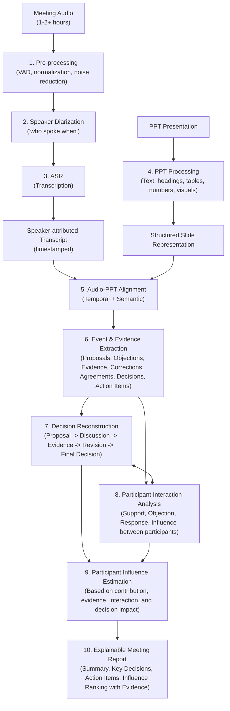

# Offline Multimodal Meeting Intelligence for Decision and Participant Influence Analysis

**MULTIMODAL AI - PROJECT REPORT**

**Degree:** Bachelor of Technology in Artificial Intelligence & Machine Learning  
**Department:** Artificial Intelligence & Machine Learning  
**Academic Year:** 2026-27

## Submitted By

- Anushka Chatterjee - 23070126015
- Amitkumar Racha - 24070126501
- Sahil Awatramani - 23070126112
- Shriyans Sahoo - 23070126125

## Under the Guidance of

**Dr. Nivedita Mishra**

Symbiosis Institute of Technology  
Pune - 412115, Maharashtra State, India  
https://www.sitpune.edu.in/

> **Conversion note:** This Markdown file preserves the content and structure of the submitted PDF while converting layout-dependent tables and the system-architecture figure into text/Markdown/Mermaid so that an LLM can read the document without relying on page images. Page markers are included as HTML comments for traceability.

<!-- PDF page 2 -->

# Certificate

This is to certify that the Project work entitled **"Offline Multimodal Meeting Intelligence for Decision and Participant Influence Analysis"** is carried out by Anushka Chatterjee, Amitkumar Racha, Sahil Awatramani and Shriyans Sahoo under the Multimodal AI course under Bachelor of Technology in Artificial Intelligence & Machine Learning, Symbiosis International (Deemed University), Pune during the academic year 2026-2027.

**Name and Signature of the Guide**

**Dr. Sumit Kumar**  
Head, Department of AI&ML

<!-- PDF page 3 -->

# Declaration

I hereby declare that the project titled **"Offline Multimodal Meeting Intelligence for Decision and Participant Influence Analysis"** submitted to Symbiosis Institute of Technology, Constituent of Symbiosis International (Deemed University) Pune for the award of the degree of Bachelor of Technology in Artificial Intelligence & Machine Learning is a result of original research carried out by me. I understand that my report may be made electronically available to the public. It is further declared that the project report or any part thereof has not been previously submitted to any University or Institute for the award of any degree or diploma.

**Name(s) of Student(s):** Anushka Chatterjee, Amitkumar Racha, Sahil Awatramani and Shriyans Sahoo

**PRN:** 23070126015, 24070126501, 23070126112, 23070126125

**Degree:** Bachelor of Technology in AI&ML

**Department:** Artificial Intelligence & Machine Learning

**Title of the project:** Offline Multimodal Meeting Intelligence for Decision and Participant Influence Analysis

**(Signatures of the Students)**

**Date:** 30 /08 /2026

<!-- PDF page 4 -->

# Acknowledgement

I want to express my sincere gratitude to everyone who supported me throughout this project. First and foremost, I would like to thank my project guide, Dr. Nivedita Mishra, for his/her valuable guidance, encouragement, and feedback. He/She has been a constant source of inspiration and motivation for me.

I would also like to thank the head of the department, Dr. Sumit Kumar, for providing me with the necessary facilities and resources for conducting this project. I am grateful to her for providing constant support and advice.

I want to acknowledge the contribution of my project team members, Amitakumar Racha, Sahil Awatramani and Shriyans Sahoo who have worked hard and cooperated with me in every project stage. They have been accommodating and supportive throughout this journey.

I would also like to thank my family and friends for their love, care, and support. They have always been there for me in times of need and stress. They have encouraged me to pursue my passion and achieve my goals.

Lastly, I thank Symbiosis Institute of Technology Pune for allowing me to work on this project and enhance my skills and knowledge. I am proud to be a part of this prestigious institution.

<!-- PDF page 5 -->

# Abstract

Meetings are an excellent source of information not only in oral communications but also in the form of the content presented during the meetings for making decisions. This project aims to develop an offline multimodal meeting intelligence framework that uses both the long duration meeting audio and corresponding PPT presentation to analyze and understand the meeting. This meeting intelligence framework will include the step of speaker diarization and automatic speech recognition to generate a transcribed conversation with the attributions of speaker, processing the PPT content, alignment of the audio content with the corresponding slides, extracting the proposals, objections, evidence, revisions, decision and action items to capture decision lineage. Lastly, the participant contribution analysis is done in order to capture decision-related influence of participants considering their evidence, interaction and impact on decisions apart from speaking time.

**Keywords:** Multimodal Meeting Intelligence, Offline AI, Speaker Diarization, Automatic Speech Recognition (ASR), PPT Analysis, Audio-Visual Alignment, Decision Lineage, Decision Mining, Action Item Extraction, Participant Contribution Analysis, Evidence Extraction, Meeting Analytics, Multimodal Fusion, Natural Language Processing (NLP)

<!-- PDF page 6 -->

# Table of Contents

- Certificate - 2
- Declaration - 3
- Acknowledgment - 4
- Abstract - 5
- Table of Contents - 6
- List of Tables - 8
- List of Figures - 9
- **CHAPTER 1: INTRODUCTION - 9-12**
  - 1.1 Introduction - 9
  - 1.2 Problem statement - 9
  - 1.3 Motivation - 10
  - 1.4 Objectives - 11
- **CHAPTER 2: LITERATURE REVIEW - 13-17**
  - 2.1 Background - 13
  - 2.2 Research gap - 17
- **CHAPTER 3: METHODOLOGY - 18-21**
  - 3.1 System Architecture - 19
  - 3.2 Processing and Integration - 20
  - 3.3 Influence Scoring - 21
  - 3.4 Final System Output - 21
- **CHAPTER 4: EVALUATION PLAN - 22-23**
  - 4.1 Baseline - 23
  - 4.2 Alblation Study - 23
  - 4.3 Human Evaluation - 23
- **CHAPTER 5: PROJECT TIMELINE - 24**
  - 5.1 Timeline Table - 24
- **CHAPTER 6: CONCLUSION - 25**
  - 6.1 Conclusion - 25
- REFERENCES - 26-29

<!-- PDF page 7 -->

# List of Tables

| Table No. | Title | Page No. |
|---|---|---:|
| Table 2.1 | Summary of Literature Review | 13 |
| Table 3.1 | System Architecture Steps | 19 |
| Table 4.1 | Steps of Evaluation Plan | 22 |
| Table 4.2 | Table of Baselines | 23 |
| Table 5.1 | Timeline of the Project | 24 |

<!-- PDF page 8 -->

# List of Figures

| Figure No. | Title | Page No. |
|---|---|---:|
| Figure 3.1 | Proposed system architecture | 18 |

<!-- PDF pages 9-12 -->

# Chapter 1: Introduction

## 1.1 Introduction

Meetings continue to be one of the key channels of communication through which organisations disseminate information, deliberate possibilities and make decisions, while the artefact created as a result, such as the audio recording and, usually, the slide presentation, tends not to be subjected to any analysis after the meeting is completed. Most currently available software only allows one to generate a transcript or some sort of abstracted overview without making the link between the spoken content and the visuals and understanding why some specific decisions have been made by the participants of the meeting explicit in the process.

The goal of this project is to design a privacy-protecting and offline Multimodal Meeting Intelligence System, which will allow to process simultaneously audio recordings of the meeting and the slides and to generate a speaker-attributed transcription of the meeting, to find the correspondence between the spoken content and the evidence presented in the form of slides, to identify inconsistencies between the two modalities and to detect the meeting events such as suggestions, objections, decisions and action items. In addition to this, the system will be able to quantify the level of influence each participant had on the final outcome of the discussion in an explainable way.

In order to formulate the problem statement, the goals and the project roadmap, the group undertook a review of the literature on the topic including twenty-eight peer-reviewed sources covering the domains of speech enhancement, streaming and multi-talker recognition, speaker diarization, multimodal meetings datasets and participant role and influence modelling.

## 1.2 Problem Statement

Many times, an offline meeting has much valuable information available in multiple modalities, including spoken discourse and PPT presentations. Current meeting analysis techniques mainly concentrate on transcription and generic summarization; however, they do not support alignment of spoken statements to the corresponding presentation content, the decision lineage, and determining participants' contributions to the decisions.

Manual analysis of a one or two-hour meeting together with a PPT presentation is labor-intensive and does not allow finding systematically valuable discussion, proposals, oppositions, evidences, decisions, and action items. In addition, speaking time does not give any insights about the actual participant contribution or influence, as one short statement can change everything.

Thus, the project suggests an offline multimodal meeting intelligence solution that takes into account both meeting audio and the corresponding PPT presentation and allows performing speaker diarization and speech recognition, extracting relevant information from the presentation slides, aligning discussion segments to the relevant slides, detecting important meeting events and decisions, finding inconsistencies between the spoken claims and presented evidences, building decision lineage, and estimating contribution and influence based on evidences.

It is expected that the proposed solution will be able to process long-duration meetings efficiently using local computation resources while preserving the explainable connection of the result analysis to the speaker statements and timestamps and presentation content.

## 1.3 Motivation

Meeting is an important aspect of organizational decision-making, however, the information generated within the course of the meeting is disseminated into multiple types of communication. The participants use oral communication as they discuss various issues, while the presentation slides contain supplementary information in terms of figures, tables, propositions, and numbers. Traditional meeting transcription and summarization techniques are mostly concerned with the transformation of speech into text and summarizing the discussion, however, they fail to relate the discussion to the slides used in the course of the meeting.

This problem becomes especially relevant in case of offline meetings of considerable duration since reviewing two or three hours of discussion, as well as the slides, takes a lot of time. Critical propositions, objections, evidence, decisions, and action items could be dispersed throughout the course of the meeting, and, therefore, might be lost in the conventional summary.

Multimodal analysis could give a more comprehensive view by analyzing what was said, by whom, and what slide was being discussed at the moment. The alignment of speech with PPT slides can give additional proof to the extracted claims and point out possible discrepancies between the verbal information and the information provided in the slides.

Moreover, another important reason is that speaking time does not characterize participant influence on the discussion. The participant who spoke a little may have introduced critical evidence, objected to something important, or proposed something to change that will affect the final decision. Hence, the aim of the project is to analyze participants' contribution in the course of the decision-making process and not just the amount of speech.

The system is motivated by the need of the creation of the evidence-grounded and explainable meeting-analysis framework.

## 1.4 Objectives

The main goals of the planned research include:

1. Construction of the speaker-attributed transcription pipeline that will work with long-term meeting audio recordings and determine speakers.
2. Capturing and representing textual and visual information from PPT slides to enable incorporation of the information about presentation into meeting analysis.
3. Determining the cross-modal alignment method to link discussion fragments with related information from the presentation.
4. Identification of important events in meetings, including suggestions, objections, evidence, corrections, decisions, and tasks.
5. Detection of possible inconsistencies between claims stated during the discussion and the PPT information and justification of this observation with evidence.
6. Meeting participant influence analysis in the decision-making process through participants' contributions, interactions, evidence and decision-making contributions, accompanied by the analysis explanation.

<!-- PDF pages 13-17 -->

# Chapter 2: Literature Review

## 2.1 Background

Automated analysis of meetings has advanced in many directions, such as speech enhancement, multi-speaker speech recognition, speaker diarization, multimodal meeting processing, dominance and influence analysis of participants, speech-to-slide alignment, and automatic summarization of meetings. Some of the existing works have devised successful methods to find the speakers, transcribe the conversation, process overlapping speech, study the role of the participants, and align the speech content with the slides used by the presenter in the meeting. Some of the datasets such as AMI corpus have also been useful in the study of multimodal meetings. However, these abilities have been studied separately. Thus, the existing literature motivates an integrated approach using the audio data of the meeting and PPT files.

### Table 2.1: Summary of Literature Review

| Ref. | Paper | Year | Research Area | Key Contribution | Relevance to Proposed Work | Limitation / Research Gap |
|---|---|---:|---|---|---|---|
| [1] | Dementyev et al., *Towards sub-millisecond latency real-time speech enhancement models on hearables* | 2025 | Speech Enhancement | Investigates highly efficient speech-enhancement models for low-latency processing. | Provides background for improving quality of meeting audio before downstream processing. | Focuses on real-time hearable devices rather than offline meeting analysis. |
| [2] | Schröter et al., *Deep multi-frame filtering for hearing aids* | 2023 | Speech Enhancement | Applies deep multi-frame filtering for speech enhancement. | Supports the need for robust speech preprocessing in noisy recordings. | Primarily designed for hearing-aid applications, not meeting intelligence. |
| [5] | Dahiya & Kumar, *Noise-robust speech recognition with latency-aware performance trade-offs* | 2026 | Robust ASR | Studies robustness of speech recognition under noise and processing constraints. | Relevant to reliable transcription of long-duration meeting recordings. | Does not address speaker influence, PPT alignment, or decision analysis. |
| [9] | Li et al., *SkiM: Skipping memory LSTM for low-latency real-time continuous speech separation* | 2022 | Speech Separation | Proposes an efficient approach for continuous speech separation. | Provides background for handling overlapping speakers in meeting audio. | Focuses on low-latency speech separation rather than higher-level meeting understanding. |
| [11] | Tripathi et al., *End-to-end multi-talker overlapping speech recognition* | 2020 | Multi-speaker ASR | Investigates recognition of speech from multiple overlapping speakers. | Relevant to meetings where participants may interrupt or speak simultaneously. | Does not perform meeting-level decision or influence analysis. |
| [12] | Patino et al., *Enhanced low-latency speaker spotting using selective cluster enrichment* | 2018 | Speaker Identification | Improves speaker spotting through cluster-based techniques. | Supports identification of individual meeting participants. | Focuses on speaker spotting rather than complete meeting understanding. |
| [13] | Bredin et al., *pyannote.audio: Neural building blocks for speaker diarization* | 2020 | Speaker Diarization | Provides neural components and pipelines for speaker diarization. | Directly supports the proposed speaker-attributed transcription pipeline. | Primarily addresses diarization rather than participant influence or decision analysis. |
| [14] | Zhen et al., *Winner takes it all: An efficient overlap-aware hybrid online diarization with partial backtracking mechanism* | 2024 | Overlap-aware Diarization | Addresses diarization in the presence of overlapping speakers. | Useful for robust speaker attribution in multi-person meetings. | Designed for online diarization and does not address multimodal meeting reasoning. |
| [15] | Cornell et al., *Overlapped speech detection and speaker counting using distant microphone arrays* | 2022 | Overlap Detection | Detects overlapping speech and estimates the number of speakers using microphone arrays. | Relevant to identifying difficult multi-speaker segments in meeting recordings. | Focuses on speech-level analysis rather than meeting decisions. |
| [16] | Wang et al., *The MISP 2022 challenge: Audio-visual diarization and recognition* | 2023 | Multimodal Speech Processing | Provides benchmarks for audio-visual diarization and speech recognition. | Demonstrates the value of multimodal information for multi-speaker meeting analysis. | Primarily uses audio-visual modalities; our system focuses on audio + PPT. |
| [17] | Eliav & Gannot, *Audio-visual approach for multimodal concurrent speaker detection* | 2026 | Concurrent Speaker Detection | Investigates multimodal detection of simultaneously active speakers. | Supports robust identification of concurrent speakers. | Uses audio-visual information and does not address presentation-grounded analysis. |
| [19] | Noulas et al., *Multimodal speaker diarization* | 2012 | Multimodal Diarization | Proposes multimodal methods for identifying and separating participant speech. | Provides foundational support for multimodal speaker attribution. | Does not connect speaker contributions to presentation content or decisions. |
| [20] | Chung et al., *Who said that? Audio-visual speaker diarisation of real-world meetings* | 2019 | Meeting Diarization | Investigates speaker diarization in real-world meeting environments. | Highly relevant to reliable identification of participants in meetings. | Focuses on speaker attribution rather than decision-linked influence. |
| [21] | Ahmad et al., *Multimodal speaker diarization using a pre-trained audio-visual synchronization model* | 2019 | Multimodal Diarization | Uses pretrained audio-visual synchronization for speaker diarization. | Provides evidence for pretrained multimodal approaches to speaker attribution. | Relies on visual information and does not analyze meeting decisions. |
| [22] | Carletta et al., *The AMI Meeting Corpus: A pre-announcement* | 2006 | Meeting Corpus | Introduces a multimodal meeting corpus containing synchronized meeting information and presentation-related data. | Provides an important foundation for research involving meeting audio and presentation content. | Dataset itself does not provide automated decision/influence analysis. |
| [23] | Hung et al., *Estimating dominance in multi-party meetings using speaker diarization* | 2011 | Participant Dominance | Estimates participant dominance using speaker-level meeting information. | Directly motivates participant-level analysis beyond simple transcription. | Conversational dominance does not necessarily represent influence on a specific decision. |
| [24] | Dong et al., *Using the influence model to recognize functional roles in meetings* | 2007 | Influence & Roles | Applies an influence model to recognize functional participant roles. | Provides a foundation for modelling influence and participant interactions. | Does not explicitly connect influence to evidence and final decisions. |
| [25] | Garg et al., *Role recognition for meeting participants: An approach based on lexical information and social network analysis* | 2008 | Roles & Interaction | Combines lexical information and social-network analysis for participant-role recognition. | Supports the use of linguistic content and interaction patterns for participant analysis. | Focuses on role recognition rather than decision-specific influence. |
| [26] | Anderer et al., *MaViLS, a benchmark dataset for video-to-slide alignment* | 2024 | Speech-Slide Alignment | Investigates alignment between meeting content and presentation slides using speech, OCR and visual features. | Directly supports the proposed audio-PPT alignment component. | Focuses on video-to-slide alignment rather than decision and influence analysis. |
| [27] | Krishna et al., *Team Hitachi @ AutoMin 2021: Reference-free automatic minuting pipeline with argument structure construction over topic-based summarization* | 2021 | Meeting Summarization & Arguments | Develops an automatic minuting pipeline using topic-based summarization and argument structure. | Supports extraction of structured meeting events and argumentative relationships. | Does not integrate PPT evidence with participant influence and decision lineage. |

## 2.2 Research Gap

Several methods have been successfully introduced for enhancing speech, speaker diarization, summarization of meetings, analysis of domination and influence of participants, and alignment of speeches with PPT slides. Yet, the above functions are generally researched independently.

One thing that is missing here is a unified system to analyze long-term audio from meetings combined with PPT slides and link speakers' involvement to the discussions and evidence used and decisions made at the meeting.

In particular, the problem with current domination models is that domination in a conversation does not necessarily imply the influence on decisions. The participants might speak less but provide the crucial evidence or suggestions which lead to the altered decision.

Thus, the main goal of this research is the combination of:

**Speaker Attribution -> Audio-PPT Alignment -> Event/Evidence Extraction -> Decision Reconstruction -> Participant Contribution -> Decision Influence**

<!-- PDF pages 18-21 -->

# Chapter 3: Methodology

The suggested system will employ an offline multimodal approach having a modular architecture to analyze the long meetings by means of the meeting audio and the associated PPT presentation. The methodology will consist of several processing stages wherein the output from one stage will serve as an input for the next stage.

## Figure 3.1: Proposed System Architecture

The original figure is converted below into a Mermaid flowchart for LLM readability while preserving the labels and connections shown in the report.

### Textual Architecture Sequence

1. Meeting Audio (1-2+ hours)
2. Pre-processing (VAD, normalization, noise reduction)
3. Speaker Diarization ("who spoke when")
4. ASR (Transcription)
5. Speaker-attributed Transcript (timestamped)
6. PPT Presentation
7. PPT Processing (Text, headings, tables, numbers, visuals)
8. Structured Slide Representation
9. Audio-PPT Alignment (Temporal + Semantic)
10. Event & Evidence Extraction (Proposals, Objections, Evidence, Corrections, Agreements, Decisions, Action Items)
11. Decision Reconstruction (Proposal -> Discussion -> Evidence -> Revision -> Final Decision)
12. Participant Interaction Analysis (Support, Objection, Response, Influence between participants)
13. Participant Influence Estimation (Based on contribution, evidence, interaction, and decision impact)
14. Explainable Meeting Report (Summary, Key Decisions, Action Items, Influence Ranking with Evidence)

## 3.1 System Architecture

### Table 3.1: System Architecture Steps

| Layer | Proposed Approach | Expected Output |
|---|---|---|
| **1. Audio Input & Pre-processing** | Accept long-duration meeting recordings and perform resampling, normalization and Voice Activity Detection. Lightweight noise reduction will be applied only when required. | Clean, speech-focused audio segments |
| **2. Speaker Identification** | Apply speaker diarization and speaker embeddings to separate participants and maintain consistent speaker identities throughout the meeting. | Timestamped speaker segments |
| **3. Speech Recognition** | Transcribe the complete meeting using an offline-capable ASR model while retaining timestamps and speaker IDs. | Speaker-attributed transcript |
| **4. PPT Understanding** | Extract text, headings, tables, numerical values and relevant visual information from each PPT slide and generate slide-level representations. | Structured PPT representation |
| **5. Audio-PPT Fusion** | Match spoken segments with relevant slides using temporal information and semantic similarity between transcript and slide representations. | Speaker-speech-slide associations |
| **6. Meeting Event Analysis** | Identify proposals, questions, objections, supporting evidence, corrections, agreements, decisions and action items from the aligned multimodal information. | Structured meeting events |
| **7. Evidence & Decision Analysis** | Associate claims and evidence with relevant slides and reconstruct how proposals evolve through discussion toward final decisions. | Evidence-linked decision chains |
| **8. Interaction Analysis** | Model responses, support, objections and influence between participants to determine how individual contributions affect the discussion and decisions. | Participant interaction graph |
| **9. Influence Estimation & Report Generation** | Calculate an explainable participant-influence score using decision-relevant contributions rather than speaking time alone, and generate the final meeting report. | Influence ranking + explainable meeting report |

## 3.2 Processing and Integration

Below are details of the processing stages of the proposed system.

### A. Long Audio Processing

The whole recording will be processed in small parts to make it efficient to process recordings that can take up to an hour or two without keeping all the audio in memory.

### B. Speaker Aware Transcription

ASR output and speaker diarization results will be combined to form a transcript that looks like:

**Timestamp -> Speaker -> Statement**

This format will be used as the main input for further analysis.

### C. PPT Representation

Each PPT slide will be transformed to a structured representation containing all the information available from it, both visual and textual. This will allow determining which part of the presentation corresponds to a certain discussion.

### D. Multimodal Fusion

A transcript and PPT slides representations will be merged using temporal and semantic alignment to form an integrated representation containing speaker, statement, timestamp and corresponding slide.

### E. Decisions and Influence Analysis

The fused representation will be analyzed to find events related to the decision-making process as well as the relations between them. Then the participant influence will be estimated depending on the effect of his contribution on the discussion and final decisions.

## 3.3 Influence Scoring

In contrast to measuring speaking duration, the suggested influence measurement scheme is going to take into account the following contribution signals:

- **Participation** - speaking turns and relevant participation.
- **Contribution to proposal** - proposal ideas or proposals made.
- **Contribution to evidence** - facts or information introduced.
- **Contribution to objection/challenge** - issues identified or challenges.
- **Contribution to decision** - the contribution that leads to a change and impacts the decision.
- **Contribution to interaction** - reactions or support/opposition caused by the contribution of a participant.

The influence scores will be calculated based on the above mentioned combination of signals for each participant and will include the evidence used for scoring to make it explainable.

## 3.4 Final System Output

The final output will be a structured meeting report containing:

1. Meeting summary
2. Speaker-wise participation
3. Key discussion points
4. PPT-linked statements
5. Proposals, objections and evidence
6. Identified decisions and decision lineage
7. Action items
8. Participant influence ranking with supporting evidence

<!-- PDF pages 22-23 -->

# Chapter 4: Evaluation Plan

The suggested framework will be assessed independently at each important phase as well as at the general analysis of meetings phase. It will help us understand which errors arise due to speech analysis, speaker identification, multimodal alignment, decision extraction, or influence evaluation.

### Table 4.1: Steps of Evaluation Plan

| Component | Evaluation Metric | Purpose |
|---|---|---|
| **Speech Recognition** | Word Error Rate (WER) | Measures transcription accuracy |
| **Speaker Diarization** | Diarization Error Rate (DER) | Measures accuracy of speaker segmentation and attribution |
| **PPT Alignment** | Precision, Recall, F1-score / Alignment Accuracy | Measures whether speech segments are matched with the correct slides |
| **Event Extraction** | Precision, Recall, F1-score | Measures identification of proposals, objections, evidence and decisions |
| **Decision Extraction** | Precision, Recall, F1-score | Measures accuracy of identifying final decisions |
| **Decision Lineage** | Chain/relationship accuracy | Measures whether the system correctly connects proposals, evidence, discussion and decisions |
| **Influence Analysis** | Correlation with human ratings / Rank correlation | Measures whether the generated influence ranking agrees with human judgement |
| **Processing Efficiency** | Processing time, Real-Time Factor (RTF), memory usage | Measures feasibility for long-duration offline meetings |

## 4.1 Baselines

To demonstrate that the proposed multimodal approach provides additional value, its performance will be compared against progressively stronger baselines.

### Table 4.2: Table of Baselines

| Baseline | Description | Purpose |
|---|---|---|
| **B1: Transcript-only** | Uses ASR transcript without PPT information | Establishes performance using audio/text alone |
| **B2: Speaker + Transcript** | Adds speaker diarization to the transcript | Measures the benefit of speaker attribution |
| **B3: Audio + PPT without Decision Analysis** | Combines meeting audio and PPT but does not model decision lineage | Measures the contribution of decision modelling |
| **B4: Audio + PPT + Decision Analysis** | Includes multimodal alignment and decision reconstruction | Measures the effectiveness of the proposed multimodal decision pipeline |
| **Proposed System** | Adds evidence-grounded participant influence analysis | Evaluates the complete system |

## 4.2 Ablation Study

Ablation tests will be performed in order to see what contributes to the overall performance of the system. Various major components such as PPT data, cross-modal alignment, evidence reasoning, interaction modeling, and influence on decision will be removed one at a time, and the performance will be evaluated against the entire system. It will be seen whether there is any improvement with the use of the proposed multimodal components.

## 4.3 Human Evaluation

In view of the fact that influence cannot be verified from reality, human evaluation becomes more critical. Human raters may be able to independently evaluate selected video clips of the meeting and rate participants based on their influence in decision making. This rating can be compared with that generated by the system. We obtain a much better evaluation than merely stating that the output is a reasonable influence measure.

<!-- PDF page 24 -->

# Chapter 5: Project Timeline

The project will be developed in a phased manner, with each phase building upon the previous stage. The proposed timeline is as follows:

### Table 5.1: Timeline of the Project

| Week(s) | Phase | Key Activities | Deliverable |
|---|---|---|---|
| **1-2** | **Literature review & problem framing** | Finalize literature review, research gap, problem statement, objectives and evaluation criteria. | Finalized problem definition and literature review |
| **3** | **Requirement analysis & architecture design** | Finalize the revised multimodal architecture and select suitable offline/open-source models and tools. | System architecture and tool-selection plan |
| **4-5** | **Audio Processing & Speaker Attribution** | Implement audio preprocessing, speaker diarization and speaker-attributed ASR on sample meeting recordings. | Working diarization and transcription pipeline |
| **6** | **PPT Processing** | Extract slide text, headings, tables, numerical information and relevant visual features. | Structured PPT representation |
| **7** | **Audio-PPT Alignment** | Develop temporal and semantic alignment between transcript segments and relevant PPT slides. | Aligned audio-PPT representation |
| **8** | **Event & Evidence Extraction** | Identify proposals, objections, evidence, corrections, agreements, decisions and action items; associate relevant evidence with slides. | Structured meeting-event representation |
| **9** | **Decision Lineage & Interaction Analysis** | Construct decision chains and participant interaction relationships to trace how discussions lead to final decisions. | Decision lineage and interaction graph |
| **10** | **Participant Influence Model** | Develop explainable influence scoring using participation, evidence, interaction and decision-impact features; implement baselines. | Influence-analysis module and baseline results |
| **11** | **Evaluation & Integration** | Conduct component-wise evaluation, ablation study and human evaluation; integrate the complete pipeline and profile processing time. | Evaluation results and integrated prototype |
| **12** | **Documentation & Final Presentation** | Analyse results, finalize the project report, prepare demonstration and presentation. | Final report, prototype and presentation |

<!-- PDF page 25 -->

# Chapter 6: Conclusion

## 6.1 Conclusion

The intended project seeks to design an offline multimodal meeting-intelligence system involving long meetings audio and PPT. The system would involve speaker-annotated transcription, audio-PPT alignment, meeting events extraction, decision reconstruction, and influence analysis of the meeting participants.

As opposed to traditional meeting summary tools that mostly concern with the content of the discussion, the intended design is meant to analyze how the decisions were made and the participants who had a significant influence on the decisions. Influence analysis will be conducted using decision relevant contribution as opposed to talking time only.

The intended system architecture is intended to be feasible for offline processing even in laptop computers, whereas the evaluation procedure would measure transcription, diarization, alignment, events extraction and influence analysis performances against relevant baselines.

<!-- PDF pages 26-29 -->

# References

[1] A. Dementyev, C. K. A. Reddy, S. Wisdom, N. Chatlani, J. R. Hershey, and R. F. Lyon, "Towards sub-millisecond latency real-time speech enhancement models on hearables," in *Proc. IEEE ICASSP*, 2025.

[2] H. Schröter, T. Rosenkranz, A. N. Escalante-B., and A. Maier, "Deep multi-frame filtering for hearing aids," in *Proc. INTERSPEECH*, 2023, pp. 3869-3873.

[3] B. Lay, R. Makarov, and T. Gerkmann, "Real-time diffusion buffer for speech enhancement on a laptop," in *Proc. INTERSPEECH*, 2025, pp. 3531-3532.

[4] X. Liang, L. Zhang, Z. Wu, and R. Xu, "Lite-RTSE: Exploring a cost-effective lite DNN model for real-time speech enhancement in RTC scenarios," *IEEE Signal Process. Lett.*, 2023, doi: 10.1109/LSP.2023.3330124.

[5] R. Dahiya and S. Kumar, "Noise-robust speech recognition with latency-aware performance trade-offs," in *Proc. 2nd Int. Conf. Cognitive Computing in Engineering, Communications, Sciences and Biomedical Health Informatics (IC3ECSBHI)*, 2026.

[6] N. Kanda, J. Wu, Y. Wu, X. Xiao, Z. Meng, X. Wang, Y. Gaur, Z. Chen, J. Li, and T. Yoshioka, "Streaming multi-talker ASR with token-level serialized output training," in *Proc. INTERSPEECH*, 2022, pp. 3774-3778.

[7] N. Kanda, J. Wu, X. Wang, Z. Chen, J. Li, and T. Yoshioka, "VarArray meets t-SOT: Advancing the state of the art of streaming distant conversational speech recognition," in *Proc. IEEE ICASSP*, 2023, pp. 1-5.

[8] N. Kanda, J. Wu, Y. Wu, X. Xiao, Z. Meng, X. Wang, Y. Gaur, Z. Chen, J. Li, and T. Yoshioka, "Streaming speaker-attributed ASR with token-level speaker embeddings," in *Proc. INTERSPEECH*, 2022, doi: 10.48550/arXiv.2203.16685.

[9] C. Li, L. Yang, W. Wang, and Y. Qian, "SkiM: Skipping memory LSTM for low-latency real-time continuous speech separation," in *Proc. IEEE ICASSP*, 2022, doi: 10.1109/ICASSP43922.2022.9746372.

[10] S. Chen, Y. Wu, Z. Chen, J. Wu, T. Yoshioka, S. Liu, J. Li, and X. Yu, "Ultra fast speech separation model with teacher student learning," in *Proc. INTERSPEECH*, 2021, pp. 3026-3030.

[11] A. Tripathi, H. Lu, and H. Sak, "End-to-end multi-talker overlapping speech recognition," in *Proc. IEEE ICASSP*, 2020, doi: 10.1109/ICASSP40776.2020.9054328.

[12] J. Patino, H. Delgado, and N. Evans, "Enhanced low-latency speaker spotting using selective cluster enrichment," in *Proc. BIOSIG*, 2018, doi: 10.23919/BIOSIG.2018.8553619.

[13] H. Bredin, R. Yin, J. M. Coria, G. Gelly, P. Korshunov, M. Lavechin, D. Fustes, H. Titeux, W. Bouaziz, and M.-P. Gill, "pyannote.audio: Neural building blocks for speaker diarization," in *Proc. IEEE ICASSP*, 2020, pp. 7124-7128.

[14] R. Zhen, X. Zhang, C. Min, and B. Li, "Winner takes it all: An efficient overlap-aware hybrid online diarization with partial backtracking mechanism," in *Proc. IEEE ICME*, 2024, doi: 10.1109/ICME57554.2024.10687627.

[15] S. Cornell, M. Omologo, S. Squartini, and E. Vincent, "Overlapped speech detection and speaker counting using distant microphone arrays," *Comput. Speech Lang.*, vol. 72, art. 101306, 2022.

[16] Z. Wang, S. Wu, H. Chen, M. He, J. Du, C.-H. Lee, J. Chen, S. Watanabe, S. M. Siniscalchi, O. Scharenborg, et al., "The multimodal information based speech processing (MISP) 2022 challenge: Audio-visual diarization and recognition," in *Proc. IEEE ICASSP*, 2023, doi: 10.1109/ICASSP49357.2023.10094836.

[17] A. Eliav and S. Gannot, "Audio-visual approach for multimodal concurrent speaker detection," *IEEE Trans. Audio, Speech, Language Process.*, 2026, doi: 10.1109/TASLPRO.2026.3668135.

[18] K. Ishizuka, S. Araki, K. Otsuka, and M. Fujimoto, "A speaker diarization method based on the probabilistic fusion of audio-visual location information," in *Proc. ICMI-MLMI*, 2009, doi: 10.1145/1647314.1647327.

[19] A. Noulas, G. Englebienne, and B. J. A. Kröse, "Multimodal speaker diarization," *IEEE Trans. Pattern Anal. Mach. Intell.*, vol. 34, no. 1, pp. 79-93, 2012.

[20] J. S. Chung, B.-J. Lee, and I. Han, "Who said that? Audio-visual speaker diarisation of real-world meetings," in *Proc. INTERSPEECH*, 2019, pp. 371-375.

[21] R. Ahmad, S. Zubair, H. Alquhayz, and A. Ditta, "Multimodal speaker diarization using a pre-trained audio-visual synchronization model," *Sensors*, vol. 19, no. 23, art. 5163, 2019.

[22] J. Carletta, S. Ashby, S. Bourban, M. Flynn, M. Guillemot, T. Hain, J. Kadlec, V. Karaiskos, W. Kraaij, M. Kronenthal, et al., "The AMI meeting corpus: A pre-announcement," in *Machine Learning for Multimodal Interaction (Lecture Notes in Computer Science)*, 2006, doi: 10.1007/11677482_3.

[23] H. Hung, Y. Huang, G. Friedland, and D. Gatica-Perez, "Estimating dominance in multi-party meetings using speaker diarization," *IEEE Trans. Audio, Speech, Language Process.*, vol. 19, no. 4, pp. 847-860, 2011.

[24] W. Dong, B. Lepri, A. Cappelletti, A. S. Pentland, F. Pianesi, and M. Zancanaro, "Using the influence model to recognize functional roles in meetings," in *Proc. 9th Int. Conf. Multimodal Interfaces (ICMI)*, 2007, pp. 271-278.

[25] N. P. Garg, S. Favre, H. Salamin, D. Hakkani-Tür, and A. Vinciarelli, "Role recognition for meeting participants: An approach based on lexical information and social network analysis," in *Proc. 16th ACM Int. Conf. Multimedia (MM)*, 2008, pp. 693-696.

[26] K. Anderer, A. Reich, and M. Wölfel, "MaViLS, a benchmark dataset for video-to-slide alignment, assessing baseline accuracy with a multimodal alignment algorithm leveraging speech, OCR, and visual features," in *Proc. INTERSPEECH*, 2024, pp. 1375-1379.

[27] A. Krishna et al., "Team Hitachi @ AutoMin 2021: Reference-free automatic minuting pipeline with argument structure construction over topic-based summarization," in *Proc. 1st Shared Task on Automatic Minuting (AutoMin), INTERSPEECH satellite / ACL Anthology*, 2021.

[28] Anonymous authors, "Multi-person speech curator for minutes of meetings along with meeting summarization and language translation," in *Proc. 7th Int. Conf. Advances in Artificial Intelligence (ICAAI)*, 2023.
