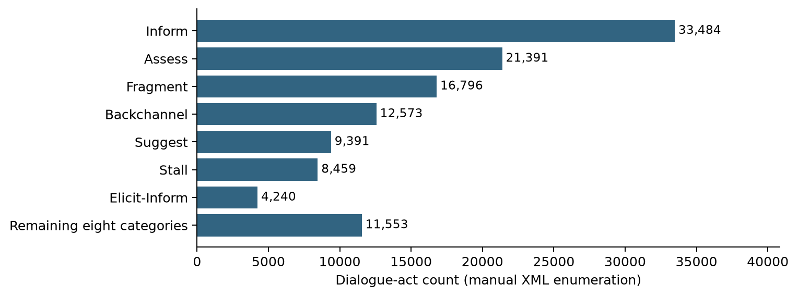
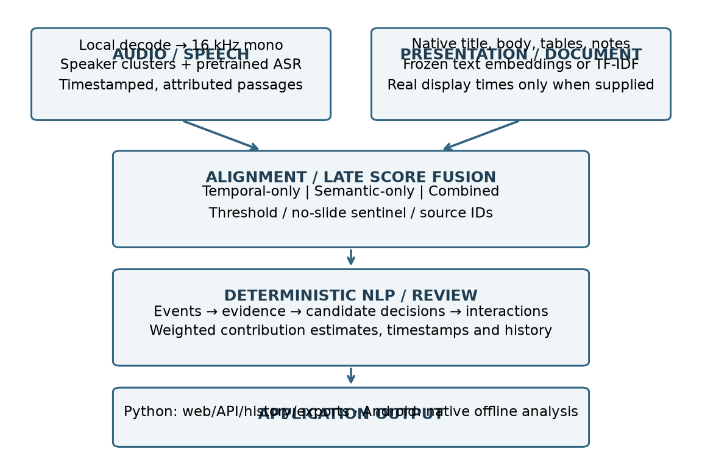
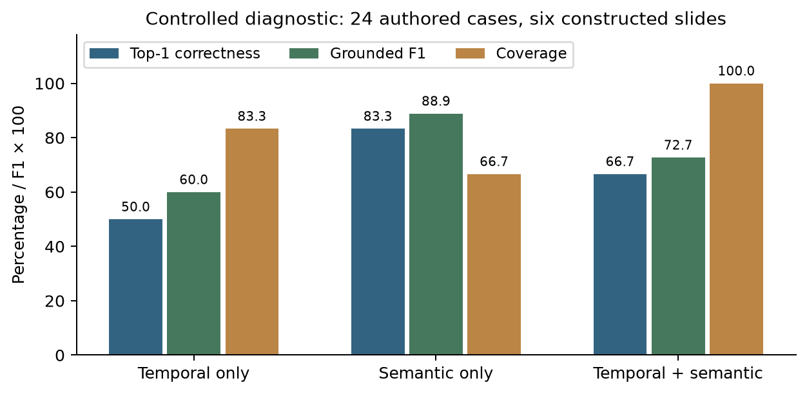
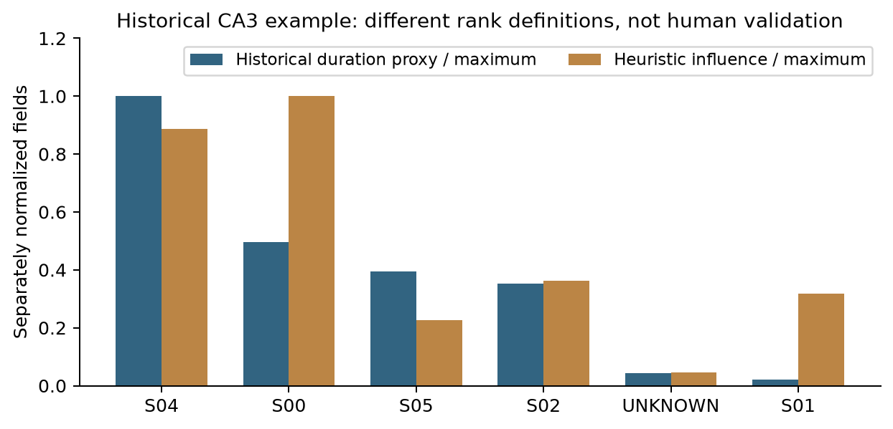
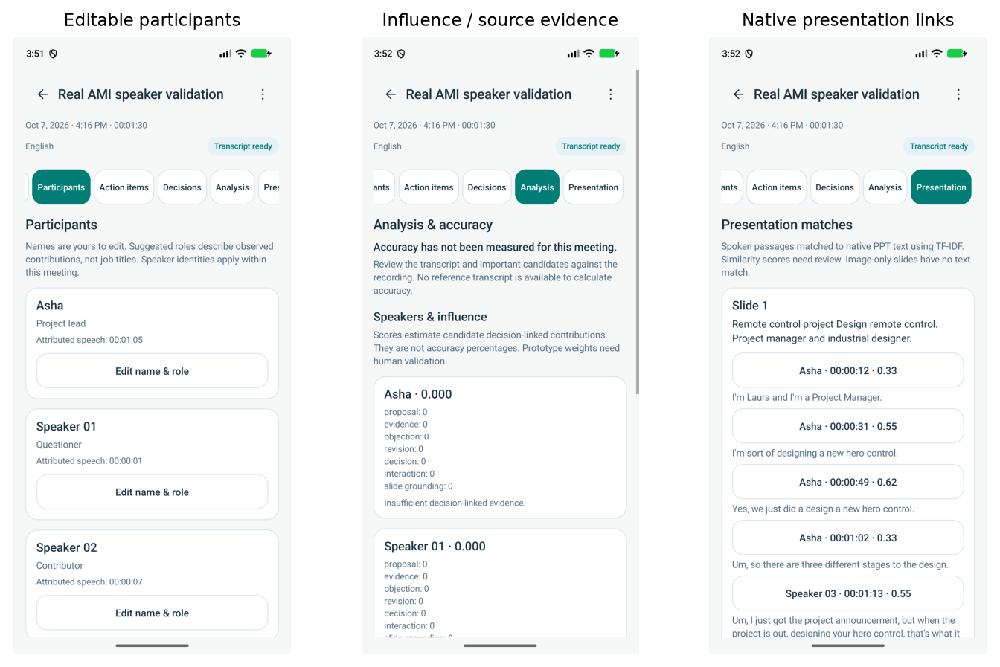
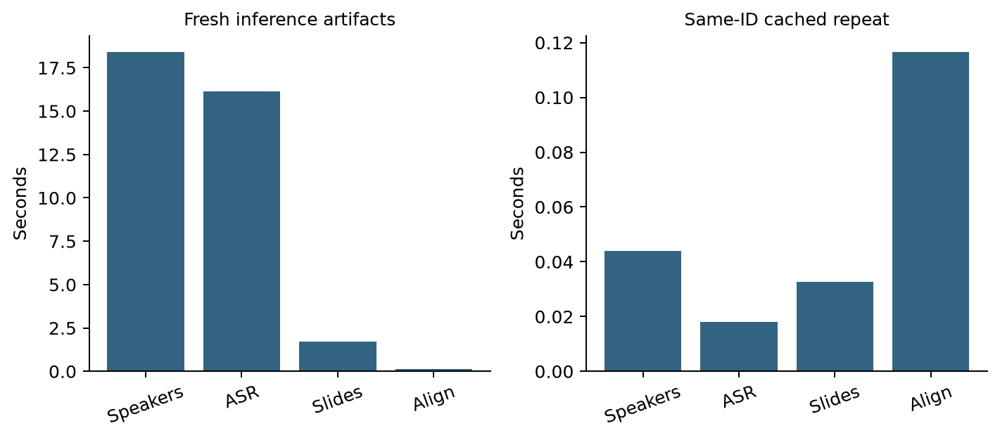

# Group 12 — Multimodal AI Final Project Report

**Continuous Assessment 4 · Consolidated project report (CA1–CA4)**

| Name | PRN |
| --- | --- |
| Anushka Chatterjee | 23070126015 |
| Amitkumar Racha | 24070126501 |
| Sahil Awatramani | 23070126112 |
| Shriyans Sahoo | 23070126125 |

**Project:** Offline Multimodal Meeting Intelligence for Decision and Participant Influence Analysis  
**Application:** InfluenceIQ / Meet IQ  
**Programme:** Bachelor of Technology in Artificial Intelligence & Machine Learning  
**Course:** Multimodal Artificial Intelligence  
**Institute:** Symbiosis Institute of Technology, Pune, Symbiosis International (Deemed University)  
**Department:** Artificial Intelligence & Machine Learning  
**Guide:** Dr. Nivedita Mishra  
**Academic year:** 2026–2027  
**Report date:** 10 October 2026

This report consolidates the problem definition and literature review from Report 1, resources/dataset/EDA from Report 2, first implementation results from CA3, and the final implementation, experiments and fusion comparison for CA4. It is one group report. Earlier submitted PDFs remain unchanged as supporting records.

## Abstract

InfluenceIQ is an offline meeting-analysis prototype that connects speaker-attributed discussion to presentation content and exposes candidate actions, decisions and participant contributions with source references. The project combines pretrained speech recognition, speaker diarization, native PPT extraction and deterministic NLP analysis. The laptop implementation uses faster-whisper, local sherpa-onnx speaker models, React, FastAPI and SQLite; the Android implementation uses whisper.cpp, packaged speaker models and native Java analysis. Generative meeting notes and question answering are excluded from the final analytical workflow.

The final assessment compares three project alignment configurations: temporal-only, semantic-only and combined temporal–semantic alignment. A reproducible diagnostic uses 24 author-designed cases and six constructed slides, with the pretrained sentence encoder frozen. Exact top-1 correctness was 12/24 (50.00%), 20/24 (83.33%) and 16/24 (66.67%), respectively. These results describe the controlled fixture, not real-meeting alignment accuracy. On a separate saved real recording with 1,008 transcript passages and 34 untimed slides, semantic and combined methods both linked 39 passages; independent relevance labels were unavailable. This demonstrates the implemented missing-timing fallback rather than a measured accuracy improvement.

Existing annotated English AMI experiments provide separately scoped speech results: laptop small-model WER 42.30% on a ten-minute window; Android base-model WER 37.74% and native speaker DER 13.48% on a different 90-second window. The windows, models and execution paths differ, so these are not a direct platform comparison. The project delivers a usable local workflow and inspectable analysis, while natural Hindi/Hinglish accuracy, genuine timed-slide evaluation, human influence agreement and physical-phone validation remain research work.

**Keywords:** multimodal meeting intelligence; offline inference; speaker diarization; transcript–slide alignment; temporal fusion; semantic fusion; decision lineage; participant influence; extractive NLP.

## 1. Assessment coverage and evidence policy

The final-assessment instruction asks for results for the fusion techniques employed, a comparison of all three techniques, and a single report carrying the group number, member names and PRNs. Those details appear on the first page. The cumulative coverage is:

| Assessment / source | Contribution incorporated in this report |
| --- | --- |
| Report 1, 29 pages | Problem, motivation, objectives, literature themes, planned architecture and evaluation |
| Report 2, 11 pages | Resource allocation, risks, AMI dataset, selected modalities and EDA |
| CA3, 10 pages | First pipeline output, decision/action examples and influence-versus-participation observations |
| Individual literature review, 24 pages | Speech robustness, overlapping speech, speaker attribution and research protocol |
| CA4 / current repository | Final delivered application, actual fusion implementation, reproducible comparisons, measured speech/performance results and limitations |

The fusion comparison follows the project’s implemented audio–presentation alignment: **temporal alignment, semantic alignment and their combined temporal–semantic scoring**. The final assessment isolates the first two as temporal-only and semantic-only baselines and compares them with the combined aligner. Section 6 maps each technique to the actual code and explains how it connects the two input modalities. Early/intermediate/late terminology is background; it is not a claim that three separately trained neural architectures were built.

Results are classified as: **annotated real-data measurements**, **controlled diagnostic results**, **unlabelled real-data outputs**, **historical application outputs**, and **engineering checks**. A count of extracted decisions, a model score or a passing software test is not an accuracy measurement. Accuracy needs a suitable reference annotation. All new fixture labels are explicitly author-designed; no independent human evaluation or training is asserted.

## 2. Introduction, problem and objectives

Meetings contain both spoken deliberation and documents that provide context, alternatives and evidence. A transcript preserves words but does not automatically explain which proposal was revised, which objection was addressed, which slide was relevant or whose contribution influenced a candidate decision. Manual review becomes costly for long recordings and multiple presentations.

The project addresses an engineering and research question: **can locally processed audio and presentation content be connected to an inspectable chain of discussion events and participant-contribution estimates?** It uses speaking participation as a descriptive baseline while modelling decision-linked evidence and interactions separately. A score is an analytical estimate, not proof of causal influence or organizational authority.

The objectives, carried forward from Report 1, are:

1. Accept meeting recordings and produce timestamped, speaker-attributed transcripts.
2. Extract slide titles, body text, tables and notes from presentations.
3. Align discussion passages with slides using content and, where available, display-time information.
4. Extract candidate proposals, objections, evidence, revisions, agreements, decisions and actions.
5. Preserve source paths through evidence relations, candidate decision lineage and participant interactions.
6. Compare alignment configurations and report their measured behavior and failure cases.
7. Deliver local review interfaces with editable speaker names/roles, playback, exports and persistent history.

The project prioritizes local processing and reviewability. Inference can work without connectivity after model provisioning. Optional remote workstation processing is a separate deployment mode requiring access to that server; it does not make remote processing offline from the client’s perspective.

## 3. Literature review and research positioning

The previous submissions reviewed speech enhancement, multi-talker recognition, diarization, multimodal alignment and meeting roles/influence. They motivate a modular pipeline in which errors and timestamps remain visible across stages. The final report retains that foundation without implying that every reviewed model has been implemented.

| Literature theme | Relevance to InfluenceIQ | Final implementation boundary |
| --- | --- | --- |
| Speech enhancement / separation | Noise, reverberation and overlapping speech affect perception | No newly trained separation or enhancement network is deployed |
| Speaker diarization / attributed ASR | Links words to speaker-time intervals | Pretrained local inference and overlap-based attribution are implemented |
| Multimodal representation / fusion | Distinguishes feature, learned-representation and decision fusion | Current slide matching combines separate content/time scores [2] |
| Sentence embeddings | Supports paraphrase-sensitive text relevance | Frozen all-MiniLM-L6-v2 is used for Python semantic matching [3], [6] |
| Speech/video-to-slide alignment | Shows the value of document and visual evidence | Native slide text is implemented; visual encoders/OCR are not [4] |
| Participant roles / dominance | Participation and decision contribution are different constructs | Heuristic contribution scoring exists; human agreement remains unmeasured |

MaViLS is relevant prior work on speech, OCR and visual features for video-to-slide alignment [4]. Its published benchmark numbers are not results of this project. The supplied individual review discusses low-latency and overlap approaches, but they remain enabling literature rather than automatically implemented features.

The project’s contribution is an **offline integration with source-linked decision and contribution analysis**, not the invention of Whisper, sentence embeddings or diarization. Evidence paths can help users review estimates, but extractive output is not guaranteed correct: ASR errors, speaker confusion, keyword false positives and incorrect slide grounding can propagate. A claim of research superiority would require matched labelled meetings and independently assessed influence; that experiment has not been completed.

## 4. Dataset, modalities and corrected EDA

### 4.1 Dataset and selected modalities

The AMI Meeting Corpus provides approximately 100 hours of synchronized meeting recordings, including scenario-based design-team meetings and natural meetings, with transcripts and other annotations [1]. This project uses meeting audio and extracted presentation/document content. Video exists in the corpus but is not part of the deployed fusion pipeline.

Audio supplies what was said, when and by which inferred speaker. Presentation text supplies topic, alternatives, quantities and document context. Acoustic audio reaches the fusion stage through ASR text/timestamps; the slide branch uses extracted text, tables and notes. Images are not converted to learned visual representations. The system therefore performs **audio-derived text to document-text alignment**, not an end-to-end acoustic–image network.

A local inventory on 10 October found 2,039 AMI WAV files occupying approximately 138.03 GB (128.55 GiB), 171 WAV inputs under `data/raw/audio/`, and 987 PPTX files under `data/raw/ppt/`. These are file counts, including channels/document variants; they are not counts of independent labelled meetings or complete paired experiments. The local storage total need not equal the earlier estimate of more than 80 GB because acquisition coverage and channels differ.

### 4.2 Dialogue-act counts

A new XML enumeration of `ami_public_manual_1.6.2/dialogueActs/*.dialog-act.xml` used 556 files and the corpus’s `ontologies/da-types.xml` labels. It counted **117,887 dialogue acts**:

| Ontology category | Count | Share |
| --- | ---: | ---: |
| Inform | 33,484 | 28.40% |
| Assess | 21,391 | 18.15% |
| Fragment | 16,796 | 14.25% |
| Backchannel | 12,573 | 10.67% |
| Suggest | 9,391 | 7.97% |
| Stall | 8,459 | 7.18% |
| Elicit-Inform | 4,240 | 3.60% |
| Comment-About-Understanding | 2,367 | 2.01% |
| Elicit-Assessment | 2,265 | 1.92% |
| Be-Positive | 2,210 | 1.87% |
| Other | 2,204 | 1.87% |
| Offer | 1,530 | 1.30% |
| Elicit-Offer-Or-Suggestion | 686 | 0.58% |
| Elicit-Comment-Understanding | 193 | 0.16% |
| Be-Negative | 98 | 0.08% |
| **Total** | **117,887** | **100% before rounding** |



*Figure 1. Re-enumerated local manual dialogue acts. Small categories are grouped only in this chart; the table preserves all ontology labels.*

Report 2’s total of 116,357 is 1,530 lower, exactly the Offer count. Its Backchannel value of 21,910 also pools several other categories rather than representing the literal Backchannel label, while 686 corresponds to Elicit-Offer-Or-Suggestion. The final table uses the ontology directly and supersedes that earlier grouped summary. Dialogue-act counts describe the corpus; they are not event-extraction performance or influence labels.

### 4.3 Preprocessing implications

Variable sample rates/channels require normalization to 16 kHz mono PCM. Noisy or overlapping speech requires cautious speaker attribution; an ambiguous speaker can remain `UNKNOWN`. Legacy `.ppt` files require conversion to `.pptx` before native text extraction. Different recording lengths require per-meeting processing and recoverable chunks. A PPT file alone does not establish slide-display timestamps. Topic relevance and display time must be distinguished, especially when a speaker refers to an earlier slide.

## 5. Final architecture and implementation



*Figure 2. Final processing architecture. The speech branch uses pretrained inference; the document branch extracts native text. Source-linked NLP follows alignment. The Android implementation is lighter than the Python evidence-graph workflow.*

### 5.1 Laptop workflow

| Stage | Implemented behavior / source area |
| --- | --- |
| Input and decoding | Browser recording/uploads; FFmpeg conversion to normalized WAV; `src/audio/` |
| Speaker analysis | sherpa-onnx segmentation, embedding and clustering; pyannote remains an optional alternative |
| Transcription | faster-whisper multilingual small by default, CPU/int8, four threads, 120-second central chunks with overlap |
| Attribution | Temporal matching between ASR words/passages and speaker intervals; ambiguous assignments can abstain |
| Document extraction | python-pptx titles/body/tables/notes; `src/ppt/` |
| Alignment | Temporal overlap plus semantic embeddings or optional TF-IDF; `src/fusion/` |
| NLP and decisions | Rule-based events, evidence relations, candidate decision reconstruction and interaction analysis |
| Influence | Configurable seven-feature weighted estimates with supporting event/decision references |
| Presentation | React interface, FastAPI single-worker queue, SQLite ownership/history and structured exports |

Stage artifacts are stored under `data/processed/`; report and evaluation artifacts are under `outputs/`. The queue serializes heavy meeting jobs. Resume state and transcription chunks permit recovery after interruption; changed inputs/settings invalidate relevant caches. Speaker failure in automatic mode produces a warning and `UNKNOWN` transcription rather than invented identities. Required-speaker mode fails when separation is unavailable.

### 5.2 NLP, lineage and influence

Keyword and bounded contextual rules identify candidate events in English/Hindi/Hinglish text. Evidence relations connect related events and selected slides; candidate decisions group proposal/discussion/evidence/revision/agreement/final-event information. Roles such as proposer, objector and evidence provider describe detected contributions, not verified job titles.

The configured influence estimate is:

```text
I(p) = 0.15 P(p) + 0.20 E(p) + 0.15 O(p) + 0.20 R(p)
     + 0.15 D(p) + 0.05 X(p) + 0.10 G(p)
```

`P, E, O, R, D, X, G` are normalized proposal, evidence, objection, revision, decision, interaction and slide-grounded contribution features. Weights are prototype defaults, not trained or human-validated coefficients. Scores can be zero when no qualifying evidence is present. `UNKNOWN` is not treated as an identified person in current participant influence output.

Candidate action items remain source sentences rather than newly generated instructions. Named ownership, deadlines and decision status still require review. A source identifier verifies where an extraction came from; it does not prove the extraction’s meaning or factual correctness.

### 5.3 Simplified interface and persistence

The final interface emphasizes Record meeting, Upload audio, optional Upload PPT and optional vocabulary hints. Users review transcript, participants, actions, decisions, influence, events and presentation evidence. Speaker names/roles are editable and reflected in transcript/export views. History preserves meetings and edits. Settings hold the profile, automatic Hindi/English language selection and advanced controls.

The website accepts supported recordings and converts them locally; users are not required to pre-convert every input to 16 kHz/mono/16-bit PCM. Automatic language observations and Hindi-safe processing are implemented, but natural code-switching accuracy has not been measured. Generative notes/questions and cross-meeting word search were removed from the final product scope.

## 6. Fusion terminology, representation and formulas

### 6.1 What fusion is actually implemented

The original inputs are **meeting audio** and **presentation/document content**. The audio branch produces timestamped speaker-attributed text; the document branch produces extracted slide text and embeddings. Temporal and semantic scores connect these representations. They are two alignment signals, not additional independent input modalities.

| Implemented technique | Actual code | How it is used |
| --- | --- | --- |
| Temporal alignment | `src/fusion/temporal_alignment.py`: `compute_temporal_scores()` | Scores passage/display-interval overlap when genuine slide times are supplied |
| Semantic alignment | `src/fusion/semantic_alignment.py`: `compute_semantic_scores()` / `iter_semantic_scores()` | Matches audio-derived text to slide text using a shared frozen encoder and cosine similarity |
| Combined temporal–semantic alignment | `src/fusion/multimodal_representation.py`: `combine_scores()` / `align_segment()` / `run_alignment()` | Combines available scores, applies candidate filtering/thresholds and returns source-linked records |

The application normally uses the combined aligner; for an untimed PPT it correctly falls back to content similarity. The assessment runner isolates temporal-only and semantic-only to compare their contributions. These are three executable alignment configurations of the implemented components, not three separate trained models or three user-facing model-selection options.

The fused record preserves passage ID, speaker, start/end, transcript text, selected slide and time/content/combined scores. Event extraction carries the slide ID onward, evidence links refer to the slide/passage, and candidate decisions/influence retain supporting source IDs. This propagation is the project’s implemented multimodal integration beyond transcription.

Optional lexical fusion uses `src/fusion/lexical_alignment.py`: `TfidfIndex`. It replaces the content scorer in the Python path; native Android uses its own slide-text TF-IDF implementation. No visual encoder, OCR or acoustic–image attention is claimed.

### 6.2 Early, intermediate and late terminology

The fusion literature distinguishes the stage at which information is combined [2]. In this project, implementation status must accompany the taxonomy:

| Fusion family | Typical combination point | Status in this project |
| --- | --- | --- |
| Early / feature fusion | Combine modality features before a shared predictor | No separately trained early-fusion classifier/network is deployed |
| Intermediate / joint-representation fusion | Combine encoded representations inside a joint learned model | No joint acoustic–visual encoder or cross-attention model is deployed |
| Late / score or decision fusion | Combine independently computed outputs/scores | Implemented: content similarity and optional display-time overlap are combined |

A joined JSON record of speaker, text and slide ID is not by itself a trained early-fusion model. The temporal–semantic combination is a hybrid of two alignment signals, but is still **late score-level fusion** in this taxonomy. Calling it “hybrid” does not establish a learned intermediate architecture. No empirical early-versus-intermediate-versus-late neural ranking is claimed.

### 6.3 Content and time representations

The slide representation concatenates title, body text, table cells and notes. The Python embedding model is all-MiniLM-L6-v2, producing 384-dimensional text vectors [6]. The same frozen encoder processes transcript passages. Its output expresses relevance, not entailment, and has not been validated here for Hindi/English cross-language matching.

For passage `i = [a_i, b_i]` and displayed slide interval `j = [s_j, e_j]`:

```text
Overlap(i,j) = max(0, min(b_i,e_j) - max(a_i,s_j))
T(i,j)       = min(1, Overlap(i,j) / max(b_i-a_i, epsilon))
S(i,j)       = dot(u_i,v_j) / (norm(u_i) * norm(v_j))
C(i,j)       = (w_t*T(i,j) + w_s*S(i,j)) / (w_t+w_s)
```

`T` is unavailable when a slide has no valid start/end time. `S` is cosine similarity and can be negative; it is not a probability. Empty text uses a zero vector. Defaults are `w_t = w_s = 0.5`, top-k = 3 and selection threshold 0.3. With missing timing, the deployed combined path falls back to content similarity. With timed overlapping slides, the current candidate filter can exclude offscreen slides before scoring. Low-score results are marked `NO_CONFIDENT_SLIDE`.

### 6.4 Three configurations compared

| Configuration | Information used | Main advantage | Main limitation |
| --- | --- | --- | --- |
| Temporal-only | Display overlap, no content score | Resolves context-dependent speech when the active slide is known | No basis for untimed decks; can link unrelated speech to the active slide |
| Semantic-only | Passage–slide embedding similarity; timing/filter removed | Supports paraphrases, untimed slides and offscreen references | Generic speech can lack a clear semantic match |
| Temporal–semantic hybrid | Current timed candidate filter and weighted time/content score | Combines contextual display evidence with content matching | Hard timing filter can suppress valid offscreen matches; time can overwhelm abstention |

The semantic-only experiment removes the timing filter completely. Merely setting the temporal weight to zero while retaining that filter would still use time and would not be a clean semantic-only baseline. Temporal-only uses zero content scores and abstains for untimed inputs.

A fourth, optional deployment scorer is TF-IDF lexical similarity. It replaces the semantic content score; it is not ensembled with embeddings in the current pipeline. Android uses native-text TF-IDF. TF-IDF is a useful lightweight alternative but its accuracy is not measured by the three embedding/time experiments in this report.

## 7. Experimental design and metrics

### 7.1 Controlled diagnostic

The final assessment runs 24 constructed transcript cases against six constructed slides. The slides cover budget, performance, schedule, offline deployment, risks and participant responsibilities. Six groups contain four cases each: exact content, paraphrases, offscreen references, missing timestamps, context-dependent statements and unrelated/blank speech.

Expected relevant slide IDs or a no-slide label are specified in the authored fixture. Cases with times use a 5–10 second passage, a designated displayed slide from 0–30 seconds and other slides from 40–70 seconds. Untimed cases supply no slide times. All methods use the same cases, slide vectors and threshold 0.3, with a frozen encoder and four CPU threads. No weights are fitted to these cases and there is no train/validation/test split. This is an illustrative regression/behavior experiment, **not an independently annotated meeting benchmark**.

The target is relevant slide content, which can differ from the displayed slide during an offscreen reference. Ground-truth author intent is known by construction. This makes the timed filter’s limitations visible but does not estimate their frequency in real meetings.

### 7.2 Metric definitions

```text
Top-1 correctness = correctly selected slide/no-slide cases / all cases
Coverage           = selected non-sentinel cases / all cases
Grounded precision = correct slide links / all predicted slide links
Grounded recall    = correct slide links / all cases needing a slide
Grounded F1        = 2*precision*recall / (precision+recall)
WER                = (substitutions+deletions+insertions) / reference words
DER                = (missed speech+false alarm+speaker confusion)
                     / reference speaker-time, after label mapping
RTF                = processing time / audio duration
```

Coverage is not accuracy: linking every passage can create false positives. Exact no-slide matches contribute to top-1 correctness, while grounded precision/recall score actual slide links. CER/event/decision F1/influence correlation require different annotations and are not inferred from these metrics.

### 7.3 Real unlabelled comparison

The same three alignment configurations are rerun on the saved 2,560.569-second meeting `meeting_8e464f9471b34c46ad9f4ab3a547c923`: 1,008 transcript passages and 34 slides. This is a saved application recording and deck, not an independently labelled slide-relevance benchmark. None of its slides has valid display start/end times. Input hashes and counts are retained, but recording content and personal identities are not reproduced in this report.

The experiment reuses saved ASR/speaker outputs to isolate alignment. It measures coverage, selection agreement and selection-stage runtime. WER, DER and influence are not recalculated for this unlabelled recording. Model loading/encoding are reported separately from selection; timings are one local run and not a general performance ranking.

## 8. Results: comparison of all three alignment techniques

### 8.1 Controlled overall results

| Method | Correct / 24 | Top-1 | Grounded precision | Grounded recall | Grounded F1 | Coverage |
| --- | ---: | ---: | ---: | ---: | ---: | ---: |
| Temporal-only | 12 | 50.00% | 60.00% | 60.00% | 0.6000 | 83.33% |
| Semantic-only | 20 | 83.33% | 100.00% | 80.00% | 0.8889 | 66.67% |
| Temporal–semantic hybrid | 16 | 66.67% | 66.67% | 80.00% | 0.7273 | 100.00% |



*Figure 3. Results on 24 author-designed cases. These are controlled diagnostic scores, not AMI slide-alignment accuracy or evidence of a statistically generalizable winner.*

Semantic-only performed best on the chosen diagnostic cases. Its lower coverage reflects appropriate abstention on unrelated/blank speech and failure on generic context-dependent statements. The combined method recovered generic timed statements, but selected incorrect active slides during offscreen references and failed to abstain on unrelated speech. Temporal-only was unable to handle untimed slides or distinguish relevant from unrelated speech within a display interval.

### 8.2 Results by case type

| Case type, four cases each | Temporal-only | Semantic-only | Hybrid |
| --- | ---: | ---: | ---: |
| Exact content | 4/4 | 4/4 | 4/4 |
| Paraphrases | 4/4 | 4/4 | 4/4 |
| Offscreen references | 0/4 | 4/4 | 0/4 |
| Missing slide times | 0/4 | 4/4 | 4/4 |
| Context-dependent statements | 4/4 | 0/4 | 4/4 |
| Unrelated/blank speech | 0/4 | 4/4 | 0/4 |

Model loading took 1.4648 seconds and shared slide/passage encoding took 0.2559 seconds for the controlled fixture. Those costs are distinct from selection time; temporal-only can operate without a text encoder.

No statistical confidence interval or significance claim is reported for this small constructed fixture. Its purpose is to demonstrate the three executable strategies and reveal concrete behaviors, including failures. The per-case inputs, intended labels and outputs are included with the report assets for inspection.

### 8.3 Real unlabelled results

| Method | Linked / 1,008 passages | Coverage | Selection-stage time | Alignment accuracy/F1 |
| --- | ---: | ---: | ---: | --- |
| Temporal-only | 0 | 0.00% | 0.0321 s | Unavailable |
| Semantic-only | 39 | 3.87% | 0.0442 s | Unavailable |
| Temporal–semantic hybrid | 39 | 3.87% | 0.0360 s | Unavailable |

Shared passage encoding took 4.6531 seconds in this run; the table times cover selection only and exclude that encoding and model loading.

Semantic/hybrid selected the same result for **100% of passages** because all slides lacked display times. That equality validates the fallback; it is not a benefit from temporal fusion. Low 3.87% coverage needs investigation against independently labelled relevance: it can reflect deck/recording mismatch, threshold/model behavior or largely unrelated discussion. Without labels, it cannot be interpreted as 3.87% accuracy or 96.13% failure.

### 8.4 What the comparison supports

Content information is necessary for untimed slides and offscreen references. Display context can help generic statements but can also generate false links. The current combined scheme is not universally better. Future experiments should test a semantic relevance gate before using time to boost scores, and retain offscreen candidates when appropriate. These are proposed changes, not deployed or benchmarked improvements. Real timed, paired recordings and independently checked slide labels are required before selecting a generally best configuration.

## 9. Speech-recognition and speaker results

### 9.1 Laptop English AMI measurements

Existing experiments use AMI ES2002a Array1-01, source window 30–630 seconds, duration 600 seconds, with manual AMI word annotations and normalized full-transcript WER. The window includes some pre-meeting material not fully represented in the reference. Different runs/settings/cache states mean timings are descriptive rather than controlled speed comparisons.

| Saved experiment | WER | Elapsed | Peak RSS | Scope / difference |
| --- | ---: | ---: | ---: | --- |
| Initial small | 45.84% | 174.973 s | 890.1 MiB | Historical small-model run |
| Initial medium | 66.76% | 329.049 s | 3,008.0 MiB | Earlier poorer medium result retained |
| Medium, language scope adjusted | 40.83% | 357.776 s | 2,309.2 MiB | Changed run/settings; not cherry-picked as an identical comparison |
| Small, 300-second chunks | 45.84% | 82.254 s | 1,516.7 MiB | Throughput profile |
| Small, 120-second chunks | 41.49% | 115.043 s | 1,479.7 MiB | Different chunk profile |
| Later small, 120-second chunks | 42.30% | 105.945 s | 1,057.2 MiB | Later saved website-scope benchmark |

The 120-second profile was slower than 300 seconds in the recorded pair but had lower WER. The latest small result is slightly worse than the earlier 120-second WER. No monotonic accuracy improvement is claimed. These runs used unavailable/disabled speaker separation, so they do not measure complete diarized-transcript quality. WER is an error rate, not a generic application “accuracy” or an influence score.

### 9.2 Android English AMI measurements

The Android annotated experiment uses the different ES2002a Array1-01 window 60–150 seconds, 90 seconds total, a multilingual base GGML model and known count four. The normalized audio was verified against the source. Manual AMI transcripts and speaker intervals provide the references.

| Measure | Saved result |
| --- | ---: |
| Reference words | 265 |
| Substitutions / deletions / insertions | 56 / 37 / 7 |
| WER | 37.74% |
| Native speaker-turn DER | 13.48% |
| Delivered passage-attribution DER | 13.98% |
| DER collar | 0.25 s |
| Cluster-label mapping / overlap | Optimal mapping; overlap included |

These are emulator-path results, not physical-phone performance. The native speaker test produced four clusters and 12 turns. The Android application test produced 33 attributed transcript passages, six event candidates and no decision candidates; all four participant influence scores were zero. It used three artificial slides, with eight selected links, solely to verify integration. Synthetic-slide counts do not constitute alignment accuracy.

The laptop and Android results use different windows, models and pipelines. Neither platform is declared more accurate on that basis. Natural Hindi/Hinglish, owner/deadline extraction, decision quality and influence agreement remain unmeasured.

## 10. Historical CA3 outputs and error analysis

The representative CA3 record `meeting_288ab746` remains available. It demonstrates the earlier analytical output, not a independently scored benchmark:

| Historical output field | Value |
| --- | --- |
| Meeting duration | 2,133.02 s / 00:35:33 |
| Reported participant rows | 6: five speaker IDs and one UNKNOWN row |
| Slides | 8 |
| Extracted events | 162 |
| Decision candidates marked confirmed | 1 |
| Action candidates | 3 |
| Participant interactions | 17 |

`UNKNOWN` does not mean a sixth identified person. The current implementation excludes unknown identity from identified participant influence. The candidate “Either whatever we decide the default to be” is labelled confirmed by rules, but the sentence fragment alone is insufficient to independently establish a final meeting decision. Candidate status must be checked with its surrounding source events.

### 10.1 Participation and influence fields

| Speaker | Historical duration field | Duration rank | Influence estimate | Influence rank |
| --- | ---: | ---: | ---: | ---: |
| SPEAKER_04 | 141.8 s | 1 | 0.3250 | 2 |
| SPEAKER_00 | 70.2 s | 2 | 0.3667 | 1 |
| SPEAKER_05 | 56.0 s | 3 | 0.0833 | 5 |
| SPEAKER_02 | 50.0 s | 4 | 0.1333 | 3 |
| UNKNOWN | 6.0 s | 5 | 0.0167 | 6 |
| SPEAKER_01 | 3.0 s | 6 | 0.1167 | 4 |



*Figure 4. Historical CA3 fields normalized separately for display. The duration field can reflect the older event-duration proxy, not verified total speaking time. UNKNOWN is a historical unresolved row. Different ranks demonstrate different scoring definitions, not proven human influence.*

The difference between duration rank and influence rank illustrates how the heuristic uses decision-linked features. It does not establish agreement with human judgement. The earlier statement that one participant’s short contribution proved more influence than another’s long contribution should therefore be interpreted as a model-output observation.

### 10.2 Action-item examples

| Earlier candidate text | Interpretation in the final assessment |
| --- | --- |
| “I’m just going to hopefully add something by next week…” | Plausible task candidate; owner/commitment/deadline still require review |
| “I’m not afraid to take that.” | Not enough evidence by itself to establish a task |
| “Like take care of yourself.” | Conversational phrase; illustrates a keyword false-positive risk |

Extracting an exact ASR sentence does not make its category correct. Final wording replaces earlier “100% traceable/non-hallucinating/production-grade” claims with **source-referenced output requiring review**. No custom Whisper pretraining on AMI took place; all speech/speaker/embedding models were used as pretrained inference components.

## 11. Android, offline execution and optional workstation deployment

The native Android 0.6 prototype is implemented in **Java with C++ inference integration**, rather than the Kotlin wording in CA3. It records 16 kHz mono PCM, accepts supported audio via local platform codecs, imports the speech model, performs speaker analysis, lets users edit speaker names/roles, and extracts candidate NLP/decision/influence results. Native PPT text is indexed with TF-IDF. History, playback, exports and resume checkpoints stay in app-private storage.



*Figure 5. Existing emulator validation screens for transcript/participants, influence and presentation references. Displayed results are examples, not an independent accuracy evaluation.*

The app has no INTERNET permission for its native workflow. Model setup and distribution need a provisioned GGML model; speaker weights are packaged. Recording supports up to six hours, but native speaker analysis has a separate one-hour limit. These limits must not be conflated. Pause waits for the current native stage/chunk to finish rather than interrupting inference instantaneously. ARM64 physical-phone battery/thermal/vendor-codec and long-meeting performance are not yet validated.

The Python pipeline can be served on a workstation through the prepared launcher and HTTPS reverse-proxy examples. GPU use requires a compatible CUDA/cuDNN/CTranslate2 environment; an environment variable alone does not install it. Android’s optional cloud entry opens a browser site with separate server history; native upload/history synchronization is not implemented. No live public hosting or measured cloud-speed result is reported.

Local processing is useful for confidential institutional/project meetings, poor connectivity, classroom project discussions and controlled research review. Server processing can help users with limited local compute but introduces network, deployment and access-management requirements. Such suitability is an intended use, not evidence of production certification.

## 12. Processing efficiency and reliability

### 12.1 Avoided work

The final engineering update shares one cached configured Whisper model in the single worker, shares one sentence-embedding model between slides and passages, batches passage encoding in groups of 32, and normalizes slide vectors once. It also skips rebuilding an unchanged website at startup and records stage timings. Models, beam settings, chunk profile and clustering threshold were not changed by those performance fixes.

A saved warm-model benchmark of 256 real passages and 34 slides measured scalar semantic scoring at **1.6661 seconds** and batched scoring at **1.1672 seconds**, a **1.4274×** stage speedup. All semantic-only selections agreed; rounded scores differed by at most approximately 1.01e-6. This is one local scoring run, not an end-to-end speedup or an alignment-accuracy result.

### 12.2 Fresh input and cached repeat

A real 90-second AMI integration with four expected speakers and an artificial three-slide PPT produced four participants and 20 Python transcript passages. Its recorded stages were:

| Stage | Fresh inference caches | Same-ID cached repeat |
| --- | ---: | ---: |
| Preprocessing | 0.0496 s | 0.0553 s |
| Speaker analysis | 18.4100 s | 0.0441 s |
| Transcription | 16.1251 s | 0.0180 s |
| Slide extraction / embeddings | 1.7024 s | 0.0327 s |
| Alignment | 0.1282 s | 0.1166 s |
| Remaining NLP / report stages | Approximately 0.043 s | Approximately 0.043 s |
| Recorded processing elapsed | **36.4631 s** | **0.3138 s** |



*Figure 6. Recorded processing stages for a fresh-ID run and its cached repeat. The second run reuses outputs; it does not transcribe 90 seconds of new audio in 0.31 seconds.*

Times exclude module imports, upload/decode, queue wait and final JSON/checkpoint writes. The environment/model files were already provisioned; “fresh” means inference artifacts for that meeting ID were fresh. No matched complete-pipeline before/after benchmark was collected for the optimization.

Separate 90-second speaker threading tests measured 20.4257 seconds at four threads, 35.2162 at one and 26.6317 at two, with the same DER 13.48%. Four remains the default. The cases ran in that order on one file, so this is a local setting check rather than a universal CPU recommendation.

### 12.3 Historical slowdown diagnosis

Saved comparable-duration 42.7-minute jobs differed in scope: the earlier job lacked successful speaker separation and PPT fusion; the later job performed both. Historical stage timings were absent, so their exact slowdown is not recoverable. New diagnostics distinguish stages, cached chunks and worker progress. Queue wait, fresh model setup, inference and cached reconstruction must be reported separately. Folder cleanup reclaims storage and reduces accidental scanning; it does not accelerate neural inference inherently.

## 13. Training, baselines and evaluation status

Pretrained perception models do not require retraining to run the app. The project did not train Whisper, diarization weights or MiniLM on AMI. A CPU training CLI exists to fit nonnegative influence-feature weights from human ratings with disjoint meeting-level train/validation/test splits, and exports a research artifact. No real labelled training run or deployment of trained influence weights has been completed.

The evaluation library contains speaking-time/event-count/evidence/transcript-only/multimodal baselines and influence weight-sensitivity experiments. Some inherited baseline implementations use extracted-event durations, while the current main influence runner can use full transcript coverage. Their definitions must be harmonized before publication.

Inherited ablation labels such as “without temporal” or “without semantic” change influence-feature weights rather than rerunning actual upstream fusion. They must not be used as the three fusion comparisons. The CA4 alignment script instead directly reruns the temporal-only, genuinely unfiltered semantic-only and current combined strategies on identical inputs.

The corrected research runner now loads full transcript, diarization and alignment artifacts; resolves decision times from source events; records missing prediction artifacts as errors when references exist; and writes meeting-specific comparison CSVs. Missing human annotations remain explicitly unavailable. Existing matching primitives are coarse for some event/decision cases and do not establish independent human influence agreement.

| Evaluation target | Evidence currently available |
| --- | --- |
| English ASR | Scoped annotated AMI WER experiments |
| Speaker attribution | Scoped 90-second AMI DER experiment |
| Three alignment configurations | Controlled fixture correctness/F1; real unlabelled coverage |
| Natural timed-slide alignment | Not independently evaluated |
| Event / decision semantic quality | Candidate outputs and regression checks; no human-scored dataset result |
| Influence ranking agreement | No independent human ranking study |
| Natural Hindi/Hinglish | Language/rule implementation; no measured end-to-end accuracy |
| Physical-phone / cloud performance | No corresponding real-device/deployed benchmark |

An adequate next study would annotate genuine paired audio/decks/display times, use at least two raters for event/decision/influence judgement, report agreement, keep meetings/participants or design series disjoint across tuning/test, and evaluate all methods on the same inputs/hardware. Counterfactual causality should not be inferred from heuristic weights.

## 14. Software validation, resources and risk management

The project runs in an isolated Python 3.11.17 environment with CPU PyTorch 2.5.1, faster-whisper 1.2.1, sherpa-onnx 1.13.8 and sentence-transformers 3.4.1. Direct dependency specifications and a lock snapshot are retained under `environment/`. Model/license notices and explicit provisioning scripts support reproducibility.

| Check | Evidence and interpretation |
| --- | --- |
| Python regression suite | 507 tests passed; seven existing upstream deprecation warnings. Rechecked for final report preparation. |
| Three-way comparison script | Executed local models and existing aligner; self-checks validate case IDs, blank vectors and missing-time fallback |
| Website | Existing lint/build and browser checks at widths 360/390/960, with speaker edits/history/evidence/export workflows |
| API startup | Actual relocated launcher/API health checked with isolated state; server stopped after validation |
| Android | Existing JVM, build and emulator validation; not a physical-phone certification |
| Preservation | Older archive hashes, submitted-report content and existing account/history rows verified during reorganization |

Software tests establish implementation behavior. They are not statistical research accuracy. Browser fixture responses are intercepted and do not evaluate recognition.

| Risk carried forward from Report 2 | Implemented mitigation | Remaining boundary |
| --- | --- | --- |
| Computation / long files | CPU int8, recoverable ASR chunks, one worker, cached artifacts | Speaker clustering reads whole audio; native speaker limit differs from recording limit |
| Speech noise / overlap | VAD/diarization and conservative attribution | Incorrect text/speaker labels still propagate |
| Format compatibility | Local audio decoding and legacy PPT conversion tools | Scanned/visual-only slides are not semantically understood |
| Cross-modal mismatch | Separate time/content scores, thresholded matches | Hard timing filter and false slide links need evaluation |
| Misinterpreted analysis | Source references, review warnings and editable speaker metadata | Candidate roles/influence/status remain heuristic |
| Connectivity | Provisioned local inference and native offline app | Optional server requires connectivity and deployment preparation |
| Data persistence | Private ownership checks, history, resume state and backups | Release/backup/access policy must be defined for a real deployment |
| Research validity | Scoped metrics, input hashes, explicit unavailable labels | Independent meeting-level semantic/influence evaluation is missing |

## 15. Project evolution and cumulative deliverables

| Phase | Original aim | Final delivered status |
| --- | --- | --- |
| CA1 | Literature, problem, architecture and evaluation plan | Problem and modular design retained; implementation scope clarified |
| CA2 | AMI, modalities, resources, risks and EDA | Inputs/provisioning established; current dialogue-act counts corrected |
| CA3 | First decisions/actions/influence output | Historical artifacts retained and independently inspected for false-positive risks |
| Laptop integration | Usable local application | Recording/upload, private history, editable speaker labels/roles, NLP views and exports |
| Speaker / native extension | Real participant analysis and PPT support | Local speaker backend and Android speakers/influence/native-text fusion |
| Reliability / structure | Recoverable and understandable project | Organized folders, categorized handbook, corrected evaluator, batching and stage timings |
| CA4 | Results and three-technique comparison | Authored-case experiment and real unlabelled coverage, plus scoped speech/performance evidence |

The older supplied source already contained temporal/semantic alignment, event/evidence rules, candidate decision lineage and weighted influence. These modules are not all new contributions of the laptop migration. The older snapshot lacked a complete live GPU-workstation environment, model weights and dataset, so exact parity cannot be independently established.

The initial source audit compared 147 first-party files (49 identical, 32 modified and 66 current-only), with 561 common report files identical. These are dated snapshot counts. Subsequent application/Android/reporting changes are described here. The redundant older working copy was removed only after verifying a 662-file source/report archive and confirming the old Git commit remained in current ancestry. Existing users/history and the original submitted report were retained.

The cumulative deliverables include the web/API prototype, native Android debug APK, local perception weights, source-linked NLP/report modules, comparison/evaluation/training tools, measured output artifacts, categorized developer/research documentation and this final group report. Debug APK availability is not a signed production/store release.

## 16. Limitations, future work and conclusion

### 16.1 Limits of the completed project

The prototype processes recordings, attributes speakers, extracts native slide text, compares alignment configurations and produces inspectable candidate meeting analysis. Its limits are concrete: no learned visual encoder/OCR; no early/intermediate trained fusion network; no natural code-switching benchmark; no independently scored genuine timed-slide dataset; no human-validated influence model; and no physical-phone/cloud deployment benchmark. Global clustering still loads an entire waveform. Keyword event/decision/action extraction can misclassify conversational fragments.

The controlled fixture is deliberately small and illustrative. Its best-performing method should not be promoted as a general winner. The real untimed deck cannot demonstrate temporal fusion accuracy. Single AMI windows do not establish cross-language or cross-meeting generalization. Historical event-duration participation fields cannot be treated as ground-truth airtime, and inferred decision status cannot be treated as a verified meeting outcome.

### 16.2 Prioritized next work

1. Collect genuine paired recordings/decks/display times and independent relevant-slide/no-slide labels.
2. Test a relevance gate and offscreen-candidate retention, then rerun the same held-out cases without tuning on test labels.
3. Add human-labelled natural Hindi/English/Hinglish meetings and report language-specific WER/CER/DER and semantic extraction metrics.
4. Annotate decision contributions with independent raters, use tie-aware ranking evaluation and fit weights only on disjoint training meetings.
5. Validate ARM64 phones for thermal/battery/codec/interruption and long-recording behavior.
6. Evaluate a provisioned workstation with network/queue/cold/warm latency separated, if remote deployment is selected.

### 16.3 Conclusion

The project progressed from an architecture and literature proposal to a working local meeting-analysis system with two application paths and reproducible evidence. Audio-derived transcripts and presentation text are linked by temporal/content scoring, then carried into structured event, decision and participant-contribution output. The final three-way comparison shows that each alignment signal has a distinct role: semantic matching handles content and untimed/offscreen slides, temporal matching resolves displayed context, and their present combination trades greater coverage for false-positive and filtering risks.

The main completed contribution is a source-linked offline integration and usable review workflow. The strongest current research finding is the measured behavior of the three alignment configurations under explicit inputs and limitations. General alignment superiority and valid human influence inference remain hypotheses requiring independently labelled real meetings. The final report records that boundary while preserving the full CA1–CA4 project history.

## References

[1] AMI Consortium, **AMI Meeting Corpus** and public annotation documentation. Official corpus source: https://groups.inf.ed.ac.uk/ami/corpus/ ; annotation release used locally: `ami_public_manual_1.6.2`. Accessed 10 October 2026.

[2] T. Baltrušaitis, C. Ahuja and L.-P. Morency, **Multimodal Machine Learning: A Survey and Taxonomy**, *IEEE Transactions on Pattern Analysis and Machine Intelligence*, 2019; author preprint arXiv:1705.09406. https://arxiv.org/abs/1705.09406 . Used for fusion terminology, not project result values.

[3] N. Reimers and I. Gurevych, **Sentence-BERT: Sentence Embeddings using Siamese BERT-Networks**, EMNLP-IJCNLP 2019, pp. 3982–3992. https://aclanthology.org/D19-1410/ . Used for sentence-representation background.

[4] K. Anderer, A. Reich and M. Wölfel, **MaViLS, a Benchmark Dataset for Video-to-Slide Alignment, Assessing Baseline Accuracy with a Multimodal Alignment Algorithm Leveraging Speech, OCR, and Visual Features**, INTERSPEECH 2024, pp. 1375–1379, DOI: 10.21437/Interspeech.2024-978. https://www.isca-archive.org/interspeech_2024/anderer24_interspeech.html . Prior work; its accuracy is not claimed for InfluenceIQ.

[5] SYSTRAN contributors, **faster-whisper: Whisper inference with CTranslate2**. https://github.com/SYSTRAN/faster-whisper . Project version 1.2.1; official inference/provisioning documentation.

[6] Sentence Transformers contributors, **all-MiniLM-L6-v2 model card** and encoding documentation. https://huggingface.co/sentence-transformers/all-MiniLM-L6-v2 ; https://sbert.net/docs/package_reference/sentence_transformer/model.html . Project library version 3.4.1.

[7] sherpa-onnx contributors, **Offline speaker diarization**. https://k2-fsa.github.io/sherpa/onnx/speaker-diarization/index.html . Project version 1.13.8; segmentation, embedding and clustering components.

[8] ggml-org contributors, **whisper.cpp**. https://github.com/ggml-org/whisper.cpp . Project native speech runtime 1.7.6; Android uses local GGML model inference.

[9] Group 12, **Offline Multimodal Meeting Intelligence for Decision and Participant Influence Analysis — Report 1**, original submitted PDF, 29 pages, AY 2026–27.

[10] Group 12, **Multimodal AI Report 2**, original submitted PDF, 11 pages; resources, risk, AMI/modalities and EDA.

[11] Group 12, **Multimodal AI Report CA3**, original submitted PDF, 10 pages; methodology and first application outputs.

[12] A. Racha, PRN 24070126501, **Literature Review — Offline Multimodal Meeting-Intelligence System**, original individual review PDF, 24 pages. Its proposals are distinguished from implemented components in this final report.

[13] Group 12 repository, **final evaluation artifacts and developer/research handbook**, local source/evaluation evidence enumerated in Appendix B; report snapshot 10 October 2026.

## Appendix A. Controlled case manifest

The fixture is fully inspectable in `final_report_assets/evidence/controlled_cases.json`. It contains six slide texts, 24 passage texts, intended relevant slide/no-slide labels, designated displayed slide IDs and a timing-availability flag. The texts are constructed examples, not extracts from private user recordings.

| Case IDs | Case family | Intended label policy |
| --- | --- | --- |
| 01–04 | Exact content | Same slide as passage content and displayed context |
| 05–08 | Paraphrase | Meaning matches a relevant slide; display agrees |
| 09–12 | Offscreen reference | Content refers to an earlier/different slide than the displayed one |
| 13–16 | Missing display times | Content label exists; no temporal evidence supplied |
| 17–20 | Context-dependent | Author intent targets the displayed slide; generic text is insufficient alone |
| 21–24 | Unrelated or blank | Correct output is `NO_CONFIDENT_SLIDE` |

Method outputs, counts, model/threshold settings and fixture hash are in `controlled_comparison.json` and the per-method alignment JSONs. A row in this manifest is not an independently human-annotated natural meeting. Dataset construction is part of the reproducible diagnostic definition.

## Appendix B. Result provenance and reproducibility

| Evidence artifact, project-relative | What it establishes |
| --- | --- |
| `outputs/evaluation/final_ca4/controlled_cases.json` | Constructed inputs and authored relevant-slide labels |
| `outputs/evaluation/final_ca4/controlled_comparison.json` | Three-method controlled metrics and per-group outputs |
| `outputs/evaluation/final_ca4/real_unlabelled_comparison.json` | Saved real-input hashes, coverage, timing availability and fallback agreement |
| `outputs/evaluation/final_ca4/eda_inventory.json` | Direct dialogue-act XML counts and local file inventory |
| `outputs/evaluation/benchmark_*_benchmark.json` | Historical annotated laptop ASR measurements and scope |
| `outputs/evaluation/android06_ami90_annotated.json` | Annotated Android-path WER/DER, source/report hashes and references |
| `outputs/evaluation/maintenance_alignment_batch.json` | Scalar/batched semantic-stage timing and score agreement |
| `outputs/evaluation/maintenance_pipeline_timing.json` | Fresh/cache processing stage durations |
| `outputs/reports/meeting_288ab746_report.json` | Historical CA3 output fields, not human-verified labels |
| `logs/final_report_20261010/python_tests.log` | Current regression run |
| `docs/README.md` | Master setup/developer/research index |

The report assets carry compact copies of relevant JSON evidence, figures and a manifest. Full speech-reference JSONs and recordings remain in the local project; their aggregate numbers are reproduced here. Original submitted PDF content is preserved. The optional complete-record PDF appends those historical submissions and the individual review without editing them; earlier defaults/assertions in those appendices are superseded by the main report’s explicit findings.

```bash
cd '/home/amitkumar/Music/MAI Project'
OMP_NUM_THREADS=4 .venv/bin/python scripts/compare_fusion_ca4.py
OMP_NUM_THREADS=4 bash scripts/check.sh -q
.venv/bin/python scripts/build_final_report.py

# To run the application:
bash scripts/start_app.sh
```

Comparison reruns use installed local models and saved inputs; they do not train models or require a hosted LLM. Numerical selection timings vary with machine load. Re-running the report builder reads the current Markdown and evidence files and recreates figures/PDFs; it does not silently regenerate research results. Re-running an experiment first can change results and must be accompanied by an updated report narrative.

## Appendix C. Developer handover

```text
backend/       FastAPI, local accounts, ownership, uploads and job queue
src/audio/     decode/preprocess, ASR, speaker analysis and attribution
src/ppt/       native presentation extraction and text embeddings
src/fusion/    lexical/semantic/temporal alignment and source-linked records
src/meeting/   events, evidence, decisions, interactions and influence
src/report/    report assembly and analytical/transcript exports
src/evaluation/  metrics, baseline definitions and weight sensitivities
frontend/      React/Vite source and generated website
android/       native Java/C++ app, models/notices, tests and debug APK
environment/   Python requirements and lock snapshot
config/        YAML settings, env template/private env and pytest config
scripts/       setup, startup, checks, provisioning, comparison and PDF build
data/          recordings, annotations, stage artifacts and SQLite state
outputs/       reports, evaluations and research/training artifacts
docs/          categorized guides, research, validation and submissions
archive/       verified older-source/history snapshot
.runtime/      private job state, signing secret and validation tooling
```

Use the project Python 3.11 venv and locked environment. Provision speech, slide and speaker weights explicitly once, then run locally. Configuration is `config/config.yaml`; history is `data/state/nexus_v2.db`; private runtime secrets and uploads should be retained for continuity. Do not publish recordings, account state, credentials or archived desktop configuration with a paper. Advanced YAML changes require a restart. The final report is an evidence-based assessment of a research prototype, not a deployment approval or independently validated journal claim.
