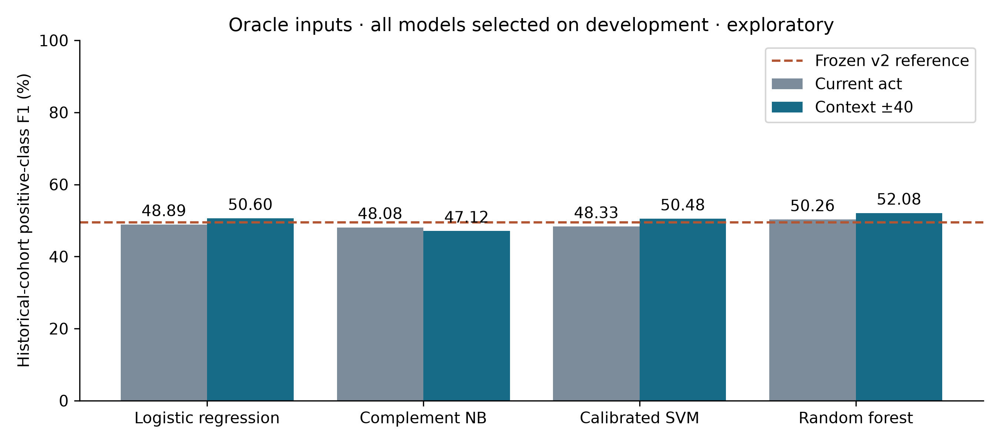

# Comparative classifier analysis

This study trains four classifier families with two feature conditions each. It preserves the previous model and reports every result, including alternatives that beat it. Model selection uses development data; the existing historical cohort is scored only after this round's settings are frozen.

| Method | Features | Precision % | Recall % | F1 % | AP % | Dev F1 % |
|---|---|---|---|---|---|---|
| Frozen v2 reference | Context ±40 | 34.13 | 90.12 | 49.51 | 56.99 | 57.04 |
| Logistic regression | Current act | 33.29 | 91.98 | 48.89 | 50.82 | 55.04 |
| Complement Naive Bayes | Current act | 32.67 | 91.01 | 48.08 | 48.35 | 55.65 |
| Calibrated linear SVM | Current act | 32.88 | 91.13 | 48.33 | 49.27 | 55.24 |
| Random forest | Current act | 35.73 | 84.72 | 50.26 | 49.91 | 54.16 |
| Logistic regression | Context ±40 | 35.61 | 87.38 | 50.60 | 56.99 | 57.05 |
| Complement Naive Bayes | Context ±40 | 31.60 | 92.58 | 47.12 | 57.65 | 55.71 |
| Calibrated linear SVM | Context ±40 | 35.04 | 90.25 | 50.48 | 53.38 | 55.78 |
| Random forest | Context ±40 | 39.38 | 76.86 | 52.08 | 41.95 | 59.72 |

**Development-selected pipeline:** random_forest__context_40. Development F1: 59.72%; historical F1: 52.08%. The frozen v2 reference has higher historical F1 than 4 of the eight matched pipelines and lower F1 than 4. A ranking observed on this cohort is not a demonstration of population superiority.

The development-selected pipeline ranks 1 of eight by historical F1. Relative to the frozen v2 reference, its precision changes from 34.13% to 39.38%, recall from 90.12% to 76.86%, and average precision from 56.99% to 41.95%. Higher F1 therefore does not imply improvement on every metric.

## Models and fair comparison

Both feature conditions use the same train-fitted word/character TF-IDF. The wider condition adds the same context-40 representation used by the frozen v2 pipeline. This gives alternatives access to that context rather than reserving it for our preferred method. Each family gets three hyperparameter values, the same smoothing choices, and the same quantile-based threshold selection rule. The frozen v2 reference used the previous development search and is not part of the new matched search budget.

- Logistic regression: C = 0.3, 1, 3; balanced classes.
- Complement Naive Bayes: alpha = 0.1, 1, 10; balanced sample weights.
- Linear SVM: C = 0.3, 1, 3; balanced classes; training-only sigmoid calibration.
- Random forest: 100 trees, minimum leaf size 2, maximum depth 10, 30 or unrestricted; balanced bootstrap-sample weights.

Smoothing radius is selected from 0, 5 and 15 acts. Each candidate's threshold search uses 13 prespecified quantiles of its development scores plus 0.5, removing duplicates. This allows sharply concentrated probability scores to be thresholded rather than advantaging one classifier's probability scale. Pooled development F1 selects each pipeline and the study's primary pipeline; fixed loop order resolves ties. No historical-score-based model replacement is performed.

The SVM calibration uses three project-separated training folds. Vocabulary/IDF remains shared across these inner folds, an unsupervised inner-calibration limitation; it sees no dev/test text during fitting. Calibration groups are recorded in `evaluation/classifier_comparison/calibration_groups.json`. The methods follow the installed scikit-learn 1.6.1 interfaces; see its [sparse-text comparison example](https://scikit-learn.org/1.6/auto_examples/text/plot_document_classification_20newsgroups.html) and [calibration documentation](https://scikit-learn.org/1.6/modules/generated/sklearn.calibration.CalibratedClassifierCV.html). Those examples' datasets and scores are not reused here.



Fig. 1. Historical F1 under matched feature conditions.

## Runtime scope

| Pipeline | Three-parameter fitting total (s) | One warm classification + smoothing pass (s) |
|---|---|---|
| logistic_regression__local | 1.826 | 0.0068 |
| complement_nb__local | 0.038 | 0.0107 |
| linear_svm__local | 8.204 | 0.0077 |
| random_forest__local | 26.402 | 0.3605 |
| logistic_regression__context_40 | 10.976 | 0.0151 |
| complement_nb__context_40 | 0.153 | 0.0326 |
| linear_svm__context_40 | 19.511 | 0.0189 |
| random_forest__context_40 | 30.434 | 0.7470 |

Fitting totals cover all three parameter fits for each pipeline. SVM totals include its grouped calibration and final training. They exclude shared text transforms, model selection/scoring overhead and artifact I/O. A single warm classification pass is descriptive; it is not a repeated controlled latency benchmark. Shared train/dev text transformation took 12.86s; historical-test transformation took 5.11s. These are classifier experiments, not full recording processing timings.

## What can be claimed

Report exact task, cohort, metric, feature condition and selected configuration with each comparison. The frozen v2 reference has higher historical F1 than 4 of the eight matched pipelines and lower F1 than 4. The complete meeting application, ASR, diarization, presentation alignment, influence rankings and Hindi/Hinglish recognition were not compared by this experiment. These are common classifier implementations on our task, not replications of published decision-extraction systems or commercial meeting assistants.

The old historical cohort had already informed previous development. This is an exploratory comparative extension, even though this round freezes selections before scoring. All rows use the same 12 meetings from only three independent project series; the 11,136 acts are not independent observations. Outside-span negatives keep the original annotation-completeness assumption. Human reference text and act boundaries are oracle inputs. A new independently annotated evaluation cohort is necessary for confirmatory claims. These models were research artifacts at comparison time; the subsequent learned-review integration is reported separately in `PIPELINE_IMPROVEMENTS.md`.

## Paired uncertainty against the frozen reference

| Pipeline | F1 difference (percentage points) | Descriptive paired-series interval |
|---|---|---|
| logistic_regression__local | -0.62 | -6.60 to +5.16 |
| complement_nb__local | -1.43 | -8.04 to +4.33 |
| linear_svm__local | -1.19 | -7.37 to +5.33 |
| random_forest__local | +0.75 | -3.35 to +3.77 |
| logistic_regression__context_40 | +1.09 | -1.00 to +1.92 |
| complement_nb__context_40 | -2.39 | -8.27 to +3.23 |
| linear_svm__context_40 | +0.97 | +0.12 to +1.69 |
| random_forest__context_40 | +2.57 | -1.62 to +10.61 |

These 3,000-draw bootstrap diagnostics resample the same project series in each pair. With only three independent groups and multiple descriptive comparisons, they do not establish significance. They must not be interpreted as act-level confidence intervals.

Paired differences between the new primary pipeline and every matched alternative are also retained in `evaluation/classifier_comparison/paired_bootstrap_primary.json`.

## Reproduce

After preparing the original pilot and v2 train-fitted vectorizers:

```bash
OPENBLAS_NUM_THREADS=2 OMP_NUM_THREADS=2 .venv/bin/python scripts/compare_discussion_models.py
OPENBLAS_NUM_THREADS=2 OMP_NUM_THREADS=2 .venv/bin/python scripts/compare_discussion_models.py --evaluate
MPLCONFIGDIR=/tmp/influenceiq-mpl .venv/bin/python scripts/report_classifier_comparison.py
```

The protocol, complete development search, frozen selection, comparison CSV, source/model hashes and per-group/meeting scores are in `evaluation/classifier_comparison/`. Trained models and row-level predictions are in `.runtime/research-classifier-comparison/`. No additional dependencies or model downloads are required.
