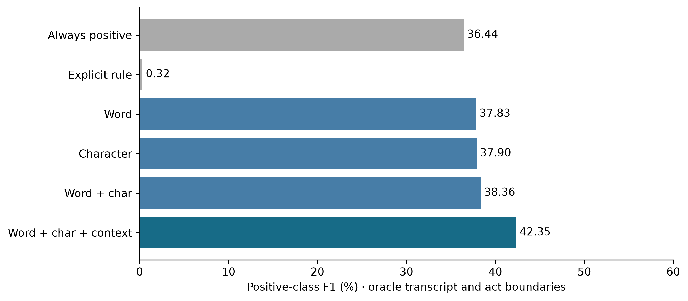

# First supervised decision-discussion experiment

This experiment measures a real NLP task against independent manual decision spans. It is research-only and does not replace the application's rules or validate influence.

Task: classify whether a reference dialogue act belongs to a manually annotated decision discussion. An act is positive when at least 50% of its lexical word IDs are inside annotated decision spans. This detects discussion membership, not final decisions or action ownership. Outside-span acts are assumed negative; annotation completeness requires review.

Inputs are oracle reference text and dialogue-act boundaries. Annotator dialogue-act class labels are excluded from features. Data are separated by project/meeting series: 29 training meetings (20,339 acts), six development meetings (3,739 acts), and 12 test meetings (11,136 acts, 2,481 positive). The test set contains only three independent series. No matching manual decision annotations were found in the official BUT test partition, so this is explicitly a custom group-separated split.

Linear TF-IDF classifiers use current-act word n-grams, character n-grams and neighbouring-act context. C and decision thresholds are selected on development only. All prespecified variants are reported. No generative model, new speech-model download or production model installation was used.

| Method | Precision % | Recall % | F1 % | AP % |
|---|---|---|---|---|
| always_positive | 22.28 | 100.00 | 36.44 | N/A |
| always_negative | 0.00 | 0.00 | 0.00 | N/A |
| current_explicit_decision_rule | 30.77 | 0.16 | 0.32 | N/A |
| word | 23.69 | 93.87 | 37.83 | 30.08 |
| char | 23.61 | 96.09 | 37.90 | 31.02 |
| word_char | 24.28 | 91.29 | 38.36 | 30.16 |
| word_char_context | 28.18 | 85.17 | 42.35 | 36.80 |

The explicit-decision rule is a narrow cue baseline on a broader discussion-membership task, so beating it alone would be weak evidence. Word-only, character-only and always-positive baselines are needed. Context produces a measurable improvement over word-only here, but precision remains low and performance varies substantially by meeting. These results are an initial experiment, not sufficient to claim robust decision extraction.

The study supports two nested comparisons: word+character+context versus word+character tests context given both lexical features; word+character versus word-only tests character features without context. Character-only is a separate baseline. Full-minus-character and full-minus-word are not tested, so this is not a complete factorial ablation. Each variant is retrained and selected on the same development split. No comparison uses renormalised influence-score magnitudes.

A descriptive series-level bootstrap interval for the dev-selected model's F1 is 36.29%–47.18%. With only three independent series this cannot justify a strong significance claim.

The main failure is false positives. Read the confusion matrices and per-meeting results in `evaluation/decision_discussion/summary.json`. Improving precision is the next development objective; do not adjust thresholds using this test set. Any new model iteration must be reported transparently as further development, with a fresh independent final evaluation before confirmatory claims.



Reproduce from the project root:

```
OPENBLAS_NUM_THREADS=2 OMP_NUM_THREADS=2 .venv/bin/python scripts/evaluate_decision_discussions.py
.venv/bin/python scripts/report_decision_discussions.py
```

Model artifacts and full text examples are under `.runtime/research-decision-model/`; they have not been loaded by the app. The prespecified split and selection description are in `evaluation/decision_discussion/protocol.json`. Provenance hashes are in the summary.
