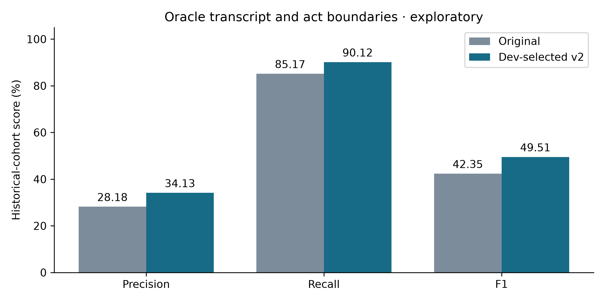

# Decision-discussion improvements — continued development

The original experiment is preserved. This second experiment uses exactly the same reference labels and project-separated train/development/historical-test cohorts. No examples are removed or relabelled.

| Method | Precision % | Recall % | F1 % | AP % |
|---|---|---|---|---|
| Original three-act context | 28.18 | 85.17 | 42.35 | 36.80 |
| Dev-selected v2: context_40 | 34.13 | 90.12 | 49.51 | 56.99 |
| V2 precision operating point | 37.47 | 83.31 | 51.69 | 56.99 |

Primary historical-cohort F1 difference: **+7.16 percentage points**. False positives: **5,384 → 4,315**. Development F1: **49.05% → 57.04%**.

## What changed

The fixed search compares current-act word/character features with symmetric context radii of 1, 5, 15 and 40 acts. A separate radius-15 variant adds relative recording position and its square/cube. It uses no meeting identifier, participant role, dialogue-act type or reference decision label as a feature. TF-IDF is fitted on training only. The model remains class-balanced logistic regression. Each configuration selects C, a probability threshold and smoothing radius on development F1. Smoothing averages predicted probabilities over neighbouring acts, never across meetings. This requires offline access to subsequent speech.

The primary variant is **context_40**; C=3.0, context radius=40, smoothing radius=15, threshold=0.15. Its model and selection were saved and hashed before the separate historical evaluation invocation. A precision-oriented threshold is also frozen on development for this same model, requiring development recall of at least 50%. It is not chosen on historical-test performance.

## All dev-selected variants and smoothing ablation

| Method | Precision % | Recall % | F1 % | AP % |
|---|---|---|---|---|
| local | 34.03 | 91.37 | 49.59 | 51.89 |
| context_1 | 35.73 | 87.46 | 50.74 | 54.99 |
| context_5 | 30.91 | 94.76 | 46.61 | 56.75 |
| context_15 | 29.56 | 94.44 | 45.02 | 54.09 |
| context_40 | 34.13 | 90.12 | 49.51 | 56.99 |
| context_15_position | 29.62 | 95.97 | 45.27 | 57.12 |
| context_40 without smoothing (same classifier; dev-tuned threshold) | 35.38 | 85.41 | 50.04 | 51.88 |

Each feature variant is independently selected on development. The no-smoothing row holds the primary fitted classifier fixed and reselects only its threshold on development; the same raw classifier probabilities are used. The full grid is retained in `evaluation/decision_discussion_v2/dev_search.csv`. This is not an exhaustive factorial study: the position feature is tested only at context radius 15.

Smoothing does not improve the primary classifier's historical F1 (50.04% without smoothing versus 49.51% with it). The primary selection remains frozen even though another configuration scores better on historical data. Neither the smoothing hypothesis nor the largest context window is consistently superior across cohorts.



Fig. 1. Original versus dev-selected tagging.

## Per-series results for the primary model

| Series | Precision % | Recall % | F1 % | False positives |
|---|---|---|---|---|
| ES2016 | 28.38 | 97.62 | 43.98 | 1244 |
| IS1006 | 22.84 | 73.26 | 34.82 | 1527 |
| TS3005 | 45.54 | 95.00 | 61.56 | 1544 |

## Evidence limits

The old test cohort had already been examined before this work. The development search is separated from this round's historical scoring, but that does not make this a new confirmatory test. No final model is selected using historical-test scores. Only three independent test series and two development series exist. The paired project-series bootstrap F1-difference interval is -1.47 to +14.38 percentage points; it is descriptive, not evidence of population significance. Variation across series remains material.

Inputs are human reference transcripts and dialogue-act boundaries. These scores do not establish final-decision extraction, ASR accuracy, speaker attribution, influence ranking, Hindi/Hinglish performance or application accuracy. Outside-span negatives retain the original annotation-completeness assumption. Larger context and smoothing can blur short discussion boundaries. The position-feature variant may rely on scenario-specific meeting structure. Independent full-recording annotation and end-to-end evaluation remain necessary before installation in the application.

## Reproduce

From the project root, after preparing the original pilot's cached rows:

```bash
OPENBLAS_NUM_THREADS=2 OMP_NUM_THREADS=2 .venv/bin/python scripts/improve_decision_discussions.py
OPENBLAS_NUM_THREADS=2 OMP_NUM_THREADS=2 .venv/bin/python scripts/improve_decision_discussions.py --evaluate
.venv/bin/python scripts/report_discussion_improvements.py
```

The full protocol, development search, frozen selection, hashes, comparison CSV, per-meeting/group scores and paired bootstrap are in `evaluation/decision_discussion_v2/`. Trained models and row-level predictions are in `.runtime/research-decision-model-v2/`. Training/vectorisation/selection took 57.4 seconds in this run; this is not an inference or end-to-end recording latency benchmark. There were no new dependencies, model downloads, cloud inference or changes to production event extraction.
