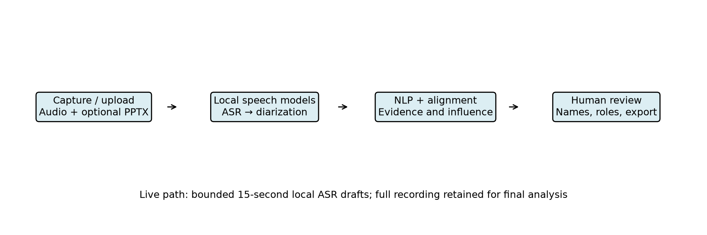
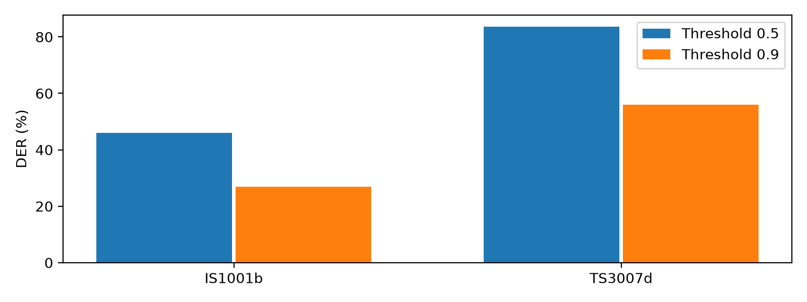

# InfluenceIQ: Local Meeting Analysis with Reviewable Evidence and Speaker Calibration

Author names, affiliations, corresponding email and ORCID: TO BE COMPLETED BY AUTHORS.

## Abstract

Meeting recordings contain decisions and contributions that are difficult to review manually, especially when speech recognition and speaker attribution errors propagate into participant analytics. This paper presents InfluenceIQ, a local meeting-analysis prototype combining pretrained speech recognition, speaker diarization, optional presentation alignment and rule-based event extraction. Users can inspect source evidence, correct participant names and roles, and review candidate decisions and actions without generative summarisation. A bounded browser recording path supplies local transcription drafts while preserving the complete recording for final analysis. The system separates cached speech observations from speaker attribution so that corrections can reuse recognition output. We evaluate clustering thresholds using two development and two held-out meeting excerpts and conduct a small Hindi and Hindi–English speech-recognition pilot using public references. Calibration reduces fragmentation and diarization error on the held-out excerpts, but substantial errors remain. Functional checks cover backend behaviour, browser workflows and Android build components. Influence rankings lack independent human annotations and are therefore not presented as validated measurements. The results support an inspectable engineering prototype and identify the additional annotation, acoustic evaluation and device testing required before reliable deployment.

Keywords: offline meeting analysis; speaker diarization; Hindi–English speech; evidence review; evaluation

## 1 Introduction

CALO established a broad meeting-assistant architecture including recognition and semantic interpretation [1]. InfluenceIQ addresses a narrower deployment objective: local processing with reviewable candidate events and participant contributions. Pretrained Whisper recognition [2] provides the speech layer. Recognition and attribution errors can invalidate downstream interpretation, so a usable interface is insufficient evidence of accuracy.

## 2 Related work and contribution

Table 1 compares fifteen relevant works, including eleven published in 2023–2025 and foundational system/dataset sources. Features outside a paper's stated scope are not treated as proven absent. WhisperX [3] addresses alignment; diarization pipelines [4,5] motivate explicit calibration. Streaming ASR [6,7] and streaming speaker tracking [13] are more specialised than the fixed-window preview implemented here. DISPLACE [8,9] motivates multilingual meeting evaluation; Vistaar [10] highlights domain diversity. MeetingBank [11] and ExplainMeetSum [12] inform evidence-oriented review, although this project excludes generative summaries. FLEURS [14] and MUCS [15] supply the public Indic pilot data.

Table 1. Related work and scope.

| Work | Scope and distinction |
|---|---|
| [1] Tur et al. (2010) | Integrated meeting capture and semantic analysis; foundational system. |
| [2] Radford et al. (2023) | Multilingual speech recognition; pretrained ASR basis, not influence analysis. |
| [3] Bain et al. (2023) | VAD and forced alignment for transcription; not implemented here as WhisperX. |
| [4] Bredin (2023) | Local segmentation, embeddings and global clustering; calibration motivates our pilot. |
| [5] Plaquet and Bredin (2023) | Overlap-sensitive speaker segmentation; no decision extraction. |
| [6] Macháček, Dabre and Bojar (2023) | Streaming commitment policy; our fixed-window preview is simpler and not equivalent. |
| [7] Wang et al. (2024) | Streaming word-boundary handling; not integrated in this prototype. |
| [8] Baghel et al. (2023) | Multilingual conversational speaker/language diarization benchmark. |
| [9] Kalluri et al. (2024) | Code-switched multi-speaker evaluation; appropriate future meeting benchmark. |
| [10] Bhogale et al. (2023) | Indian-language diversity and domain evaluation; no integration claim. |
| [11] Hu et al. (2023) | Meeting transcripts, minutes and metadata; generative summarisation is outside our scope. |
| [12] Kim, Cho and Na (2023) | Evidence-backed summary evaluation; our outputs are extractive candidates. |
| [13] Medennikov et al. (2025) | Streaming identity tracking; our live preview does not provide this. |
| [14] Conneau et al. (2022) | Multilingual speech benchmark; Hindi pilot source. |
| [15] Diwan et al. (2021) | Code-switch ASR benchmark; Hinglish pilot source. |
| InfluenceIQ | Local audio + PPTX evidence review, editable identities, heuristic decisions and influence; privacy by local inference, not audited encryption. |

The engineering contributions are local audio/presentation integration, cached recognition independent of speaker corrections, editable identities propagated to evidence, bounded live drafts, and explicit missing-ground-truth reporting. These are integration contributions, not a new foundational speech model or a demonstrated patent novelty claim. Offline execution, diarization and decision extraction are not individually novel.

## 3 System and methods

Fig. 1 depicts the implemented pipeline. FFmpeg normalises audio. Local faster-whisper decodes chunks, while Sherpa-ONNX performs complete-recording speaker clustering. The word cache supports re-attribution. PPTX extraction feeds configured semantic/temporal alignment; a lexical TF-IDF option is also available. Unicode-aware rules identify English, Hindi and romanised-Hindi event candidates. Evidence and interaction links support decision chains. No language model generates meeting summaries or answers.

Fig. 1. Local processing and review.

Influence is a weighted sum of participant-normalised proposal, evidence, objection, revision, decision, interaction and slide-grounding features. Current weights are 0.15, 0.20, 0.15, 0.20, 0.15, 0.05 and 0.10. They are prototype assumptions, not fitted or independently validated parameters. Zero means no scored evidence was detected. Speaker identity errors can change every downstream feature.

The browser stores the original recording and sends independent 15-second PCM windows to an authenticated local preview endpoint. One worker and bounded admission avoid an unbounded preview queue. Busy periods are disclosed and final analysis uses the complete saved audio. Live speaker identities, stable streaming word commitments and constant-memory full-recording diarization are not implemented.

## 4 Evaluation protocol

AMI Array1-01 excerpts cover seconds 60–180. ES2002a and ES2003a form development; IS1001b and TS3007d form held-out testing. Thresholds 0.5, 0.7, 0.9 and 1.1 were fixed before inference; minimum pooled development DER selects 0.9. DER includes overlap, optimal speaker permutation, a 0.25-second collar and an explicit 120-second evaluation interval. Manual segment references may include internal silence; this is not an official full-corpus score.

The Hindi pilot uses eight FLEURS test recordings [14]; the Hinglish pilot uses eight consecutive MUCS mirror test rows [15]. Selection precedes inference and manifests record revisions and hashes. Word scoring applies NFKC, case folding and Unicode word tokenisation, without transliteration. Character scoring excludes spaces. Both models use local CPU int8 inference and automatic language settings. No reference text supplies hints. Timing during concurrent evaluation is not used for comparative speed claims. Human event, alignment and influence references are absent.

## 5 Results

Table 2 reports held-out speaker results. Fig. 2 visualises the same measured ablation. Calibration improves both excerpts, but the second remains difficult; matching speaker count does not imply correct attribution.

Table 2. Held-out diarization pilot.

| Meeting | Threshold | Groups | Reference speakers | DER |
|---|---|---|---|---|
| IS1001b | 0.5 | 12 | 4 | 46.01% |
| TS3007d | 0.5 | 13 | 4 | 83.54% |
| IS1001b | 0.9 | 4 | 4 | 26.90% |
| TS3007d | 0.9 | 7 | 4 | 56.01% |

Fig. 2. Held-out diarization error.

The private 42-minute diagnostic produced 37 groups versus the previous 139. Its true count is unknown, so this cannot establish speaker accuracy. It remains unsuitable for unreviewed participant rankings.

Table 3 reports strict Indic recognition error. Medium reduces WER in this pilot but retains substantial errors; Hinglish CER increases. Script variation, spelling and segment-boundary differences require transparent error analysis rather than post-hoc reference correction.

Table 3. Indic recognition pilot.

| Model | Corpus | Samples | WER | CER |
|---|---|---|---|---|
| small | hindi | 8 | 50.96% | 20.09% |
| small | hinglish | 8 | 66.13% | 50.00% |
| medium | hindi | 8 | 37.02% | 14.98% |
| medium | hinglish | 8 | 57.26% | 52.25% |

The two English held-out WER values were 41.59% and 81.00%. Automated functional tests, synthetic microphone browser checks, real preview inference, Java tests and APK compilation provide separate implementation evidence. Eight downstream ablations execute, but missing human rankings prevent ranking-accuracy comparisons. No overall influence accuracy is reported.

## 6 Discussion and limitations

The principal unresolved issue is propagation of speech and speaker errors into decisions and participant scores. A smaller error rate in this pilot does not demonstrate broad reliability. Two test meetings and eight samples per Indic corpus are insufficient for strong statistical claims. Consecutive lecture examples are correlated and do not represent natural multi-party Hinglish meetings. Pretraining overlap is unknown. Physical-phone memory, heat and battery behaviour are unmeasured. Local execution avoids remote inference but does not itself provide audited storage encryption or consent management.

Future evaluation requires independent speaker/session splits, fluent annotators, adjudication, inter-rater agreement and meeting-level confidence intervals. Influence evaluation must compare independent human rankings and simple speaking-time baselines. Domain-specific model tuning should use separate training/development/test data; the present study performs no fine-tuning.

## 7 Conclusion

InfluenceIQ integrates local speech processing, presentation evidence and editable participant review with bounded recording previews. The calibration pilot reduces speaker fragmentation, while measured recognition and diarization errors reveal clear limits. Functional completion does not validate influence or establish deployment accuracy. The prototype is suitable for further controlled research and review; broader multilingual annotation and physical-device evaluation are required before stronger claims.

## Statements and declarations

Funding, competing interests, author contributions, affiliation and ethics/consent statements: authors must supply and verify these before submission. No ethics approval is asserted here. Public dataset references and manifests are provided; private meeting artifacts must not be redistributed without consent. Code availability depends on the authors' chosen repository release. AI assistance was used for coding, evaluation orchestration and drafting; human authors must review all claims and comply with institutional and journal disclosure rules.

## References

[1] Tur et al. (2010). The CALO Meeting Assistant System. https://doi.org/10.1109/TASL.2009.2038810

[2] Radford et al. (2023). Robust Speech Recognition via Large-Scale Weak Supervision. https://proceedings.mlr.press/v202/radford23a.html

[3] Bain et al. (2023). WhisperX: Time-Accurate Speech Transcription of Long-Form Audio. https://www.isca-archive.org/interspeech_2023/bain23_interspeech.html

[4] Bredin (2023). pyannote.audio 2.1 speaker diarization pipeline: principle, benchmark, and recipe. https://www.isca-archive.org/interspeech_2023/bredin23_interspeech.html

[5] Plaquet and Bredin (2023). Powerset multi-class cross entropy loss for neural speaker diarization. https://www.isca-archive.org/interspeech_2023/plaquet23_interspeech.html

[6] Macháček, Dabre and Bojar (2023). Turning Whisper into Real-Time Transcription System. https://aclanthology.org/2023.ijcnlp-demo.3/

[7] Wang et al. (2024). Simul-Whisper: Attention-Guided Streaming Whisper with Truncation Detection. https://www.isca-archive.org/interspeech_2024/wang24ea_interspeech.html

[8] Baghel et al. (2023). The DISPLACE Challenge 2023. https://www.isca-archive.org/interspeech_2023/baghel23_interspeech.html

[9] Kalluri et al. (2024). The Second DISPLACE Challenge: DIarization of SPeaker and LAnguage in Conversational Environments. https://www.isca-archive.org/interspeech_2024/kalluri24_interspeech.html

[10] Bhogale et al. (2023). Vistaar: Diverse Benchmarks and Training Sets for Indian Language ASR. https://www.isca-archive.org/interspeech_2023/bhogale23_interspeech.html

[11] Hu et al. (2023). MeetingBank: A Benchmark Dataset for Meeting Summarization. https://aclanthology.org/2023.acl-long.906/

[12] Kim, Cho and Na (2023). ExplainMeetSum: A Dataset for Explainable Meeting Summarization Aligned with Human Intent. https://aclanthology.org/2023.acl-long.731/

[13] Medennikov et al. (2025). Streaming Sortformer: Speaker Cache-Based Online Speaker Diarization with Arrival-Time Ordering. https://www.isca-archive.org/interspeech_2025/medennikov25_interspeech.html

[14] Conneau et al. (2022). FLEURS: Few-shot Learning Evaluation of Universal Representations of Speech. https://arxiv.org/abs/2205.12446

[15] Diwan et al. (2021). MUCS 2021: Multilingual and Code-Switching ASR Challenges for Low Resource Indian Languages. https://www.isca-archive.org/interspeech_2021/diwan21_interspeech.html
