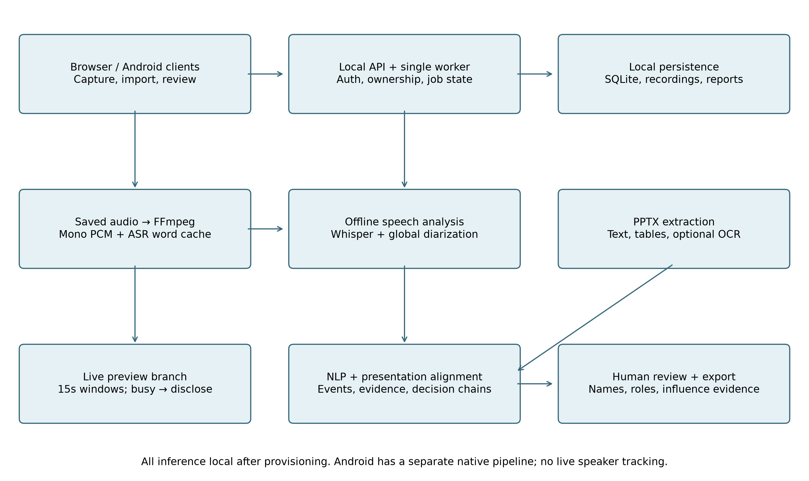
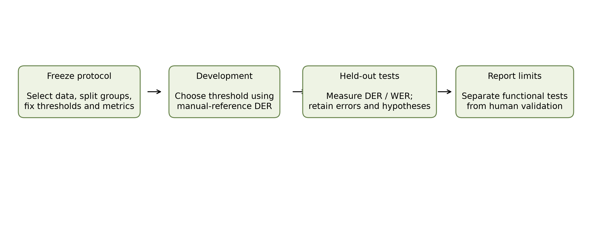
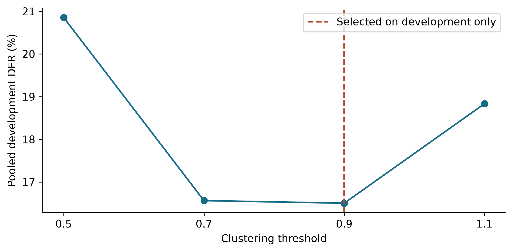
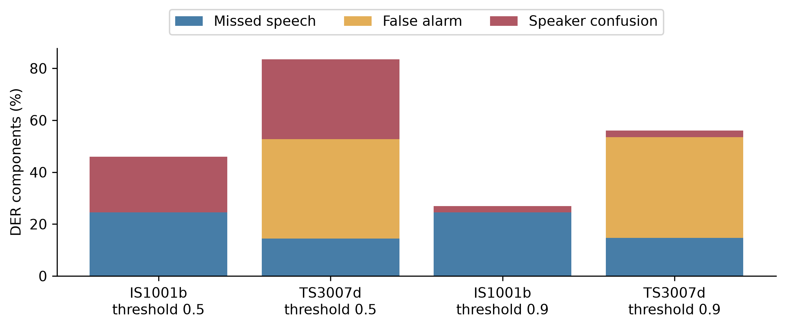
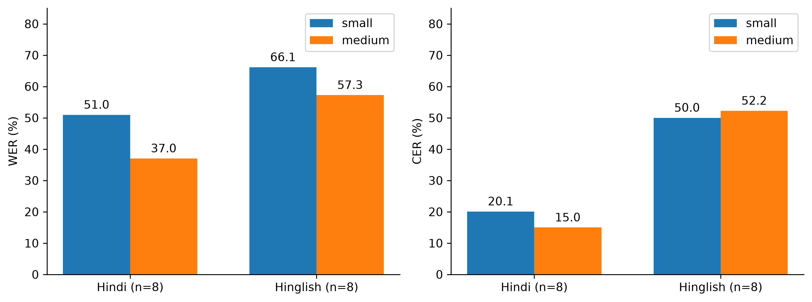
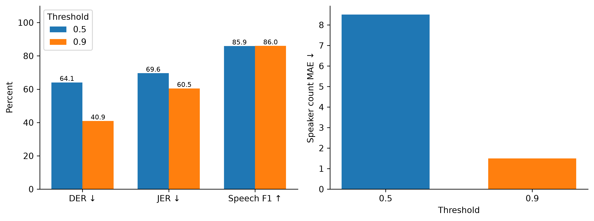
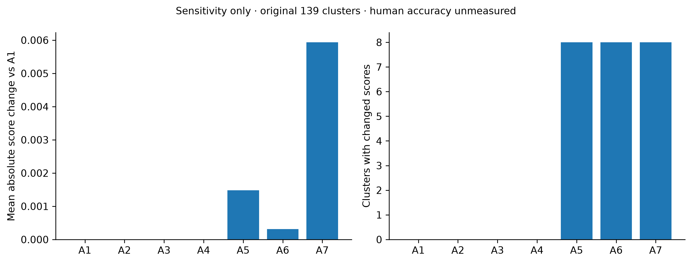

# InfluenceIQ: Local Meeting Analysis with Reviewable Evidence and Speaker Calibration

Author names, affiliations, corresponding email and ORCID: TO BE COMPLETED BY AUTHORS.

## Abstract

Meeting recordings contain decisions and contributions that are difficult to review manually, especially when speech recognition and speaker attribution errors propagate into participant analytics. This paper presents InfluenceIQ, a local meeting-analysis prototype combining pretrained speech recognition, speaker diarization, optional presentation alignment and rule-based event extraction. Users can inspect source evidence, correct participant names and roles, and review candidate decisions and actions without generative summarisation. A bounded browser recording path supplies local transcription drafts while preserving the complete recording for final analysis. The system separates cached speech observations from speaker attribution so that corrections can reuse recognition output. We evaluate clustering thresholds using two development and two held-out meeting excerpts and conduct a small Hindi and Hindi–English speech-recognition pilot using public references. Calibration reduces fragmentation and diarization error on the held-out excerpts, but substantial errors remain. An exploratory four-family comparison followed by forest/linear score combination reaches 53.54% discussion-membership F1 with reference transcripts and dialogue-act boundaries on a previously examined cohort. The selected model now supplies local review suggestions; independent recording-level accuracy validation remains necessary. Functional checks cover backend behaviour, browser workflows and Android build components. Influence rankings lack independent human annotations and are therefore not presented as validated measurements. The results support an inspectable engineering prototype and identify the additional annotation, acoustic evaluation and device testing required before reliable deployment.

Keywords: offline meeting analysis; speaker diarization; Hindi–English speech; evidence review; evaluation

## 1 Introduction

CALO established a broad meeting-assistant architecture including recognition and semantic interpretation [1]. InfluenceIQ addresses a narrower deployment objective: local processing with reviewable candidate events and participant contributions. Pretrained Whisper recognition [2] provides the speech layer. Recognition and attribution errors can invalidate downstream interpretation, so a usable interface is insufficient evidence of accuracy.

## 2 Related work and contribution

Table 1 compares fifteen relevant works, including eleven published in 2023–2025 and foundational system/dataset sources. Features outside a paper's stated scope are not treated as proven absent. WhisperX [3] addresses alignment; diarization pipelines [4,5] motivate explicit calibration. Streaming ASR [6,7] and streaming speaker tracking [13] are more specialised than the fixed-window preview implemented here. DISPLACE [8,9] motivates multilingual meeting evaluation; Vistaar [10] highlights domain diversity. MeetingBank [11] and ExplainMeetSum [12] inform evidence-oriented review, although this project excludes generative summaries. FLEURS [14] and MUCS [15] supply the public Indic pilot data.

Table 1. Related work and scope.

| Work | Scope and distinction |
|---|---|
| [1] Tur et al. (2010) | Integrated meeting capture and semantic analysis; foundational system. |
| [2] Radford et al. (2023) | Multilingual speech recognition; pretrained ASR basis, not influence analysis. |
| [3] Bain et al. (2023) | VAD and forced alignment for transcription; not implemented here as WhisperX. |
| [4] Bredin (2023) | Local segmentation, embeddings and global clustering; calibration motivates our pilot. |
| [5] Plaquet and Bredin (2023) | Overlap-sensitive speaker segmentation; no decision extraction. |
| [6] Macháček, Dabre and Bojar (2023) | Streaming commitment policy; our fixed-window preview is simpler and not equivalent. |
| [7] Wang et al. (2024) | Streaming word-boundary handling; not integrated in this prototype. |
| [8] Baghel et al. (2023) | Multilingual conversational speaker/language diarization benchmark. |
| [9] Kalluri et al. (2024) | Code-switched multi-speaker evaluation; appropriate future meeting benchmark. |
| [10] Bhogale et al. (2023) | Indian-language diversity and domain evaluation; no integration claim. |
| [11] Hu et al. (2023) | Meeting transcripts, minutes and metadata; generative summarisation is outside our scope. |
| [12] Kim, Cho and Na (2023) | Evidence-backed summary evaluation; our outputs are extractive candidates. |
| [13] Medennikov et al. (2025) | Streaming identity tracking; our live preview does not provide this. |
| [14] Conneau et al. (2022) | Multilingual speech benchmark; Hindi pilot source. |
| [15] Diwan et al. (2021) | Code-switch ASR benchmark; Hinglish pilot source. |
| InfluenceIQ | Local audio + PPTX evidence review, editable identities, heuristic decisions and influence; privacy by local inference, not audited encryption. |

The engineering contributions are local audio/presentation integration, cached recognition independent of speaker corrections, editable identities propagated to evidence, bounded live drafts, and explicit missing-ground-truth reporting. These are integration contributions, not a new foundational speech model or a demonstrated patent novelty claim. Offline execution, diarization and decision extraction are not individually novel.

## 3 System and methods

Fig. 1 depicts the implemented pipeline. FFmpeg normalises audio. Local faster-whisper decodes chunks, while Sherpa-ONNX performs complete-recording speaker clustering. The word cache supports re-attribution. PPTX extraction feeds configured semantic/temporal alignment; a lexical TF-IDF option is also available. Unicode-aware rules identify English, Hindi and romanised-Hindi event candidates. Evidence and interaction links support decision chains. A local forest/linear discussion detector additionally suggests English source passages for human review; these suggestions do not create final-decision anchors. No language model generates meeting summaries or answers.

Fig. 1. Local processing and review.

Influence is a weighted sum of participant-normalised proposal, evidence, objection, revision, decision, interaction and slide-grounding features. Current weights are 0.15, 0.20, 0.15, 0.20, 0.15, 0.05 and 0.10. They are prototype assumptions, not fitted or independently validated parameters. Zero means no scored evidence was detected. Speaker identity errors can change every downstream feature.

The browser stores the original recording and sends independent 15-second PCM windows to an authenticated local preview endpoint. One worker and bounded admission avoid an unbounded preview queue. Busy periods are disclosed and final analysis uses the complete saved audio. Live speaker identities, stable streaming word commitments and constant-memory full-recording diarization are not implemented.

### 3.1 Interfaces and error propagation

The system description separates architecture, component methods and evaluation. The implementation differs from CALO and its published results are not reused as our own. Browser previews contain unassigned-speaker text; final speaker labels are assigned only after complete-recording clustering. Authentication, source preservation and review controls surround the analysis stages. The native Android client is a separate execution path and is not assigned the laptop's benchmark results.

### 3.2 Scoring definitions

For participant p and feature k, let x(p,k) be the decision-gated contribution feature value, including the bonuses defined by the implementation and m(k) the maximum across participants. The normalised value is z(p,k)=x(p,k)/m(k) when m(k)>0, otherwise zero. The influence estimate is I(p)=sum_k w(k)z(p,k), with nonnegative weights summing to one. This equation describes the implemented score; it is not a causal model. Errors in speaker labels, extracted events or slide links alter x(p,k). A name edit changes displayed identity, not the acoustic evidence.

WER=(S+D+I)/N, where S, D and I are word substitutions, deletions and insertions and N is the reference word count. DER=(missed speaker-time + false-alarm speaker-time + confused speaker-time)/reference speaker-time under the declared collar and overlap policy. These error rates answer different questions and cannot be averaged into a single system accuracy.

## 4 Evaluation protocol

AMI Array1-01 excerpts cover seconds 60–180. These four meetings are in the published BUT/pyannote training partition; “held-out” below refers only to the local calibration split, not the official benchmark test set. ES2002a and ES2003a form development; IS1001b and TS3007d form held-out testing. Thresholds 0.5, 0.7, 0.9 and 1.1 were fixed before inference; minimum pooled development DER selects 0.9. DER includes overlap, optimal speaker permutation, a 0.25-second collar and an explicit 120-second evaluation interval. Manual segment references may include internal silence and differ from the standard word-derived RTTM recipe. TS3007d has no supplied manual segment before 99.5 seconds although the clip begins at 60 seconds; the recogniser emits text in that prefix. This coverage sensitivity requires audio/reference auditing. The standard AMI UEM covers the full recording, so this study does not remove the prefix post hoc. These are custom pilot scores, not official benchmark results.

The Hindi pilot uses eight FLEURS test recordings [14]; the Hinglish pilot uses eight consecutive MUCS mirror test rows [15]. Selection precedes inference and manifests record revisions and hashes. Word scoring applies NFKC, case folding and Unicode word tokenisation, without transliteration. Character scoring excludes spaces. Both models use local CPU int8 inference and automatic language settings. No reference text supplies hints. Timing during concurrent evaluation is not used for comparative speed claims. Reference labels matching the project event taxonomy, slide alignment and influence rankings are absent. Separate manual decision-discussion spans support the narrower classifier pilot described below.

Fig. 2 summarises the evaluation separation. The public references are used for scoring rather than injected into recognition. Fig. 3 shows the development threshold sweep; the selected threshold is carried unchanged into held-out testing. Confidence intervals are not reported for the two-meeting experiment because that sample cannot support a useful population-level claim.

Fig. 2. Evaluation separation.

Fig. 3. Development threshold sweep.

### 4.1 Comparative metrics and component removal

Additional diagnostics re-score the same saved AMI predictions: Jaccard error rate (JER), union-of-speech precision/recall/F1 and absolute speaker-count error. DER is pooled by reference speaker-time; JER is pooled by reference-speaker count; count MAE averages meetings. These supplementary diagnostics do not reselect the threshold. Definitions and implementation follow pyannote.metrics and its documented diarization evaluation approach [4]. Speech-region detection ignores speaker identity. Word/character comparisons use identical samples and report strict edit counts. We report descriptive differences; the small sample does not support claims of population significance.

A1 is the full-system control. A2 removes presentation links before rerunning downstream NLP. A3 removes temporal alignment, and A4 removes semantic alignment; each recomputes downstream analysis. A5 removes evidence weights, A6 interaction weights, and A7 decision-impact weights; remaining weights are renormalized. A8 is the speaking-time baseline, not a component-removal ablation. The downstream study uses the original saved 139-cluster recording, so it evaluates code sensitivity rather than validated participant influence. Mean absolute score change averages the same cluster set. Zero change and missing human labels remain visible.

### 4.2 Supervised decision-discussion pilot

A separate research-only classifier uses manual decision-discussion spans from 47 AMI meetings. A dialogue act is labelled positive when at least half of its lexical word IDs belong to a manual decision span. Reference text and act boundaries are oracle inputs; annotator act-type labels are not features. Outside-span acts are assumed negative, subject to annotation-completeness review. This task measures discussion membership, not final decisions or influence.

The custom project-series split uses 29 training, six development and 12 test meetings. Only three independent series are in the test cohort. The available manual decision files do not intersect the official BUT test partition, so this is explicitly a custom split. TF-IDF word/character/context variants use class-balanced logistic regression. C and thresholds are selected on development F1; all predefined variants are retained. Context includes the neighbouring previous/next act and therefore assumes offline access. Models remain research artifacts and are not installed in the app.

### 4.3 Matched classifier comparison

A subsequent fixed search compares logistic regression, Complement Naive Bayes, a linear SVM and random forest, each using either current-act word/character TF-IDF or those same features plus context within 40 neighbouring acts on each side. All families reuse the same train-fitted vocabulary and IDF. Three prespecified model parameters, smoothing radii 0/5/15, and thresholds from 13 fixed development-score quantiles plus 0.5 are searched for each pipeline. Duplicated thresholds are removed. Every pipeline selects by pooled development F1; all eight are evaluated after model/selection hashes are frozen. The previously frozen v2 model is an additional reference, with its earlier search budget disclosed separately.

The linear SVM uses sigmoid calibration with three project-separated training folds and a final fit on all training rows. The vocabulary/IDF is shared across these inner training folds, but no development or historical-test text fits the representation. Class balancing uses class weights for the linear models, sample weights for Naive Bayes, and balanced bootstrap-sample weights for the forest. Forests use 100 trees and three maximum depths. Equal search counts do not imply equal compute or globally optimal tuning. No complete external meeting-assistant implementation is benchmarked.

## 5 Results

Table 2 reports held-out speaker results. Fig. 4 visualises the same calibration comparison. Calibration improves both excerpts, but the second remains difficult; matching speaker count does not imply correct attribution.

Table 2. Held-out diarization pilot.

| Meeting | Threshold | Groups | Reference speakers | DER |
|---|---|---|---|---|
| IS1001b | 0.5 | 12 | 4 | 46.01% |
| TS3007d | 0.5 | 13 | 4 | 83.54% |
| IS1001b | 0.9 | 4 | 4 | 26.90% |
| TS3007d | 0.9 | 7 | 4 | 56.01% |

Fig. 4. Held-out diarization error.

The private 42-minute diagnostic produced 37 groups versus the previous 139. Its true count is unknown, so this cannot establish speaker accuracy. It remains unsuitable for unreviewed participant rankings.

Table 3 reports strict Indic recognition error. Medium reduces WER in this pilot but retains substantial errors; Hinglish CER increases. Script variation, spelling and segment-boundary differences require transparent error analysis rather than post-hoc reference correction.

Table 3. Indic recognition pilot.

| Model | Corpus | Samples | WER | CER |
|---|---|---|---|---|
| small | hindi | 8 | 50.96% | 20.09% |
| small | hinglish | 8 | 66.13% | 50.00% |
| medium | hindi | 8 | 37.02% | 14.98% |
| medium | hinglish | 8 | 57.26% | 52.25% |

The two English held-out WER values were 41.59% and 81.00%. Automated functional tests, synthetic microphone browser checks, real preview inference, Java tests and APK compilation provide separate implementation evidence. Eight downstream ablations execute, but missing human rankings prevent ranking-accuracy comparisons. No overall influence accuracy is reported.

Fig. 5 breaks held-out DER into missed speech, false alarms and speaker confusion. The residual error is not solely a clustering problem: false alarms remain prominent on TS3007d. Fig. 6 compares strict word and character errors on identical Indic samples. Medium reduces WER but increases Hinglish CER, so the evidence does not support a blanket claim that the larger model is more accurate on every measure.

Fig. 5. Diarization error components.

Fig. 6. Indic word and character errors.

An additional public MUCS diagnostic used four prespecified spaced test rows (100, 400, 800, 1200), downloaded from the dataset mirror and processed locally with the small model. Pooled strict WER was 78.72% (37 edits / 47 reference words). This additional diagnostic was performed after the initial pilot and is not a confirmatory full-corpus benchmark. Table 4 lists each result; speaker/session independence and boundary quality still need auditing.

Table 4. Additional public-audio diagnostic.

| Test row | Reference words | WER |
|---|---|---|
| 100 | 14 | 78.57% |
| 400 | 8 | 50.00% |
| 800 | 18 | 77.78% |
| 1200 | 7 | 114.29% |

### 5.1 Complementary audio metrics

Table 5 and Fig. 7 present the additional diagnostics on the same two held-out excerpts. DER, JER and count errors improve, while speech detection changes little. Grouping improves without solving all speech-region errors. Count accuracy alone is insufficient evidence of correct identities.

Table 5. Complementary audio diagnostics.

| Threshold | DER % | JER % | Speech P % | Speech R % | Speech F1 % | Speaker count MAE |
|---|---|---|---|---|---|---|
| 0.5 | 64.08 | 69.60 | 81.68 | 90.57 | 85.89 | 8.50 |
| 0.9 | 40.91 | 60.45 | 81.70 | 90.73 | 85.98 | 1.50 |

Fig. 7. Complementary audio metrics.

### 5.2 Component ablation

Table 6 and Fig. 8 show the completed downstream sensitivity study. A2–A4 do not change influence scores on this recording, although slide-grounded event counts change in A2/A4. Consequently, this case supplies no evidence that presentation alignment improves influence ranking. The saved feature audit shows that only decision contribution is nonzero; the other six feature families are inactive. Exactly, proposed scores equal 0.15 times the B3 decision-event-count baseline, so their rankings are identical. A5 is pure rescaling by 1/0.80 and A6 by 1/0.95 (within stored rounding), while A7 removes the only active feature. The score-change bars therefore do not demonstrate evidence or interaction utility. None of the 34 slides has timing metadata, making the temporal ablation uninformative. These are algebraic diagnostics of a degenerate case, not positive component-utility results.

Table 6. Component-removal sensitivity.

| ID | Variant | Slide-grounded events | Changed scores | Mean absolute score change |
|---|---|---|---|---|
| A1 | full_system | 6 | 0 | 0.000000 |
| A2 | without_ppt | 0 | 0 | 0.000000 |
| A3 | without_temporal_alignment | 6 | 0 | 0.000000 |
| A4 | without_semantic_alignment | 0 | 0 | 0.000000 |
| A5 | without_evidence_features | 6 | 8 | 0.001484 |
| A6 | without_interaction_features | 6 | 8 | 0.000312 |
| A7 | without_decision_impact_features | 6 | 8 | 0.005935 |
| A8 | speaking_time_only_baseline | N/A | N/A | N/A |

Fig. 8. Component-removal sensitivity.

A1–A7 are shown in Fig. 8. A8 has a different scoring definition and is retained as a separate baseline. These outputs derive from 139 unverified acoustic clusters; they must not be used as real-person rankings. Independent human ratings are needed to turn sensitivity changes into a component-utility study.

### 5.3 Influence baselines

Table 7 records the six baseline methods and proposed score. Output coverage is descriptive. All human-ranking comparisons remain unavailable. Score scales differ between methods, so nonzero counts and score magnitudes cannot rank their quality. Performance numbers from unrelated publications or commercial products are not inserted into this comparison.

Table 7. Baseline output coverage.

| Method | Clusters | Nonzero scores | Human accuracy |
|---|---|---|---|
| B1_speaking_time | 139 | 139 | Unmeasured |
| B2_speaking_time_turns | 139 | 139 | Unmeasured |
| B3_decision_event_count | 139 | 8 | Unmeasured |
| B5_transcript_only | 139 | 8 | Unmeasured |
| B4_decision_evidence_count | 139 | 0 | Unmeasured |
| B6_audio_ppt_no_decision | 139 | 139 | Unmeasured |
| Proposed_decision_linked | 139 | 8 | Unmeasured |

### 5.4 Initial decision-discussion comparison

Table 8 reports the independently annotated discussion-membership experiment. The context model, selected on development, achieves 42.35% F1 versus 37.83% for word-only and 38.36% for word+character. Its precision is 28.18%, so false positives remain a major limitation. Always-positive F1 is 36.44%; this baseline prevents a misleading interpretation of high recall. The explicit-decision rule addresses narrower cues than discussion membership, so its poor recall is not the principal evidence of improvement. The result is exploratory and requires a new independent final evaluation after further development.

Table 8. Decision-discussion tagging with oracle inputs.

| Method | Precision % | Recall % | F1 % | AP % |
|---|---|---|---|---|
| always_positive | 22.28 | 100.00 | 36.44 | N/A |
| always_negative | 0.00 | 0.00 | 0.00 | N/A |
| current_explicit_decision_rule | 30.77 | 0.16 | 0.32 | N/A |
| word | 23.69 | 93.87 | 37.83 | 30.08 |
| char | 23.61 | 96.09 | 37.90 | 31.02 |
| word_char | 24.28 | 91.29 | 38.36 | 30.16 |
| word_char_context | 28.18 | 85.17 | 42.35 | 36.80 |

### 5.5 Continued development with wider context

Table 9 compares the original pilot with a second, frozen development search on the same labels and split. The primary method (context_40, C=3.0, smoothing radius 15, threshold 0.15) was selected exclusively by pooled development F1 before scoring this cohort. It changes historical-cohort F1 from 42.35% to 49.51% (+7.16 percentage points), precision from 28.18% to 34.13%, and recall from 85.17% to 90.12%. False positives change from 5,384 to 4,315. The secondary precision operating point is selected on development with a recall floor of 50%; that floor is not guaranteed on new data.

Table 9. Continued development on the historical cohort.

| Method | Precision % | Recall % | F1 % | AP % |
|---|---|---|---|---|
| Original three-act context | 28.18 | 85.17 | 42.35 | 36.80 |
| Dev-selected v2: context_40 | 34.13 | 90.12 | 49.51 | 56.99 |
| V2 precision operating point | 37.47 | 83.31 | 51.69 | 56.99 |

The primary classifier without smoothing, with its threshold reselected on development, scores 50.04% historical F1. Smoothing therefore does not improve this model's historical F1, despite being selected on development; the ablation is retained as a negative result.

The original test results had already informed the decision to investigate false positives and context. This is therefore exploratory continued development, not fresh independent confirmation. Only three independent project series are available. A paired series bootstrap gives a descriptive F1-difference interval of -1.47 to +14.38 percentage points; it cannot establish population significance. Reference text and dialogue-act boundaries remain oracle inputs. All searched variants, per-group errors, frozen selection hashes and the same-classifier smoothing ablation are retained in the supplementary experiment. The models are research artifacts and do not replace the application's explicit-decision rules.

### 5.6 Matched classifier comparison

Table 10 reports every model/feature combination from the fixed comparative search. The new study selects **Random forest with context ±40** by development F1 (59.72%); its historical F1 is 52.08%. The frozen v2 reference has higher historical F1 than 4 of the eight matched pipelines and lower F1 than 4. Results therefore support specific task-level comparisons, rather than a claim that the complete InfluenceIQ pipeline outperforms all alternatives. The selected method is not changed to the highest historical-test scorer.

Table 10. Matched classifier and feature comparison.

| Method | Features | Precision % | Recall % | F1 % | AP % | Dev F1 % |
|---|---|---|---|---|---|---|
| Frozen v2 reference | Context ±40 | 34.13 | 90.12 | 49.51 | 56.99 | 57.04 |
| Logistic regression | Current act | 33.29 | 91.98 | 48.89 | 50.82 | 55.04 |
| Complement Naive Bayes | Current act | 32.67 | 91.01 | 48.08 | 48.35 | 55.65 |
| Calibrated linear SVM | Current act | 32.88 | 91.13 | 48.33 | 49.27 | 55.24 |
| Random forest | Current act | 35.73 | 84.72 | 50.26 | 49.91 | 54.16 |
| Logistic regression | Context ±40 | 35.61 | 87.38 | 50.60 | 56.99 | 57.05 |
| Complement Naive Bayes | Context ±40 | 31.60 | 92.58 | 47.12 | 57.65 | 55.71 |
| Calibrated linear SVM | Context ±40 | 35.04 | 90.25 | 50.48 | 53.38 | 55.78 |
| Random forest | Context ±40 | 39.38 | 76.86 | 52.08 | 41.95 | 59.72 |

The development-selected pipeline ranks 1 of eight by historical F1. Relative to the frozen v2 reference, its precision changes from 34.13% to 39.38%, recall from 90.12% to 76.86%, and average precision from 56.99% to 41.95%. Higher F1 therefore does not imply improvement on every metric.

The same 11,136 acts and 2,481 positives are scored for every row. Historical scores use oracle reference transcripts and dialogue-act boundaries on the previously examined cohort. Only three test project series and two development series are available. Project-series paired bootstrap diagnostics, per-meeting scores, all search candidates and timing scope are retained in the supplementary comparison. Differences are descriptive and require fresh independent confirmation.

### 5.7 Learned discussion review in the pipeline

Table 11 reports a further fixed development search combining the previously trained context forest and linear classifier. Linear mixture weights 0/0.25/0.5/0.75/1, smoothing radii 0/5/15, and the same development-quantile threshold rule are searched; all mixture weights are retained in the supplement. Selection uses development F1 before historical scoring. The selected mixture uses 75% forest and 25% linear scores, smoothing radius 5 and threshold 0.357740. Development F1 is 59.79%.

Table 11. Historical discussion-detection results.

| Method | Precision % | Recall % | F1 % | AP % |
|---|---|---|---|---|
| Earlier v2 context model | 34.13 | 90.12 | 49.51 | 56.99 |
| Matched context logistic regression | 35.61 | 87.38 | 50.60 | 56.99 |
| Matched context random forest | 39.38 | 76.86 | 52.08 | 41.95 |
| New discussion-review pipeline | 39.94 | 81.18 | 53.54 | 53.40 |

The new pipeline improves historical F1 over the matched forest by 1.46 percentage points. A paired three-series bootstrap difference interval is -7.16 to +5.99 points; it is descriptive and does not establish significance. Average precision remains below the earlier v2 and matched linear model, so the result is not a gain on every metric. This is another exploratory iteration on the previously examined cohort.

The selected model is now packaged for the local English discussion-review stage. The complete app runs it on final ASR passages, persists source text/segment IDs/speakers/timestamps and exposes suggested passages in the decision-review screen and JSON/Markdown/HTML reports. Suggested discussion membership does not create final-decision anchors or participant-influence contributions. Missing models and unsupported languages retain an explicit stage status. Real cached ASR smoke checks and pipeline/browser tests establish execution and traceability; the 53.54% score still uses oracle transcript/act boundaries and must not be assigned to recording-level application accuracy.

### 5.8 Further quality trials and complete discussion metrics

Table 12 expands the installed discussion model's metrics on the same historical oracle-act cohort. Majority-class accuracy is 77.72% with zero positive recall/F1, demonstrating why plain accuracy alone is insufficient. No whole-application accuracy is inferred.

Table 12. Installed discussion model versus an always-negative baseline.

| Metric | Installed forest/linear | Always negative |
| --- | --- | --- |
| Accuracy | 68.62% | 77.72% |
| Balanced accuracy | 73.10% | 50.00% |
| Precision | 39.94% | 0.00% |
| Recall | 81.18% | 0.00% |
| F1 | 53.54% | 0.00% |
| Specificity | 65.01% | 100.00% |
| Macro F1 | 64.92% | 43.73% |
| Average precision | 53.40% | 22.28% |
| ROC AUC | 80.03% | 50.00% |
| MCC | 0.3861 | 0.0000 |
| Brier score | 0.1625 | 0.2228 |

Frozen semantic features and time-aware continuity failed the development non-regression gate. A calibrated forest/NB mixture improved development F1 but reduced historical F1 to 52.93% and AP to 45.91%. A single final train+development refit with all settings fixed produced F1 53.72% but AP 48.70%; it lacks an independent development score and uses more training data. Neither replacement was installed. Full alternatives, gates and provenance are retained in the supplement. These negative results remain part of the exploratory study.

### 5.9 Stronger local speech recognition

Table 13 compares the cached recognition models without speech fine-tuning. The shared default is small; eligibility requires no WER/CER regression versus small on English development and the unchanged Hindi/Hinglish pilots. Historical English WER regressed; retain small as the shared default and expose turbo as an optional model. All samples, references and normalization remain fixed. Historical English scores are exploratory, and its uncovered reference prefix was retained. Concurrent execution prevents speed claims. Larger-model memory/storage requirements and small, correlated cohorts limit deployment/generalisation conclusions.

Table 13. Fixed-sample speech comparison; lower error is better.

| Cohort | Speech model | WER ↓ (edits/words) | CER ↓ (edits/characters) |
| --- | --- | --- | --- |
| English development (2 clips) | small | 29.98% (164/547) | 20.32% (437/2151) |
| English development (2 clips) | medium | 31.44% (172/547) | 21.80% (469/2151) |
| English historical (2 clips) | small | 61.61% (268/435) | 46.97% (774/1648) |
| Hindi (8 samples) | small | 50.96% (106/208) | 20.09% (173/861) |
| Hindi (8 samples) | medium | 37.02% (77/208) | 14.98% (129/861) |
| Hinglish (8 samples) | small | 66.13% (82/124) | 50.00% (267/534) |
| Hinglish (8 samples) | medium | 57.26% (71/124) | 52.25% (279/534) |
| English development (2 clips) | large-v3-turbo | 28.15% (154/547) | 19.76% (425/2151) |
| English historical (2 clips) | large-v3-turbo | 63.91% (278/435) | 53.52% (882/1648) |
| Hindi (8 samples) | large-v3-turbo | 28.85% (60/208) | 9.41% (81/861) |
| Hinglish (8 samples) | large-v3-turbo | 57.26% (71/124) | 48.31% (258/534) |

## 6 Discussion and limitations

The current experiments do not establish benefit beyond decision-event counting: the only active feature in the downstream case is decision contribution, and its proposed ranking equals that baseline. Audio reference coverage and scoring conventions also need validation before interpreting the weakest scores. The principal unresolved issue is propagation of speech and speaker errors into decisions and participant scores. A smaller error rate in this pilot does not demonstrate broad reliability. Two test meetings and eight samples per Indic corpus are insufficient for strong statistical claims. Consecutive lecture examples are correlated and do not represent natural multi-party Hinglish meetings. Pretraining overlap is unknown. Physical-phone memory, heat and battery behaviour are unmeasured. Local execution avoids remote inference but does not itself provide audited storage encryption or consent management.

Future evaluation requires independent speaker/session splits, fluent annotators, adjudication, inter-rater agreement and meeting-level confidence intervals. Influence evaluation must compare independent human rankings and simple speaking-time baselines. Domain-specific model tuning should use separate training/development/test data; the speech models are not fine-tuned, while the separate linear discussion classifier is trained on manual annotations.

## 7 Conclusion

InfluenceIQ integrates local speech processing, presentation evidence and editable participant review with bounded recording previews. The calibration pilot reduces speaker fragmentation, while measured recognition and diarization errors reveal clear limits. The learned discussion-review extension combines forest and linear scores, reaches 53.54% historical F1 with oracle inputs, and is integrated into the local report and review workflow. Its recording-level accuracy remains unmeasured. Functional completion does not validate influence or establish deployment accuracy. The prototype is suitable for further controlled research and review; broader multilingual annotation and physical-device evaluation are required before stronger claims.

## Statements and declarations

Dataset licensing: original MUCS source SLR104 specifies CC BY-SA 4.0; the Hugging Face mirror declares CC BY 4.0. The discrepancy is recorded in the protocol; original-source terms must be respected. Audio is not bundled with the manuscript.

Funding, competing interests, author contributions, affiliation and ethics/consent statements: authors must supply and verify these before submission. No ethics approval is asserted here. Public dataset references and manifests are provided; private meeting artifacts must not be redistributed without consent. Code availability depends on the authors' chosen repository release. AI assistance was used for coding, evaluation orchestration and drafting; human authors must review all claims and comply with institutional and journal disclosure rules.

## References

[1] Tur et al. (2010). The CALO Meeting Assistant System. IEEE Transactions on Audio, Speech, and Language Processing 18(6). . https://doi.org/10.1109/TASL.2009.2038810

[2] Alec Radford; Jong Wook Kim; Tao Xu; Greg Brockman; Christine Mcleavey; Ilya Sutskever (2023). Robust Speech Recognition via Large-Scale Weak Supervision. International Conference on Machine Learning. 28492–28518. https://proceedings.mlr.press/v202/radford23a.html

[3] Bain, Max; Huh, Jaesung; Han, Tengda; Zisserman, Andrew (2023). WhisperX: Time-Accurate Speech Transcription of Long-Form Audio. Proc. Interspeech 2023. 4489–4493. https://doi.org/10.21437/Interspeech.2023-78

[4] Bredin, Hervé (2023). pyannote.audio 2.1 speaker diarization pipeline: principle, benchmark, and recipe. Proc. Interspeech 2023. 1983–1987. https://doi.org/10.21437/Interspeech.2023-105

[5] Plaquet, Alexis; Bredin, Hervé (2023). Powerset multi-class cross entropy loss for neural speaker diarization. Proc. Interspeech 2023. 3222–3226. https://doi.org/10.21437/Interspeech.2023-205

[6] Dominik Macháček; Raj Dabre; Ondřej Bojar (2023). Turning Whisper into Real-Time Transcription System. Proceedings of the 13th International Joint Conference on Natural Language Processing and the 3rd Conference of the Asia-Pacific Chapter of the Association for Computational Linguistics: System Demonstrations. 17–24. https://doi.org/10.18653/v1/2023.ijcnlp-demo.3

[7] Wang, Haoyu; Hu, Guoqiang; Lin, Guodong; Zhang, Wei-Qiang; Li, Jian (2024). Simul-Whisper: Attention-Guided Streaming Whisper with Truncation Detection. Proc. Interspeech 2024. 4483–4487. https://doi.org/10.21437/Interspeech.2024-1814

[8] Baghel, Shikha; Ramoji, Shreyas; Sidharth, ; H, Ranjana; Singh, Prachi; Jain, Somil; Roy Chowdhuri, Pratik; Kulkarni, Kaustubh; Padhi, Swapnil; Vijayasenan, Deepu; Ganapathy, Sriram (2023). The DISPLACE Challenge 2023. Proc. Interspeech 2023. 3562–3566. https://doi.org/10.21437/Interspeech.2023-2367

[9] Kalluri, Shareef Babu; Singh, Prachi; Roy Chowdhuri, Pratik; Kulkarni, Apoorva; Baghel, Shikha; Hegde, Pradyoth; Sontakke, Swapnil; K T, Deepak; Prasanna, S.R. Mahadeva; Vijayasenan, Deepu; Ganapathy, Sriram (2024). The Second DISPLACE Challenge: DIarization of SPeaker and LAnguage in Conversational Environments. Proc. Interspeech 2024. 1630–1634. https://doi.org/10.21437/Interspeech.2024-1833

[10] Bhogale, Kaushal; Sundaresan, Sai; Raman, Abhigyan; Javed, Tahir; Khapra, Mitesh M.; Kumar, Pratyush (2023). Vistaar: Diverse Benchmarks and Training Sets for Indian Language ASR. Proc. Interspeech 2023. 4384–4388. https://doi.org/10.21437/Interspeech.2023-2589

[11] Yebowen Hu; Timothy Ganter; Hanieh Deilamsalehy; Franck Dernoncourt; Hassan Foroosh; Fei Liu (2023). MeetingBank: A Benchmark Dataset for Meeting Summarization. Proceedings of the 61st Annual Meeting of the Association for Computational Linguistics (Volume 1: Long Papers). 16409–16423. https://doi.org/10.18653/v1/2023.acl-long.906

[12] Hyun Kim; Minsoo Cho; Seung-Hoon Na (2023). ExplainMeetSum: A Dataset for Explainable Meeting Summarization Aligned with Human Intent. Proceedings of the 61st Annual Meeting of the Association for Computational Linguistics (Volume 1: Long Papers). 13079–13098. https://doi.org/10.18653/v1/2023.acl-long.731

[13] Medennikov, Ivan; Park, Taejin; Wang, Weiqing; Huang, He; Dhawan, Kunal; Wang, Jinhan; Balam, Jagadeesh; Ginsburg, Boris (2025). Streaming Sortformer: Speaker Cache-Based Online Speaker Diarization with Arrival-Time Ordering. Proc. Interspeech 2025. 5238–5242. https://doi.org/10.21437/Interspeech.2025-2244

[14] Conneau, Alexis; Ma, Min; Khanuja, Simran; Zhang, Yu; Axelrod, Vera; Dalmia, Siddharth; Riesa, Jason; Rivera, Clara; Bapna, Ankur (2022). FLEURS: Few-shot Learning Evaluation of Universal Representations of Speech. . . https://arxiv.org/abs/2205.12446

[15] Diwan, Anuj; Vaideeswaran, Rakesh; Shah, Sanket; Singh, Ankita; Raghavan, Srinivasa; Khare, Shreya; Unni, Vinit; Vyas, Saurabh; Rajpuria, Akash; Yarra, Chiranjeevi; Mittal, Ashish; Ghosh, Prasanta Kumar; Jyothi, Preethi; Bali, Kalika; Seshadri, Vivek; Sitaram, Sunayana; Bharadwaj, Samarth; Nanavati, Jai; Nanavati, Raoul; Sankaranarayanan, Karthik (2021). MUCS 2021: Multilingual and Code-Switching ASR Challenges for Low Resource Indian Languages. Proc. Interspeech 2021. 2446–2450. https://doi.org/10.21437/Interspeech.2021-1339
